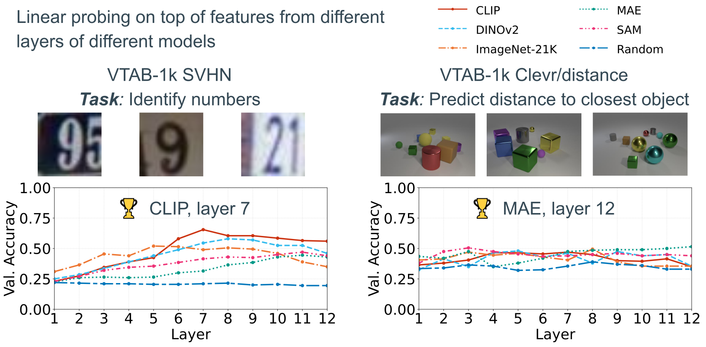

# Why adapt models in robotics?

A model trained in one context may lose performance when that context changes.

### 🌍 Diverse environments
Indoor, outdoor, underwater, aerial

**What changes:** lighting, visibility, obstacles, disturbances

### 🎯 Diverse tasks
Navigation, manipulation, inspection, exploration

**What changes:** objectives, accuracy, safety constraints

### 🤖 Diverse robots
Wheeled robots, quadrupeds, arms, drones

**What changes:** sensors, actuators, morphology, dynamics

**Adapt models to transfer what they have learned to new conditions**

Maintain performance while limiting the data and retraining required.

---
storyboard: S79
section: Key considerations to remember
class: ssl-slide
clicks: 2
---

# Adaptation

<AdaptationChoices :stage="$clicks" />

---
storyboard: L01
class: ssl-slide adaptation-module
clicks: 3
disabled: true
---

# Head-only training versus LoRA

<AdaptationMechanics mode="paths" :stage="$clicks" />

$$

\hat y=h_\beta(\psi),\qquad \psi=f_\theta(x)

$$

<b>Head only</b>Update β. For a fixed input, the encoder features ψ stay identical.

<b>LoRA + head</b>Update A, B and β. Internal corrections change ψ even though θ₀ stays frozen.

A nonlinear head can decode richer patterns, but cannot recover information absent from its input features.

<a href="https://arxiv.org/abs/2106.09685">Hu et al. · LoRA · ICLR 2022 · §4</a>

---
layout: default
storyboard: L00
---

# LoRA: adapt a model with few parameters

**Low-Rank Adaptation** — learn a low-rank correction while keeping the original weights frozen.

$$
W_{\text{adapted}} = \underbrace{W_0}_{\text{frozen weights}}
+ \underbrace{\Delta W}_{BA\,:\,\text{learned correction}}
$$

### ⚙️ Lightweight adaptation
Only two small matrices, **A and B**, are trained.

**Fewer parameters to optimize** and less training memory.

### 🔒 Preserved model
The original weights **remain unchanged** during adaptation.

Disable the correction to **recover the initial model**.

### 🔄 Modular adaptations
One base model can support **several corrections**.

Load the adaptation for the **domain, task, or robot**.

**One shared base model + a small correction for each context**

---
storyboard: L02
class: ssl-slide adaptation-module
clicks: 2
---

# LoRA: Low-Rank Adaptation

<AdaptationMechanics mode="branch" :stage="$clicks" />

$$

z=W_0u+sB(Au),\qquad W_0\in\mathbb R^{d\times k},\ A\in\mathbb R^{q\times k},\ B\in\mathbb R^{d\times q},\ s=\alpha/q

$$

<b>A: k → q</b>Measure q learned combinations of the input coordinates.

<b>B: q → d</b>Use those q coefficients to form a correction in the output space.

Both branches receive the same u; add their outputs.

<a href="https://arxiv.org/abs/2106.09685">Hu et al. · LoRA · ICLR 2022 · §4</a>

---
storyboard: L03
class: ssl-slide adaptation-module
clicks: 2
---

# What does “low rank” constrain?

$$

\Delta W=sBA=s\sum_{j=1}^{q}b_j a_j^\top,\qquad \Delta Wu=s\sum_{j=1}^{q}b_j(a_j^\top u)

$$

<AdaptationMechanics mode="rank" :stage="$clicks" />

<b>Read a direction</b>Each row aⱼᵀ extracts one scalar from u.

<b>Write a direction</b>Each column bⱼ supplies one output direction.

rank(ΔW) ≤ q: every correction lies in span(b₁,…,bq). The directions themselves are learned.

The rank constraint applies to ΔW. The effective matrix W₀ + ΔW can remain full rank.

<a href="https://arxiv.org/abs/2106.09685">Hu et al. · LoRA · ICLR 2022 · §4</a>

---
storyboard: L04
class: ssl-slide adaptation-module
clicks: 1
disabled: true
---

# A rank-one update can change every weight

$$

A=\begin{bmatrix}1&2&-1\end{bmatrix},\quad B=\begin{bmatrix}2\\-1\end{bmatrix},\quad BA=\begin{bmatrix}2&4&-2\\-1&-2&1\end{bmatrix}

$$

$$

u=\begin{bmatrix}1\\0\\1\end{bmatrix}\Rightarrow Au=0,\qquad v=\begin{bmatrix}1\\1\\0\end{bmatrix}\Rightarrow Av=3

$$

$$

\Delta Wu=\begin{bmatrix}0\\0\end{bmatrix},\qquad\Delta Wv=\begin{bmatrix}6\\-3\end{bmatrix}\quad(s=1)

$$

All six entries of ΔW are nonzero, yet its columns are multiples of B. Low rank does not mean sparse.

Constructed example: this tiny 2 × 3 case explains the algebra; q(d + k) = 5 versus dk = 6 gives little saving.

<a href="https://arxiv.org/abs/2106.09685">Hu et al. · LoRA · ICLR 2022 · §4</a>

---
storyboard: L05
class: ssl-slide adaptation-module
clicks: 0
---

# How many parameters do we train?

<strong>589,824</strong>Full 768 × 768 matrix

<strong>12,288</strong>A + B with q = 8

<strong>48×</strong>Fewer trainable parameters

$$

N_{\rm full}=dk,\qquad N_{\rm LoRA}=q(k+d),\qquad \frac{N_{\rm LoRA}}{N_{\rm full}}\approx2.08\%

$$

<b>Low q</b>Less adapter storage and fewer optimizer states; more restricted corrections.

<b>High q</b>More capacity and cost

W₀ remains resident. Activations and gradient propagation through the encoder still cost memory and compute.

<a href="https://arxiv.org/abs/2106.09685">Hu et al. · LoRA · ICLR 2022 · §4</a>

---
storyboard: L06
class: ssl-slide adaptation-module
clicks: 1
disabled: true
---

# Frozen weights do not stop gradient propagation

$$

g=\frac{\partial\mathcal L}{\partial z},\qquad\frac{\partial\mathcal L}{\partial B}=s\,g(Au)^\top,\qquad\frac{\partial\mathcal L}{\partial A}=sB^\top g\,u^\top

$$

<b>Start at the pretrained function</b>A is random, B = 0 ⇒ ΔW = 0.

<b>First data gradient</b>B can move; A initially receives zero gradient because B = 0.

<b>Subsequent steps</b>Once B ≠ 0, both factors can learn. W₀ remains fixed.

$$

\frac{\partial\mathcal L}{\partial u}=(W_0+sBA)^\top g

$$

Do not detach the encoder path: the gradient must reach earlier trainable LoRA modules.

If A and B both start at zero, both data gradients vanish. Formulas show one sample, without regularization.

<a href="https://arxiv.org/abs/2106.09685">Hu et al. · LoRA · ICLR 2022 · §4</a>

---
storyboard: L07
class: ssl-slide adaptation-module
clicks: 0
---

# Where does LoRA act in a Transformer?

Tokens uᵢQ, K, V projections <b>Selected W₀ + sBA</b>AttentionNew features ψ

$$

Q_i=(W_{Q0}+sB_QA_Q)u_i,\quad V_i=(W_{V0}+sB_VA_V)u_i,\quad K_i=W_{K0}u_i

$$

<b>Change Q</b>Modify which tokens the representation attends to.

<b>Change V</b>Modify the information carried by the attended tokens.

The original paper studies Q/V adaptation. K, output projections and MLP matrices are also possible targets.

Choose layers, matrices, rank and scale on held-out data. Every adapted matrix has its own compatible factors; q is our rank notation.

<a href="https://arxiv.org/abs/2106.09685">Hu et al. · LoRA · ICLR 2022 · §4.2 · §7.1</a>

---
storyboard: L08
class: ssl-slide adaptation-module
clicks: 0
---

# At deployment, fold the correction into the weights

W₀u + sB(Au)W★ = W₀ + sBAW★u

<b>Before merging</b>Store one base model and compact task-specific adapters; switch adapters as needed.

<b>After merging</b>One ordinary matrix multiplication. No separate LoRA branch for that fixed task.

$$

(W_0+sBA)u=W_0u+sB(Au)

$$

This merges a correction into its own base weights. Combining unrelated models or several task adapters is a different problem.

<a href="https://arxiv.org/abs/2106.09685">Hu et al. · LoRA · ICLR 2022 · §4</a>

---
storyboard: L09
class: ssl-slide adaptation-module
clicks: 1
---

# Head only, LoRA, or full fine-tuning?

<b>Head only</b>Fixed encoder. Cheap training; cache features if preprocessing is fixed. Limited by the available representation.

<b>LoRA + head</b>Adapt internal features with few parameters. Still backpropagate through the encoder; choose rank and insertion sites.

<b>Full fine-tuning</b>Most flexible updates. More gradients and optimizer states; greater storage and overfitting risk.

<a href="https://arxiv.org/abs/2106.09685">Hu et al. · LoRA · ICLR 2022 · §4</a>

---
storyboard: C01
class: ssl-slide adaptation-module
clicks: 0
---

# Useful features may be hidden in different layers

<figure class="adapt-original"></figure>

Digits: CLIP, layer 7Distance: MAE, layer 12

<b>One frozen model</b>Its final layer need not be the best representation for the new task.

<b>Several frozen models</b>Different pretraining objectives can provide complementary information.

ComBo learns to read intermediate features from one or several backbones.

Original project figure: validation linear-probe accuracy versus layer. Best model/layer differs between these tasks.

<a href="https://arxiv.org/abs/2512.01405">Ramtoula et al. · ComBo · NeurIPS 2025 · page projet / project figure</a>

---
storyboard: C02
class: ssl-slide adaptation-module
clicks: 0
---

# ComBo: combine features from multiple backbones

<figure class="adapt-original"></figure>

For a given task (e.g., segmentation or traversability), we train a small Transformer to combine features from different layers of several models. The result is a mixture of useful, task-specific features.

Fusion happens in feature space. The original backbones remain separate and frozen.

<a href="https://arxiv.org/abs/2512.01405">Ramtoula et al. · ComBo · NeurIPS 2025 · fig. 3 · §3</a>

---
storyboard: C03
class: ssl-slide adaptation-module
clicks: 2
disabled: true
---

# Align positions before combining channels

<AdaptationMechanics mode="align" :stage="$clicks" />

$$

S_i=\operatorname{concat}_{k,\ell}\hat F_{k,\ell}[i,:]\in\mathbb R^D,\qquad t_i=P S_i+b\in\mathbb R^{D\prime}

$$

<b>Same image position i</b>Bilinear interpolation to a common grid; normalize each map. Remove backbone CLS/register tokens.

<b>Same learned projection P</b>Shared over positions; selects and mixes channels across layers and models. T positions stay T tokens.

In the paper: align to the smallest grid. Compression reduces channel dimension; interpolation can still lose spatial detail.

<a href="https://arxiv.org/abs/2512.01405">Ramtoula et al. · ComBo · NeurIPS 2025 · §3 · équation / equation 1</a>

---
storyboard: C04
class: ssl-slide adaptation-module
clicks: 0
disabled: true
---

# What does ComBo train?

Frozen maps stop-gradientProjection P, bTransformer F + learned CLSHead hβ Task loss

$$

O=\mathcal F([t_{\rm cls};t_1;\ldots;t_T]),\qquad\hat y=h_\beta(o_{\rm cls})

$$

<b>Training</b>Optimize projection, CLS token, Transformer and task head. No gradient through the backbones.

<b>Inference</b>Still execute every retained backbone, then ComBo.

<a href="https://arxiv.org/abs/2512.01405">Ramtoula et al. · ComBo · NeurIPS 2025 · §3–4</a>

---
storyboard: C05
class: ssl-slide adaptation-module
clicks: 0
disabled: true
---

# Keep only the backbones useful for the task

$$

P=[P_1\mid\cdots\mid P_K],\qquad s_k=\|P_k\|_F,\qquad\mathcal L=\mathcal L_{\rm task}+\lambda\sum_{k=1}^{K}s_k

$$

Train with all + group penaltyRank models by sₖSelect a subsetRetrain ComBo without penalty

<b>Group by backbone</b>Pₖ contains columns corresponding to all selected layers of model k.

<b>Interpret with care</b>The score depends on the task and competing models; it is not an intrinsic quality rating.

The paper keeps the top two models per task. Selection costs training first; it can reduce later inference cost.

Frobenius norm = ℓ₂ norm of all entries of Pₖ. Choose settings on validation, not the test set.

<a href="https://arxiv.org/abs/2512.01405">Ramtoula et al. · ComBo · NeurIPS 2025 · §3 · sélection / selection</a>

---
storyboard: C06
class: ssl-slide adaptation-module
clicks: 0
disabled: true
---

# What do the published comparisons show?

<AdaptationMechanics mode="results" />

<b>One shared backbone</b>ComBo improves over final-layer linear probing. LoRA and Adapter+ score higher here.

<b>Multiple backbones</b>Selected top-two ComBo beats all-four ComBo on the reported aggregate; inference uses two backbones.

VTAB-1k: 19 classification tasks, 1,000 labeled images per task, 3 seeds. Paper “Global Average”: mean of the three task-group averages. Different panels use different backbones.

<a href="https://arxiv.org/abs/2512.01405">Ramtoula et al. · ComBo · NeurIPS 2025 · tableaux / tables 1–2</a>

---
storyboard: C07
class: ssl-slide adaptation-module
clicks: 0
disabled: true
---

# First adapt the models, then combine their features

Each model + Adapter+Freeze the adapted modelsTrain ComBo on their features

<strong>79.9%</strong>DINOv2 + Adapter+

<strong>79.3%</strong>ComBo on adapted models

<strong>78.7%</strong>Joint Multi-Adapter+

Combining adapted models is not guaranteed to beat the best individual model. ComBo avoids joint backbone backpropagation during the fusion stage.

Table 3, same reported VTAB aggregate. Adaptation already had a cost. Table 4 further shows that useful task information can concentrate in the final layer after tuning.

The paper uses Adapter+ here. Replacing it with LoRA is a possible experiment, not this reported result.

<a href="https://arxiv.org/abs/2512.01405">Ramtoula et al. · ComBo · NeurIPS 2025 · §4.3 · tableaux / tables 3–4</a>

---
storyboard: C08
class: ssl-slide adaptation-module
clicks: 1
---

# Choose where the adaptation should happen

<b>Head only</b>Read the final frozen features. Lowest training burden when they already suffice.

<b>LoRA</b>Change internal computations of a backbone. Compact task updates and mergeable linear branches.

<b>ComBo</b>Read and combine intermediate features from several models.

---
storyboard: S80
class: ssl-slide
clicks: 3
disabled: true
---

# Label efficiency

<LabelEfficiency :stage="$clicks" />

---
storyboard: S81
class: ssl-slide
clicks: 2
---

# Splitting robot data correctly

<RobotDataSplit :stage="$clicks" />

---
storyboard: S82
class: ssl-slide
clicks: 3
disabled: true
---

# Evaluating the intended perception task

<TaskEvaluation :stage="$clicks" />

---
storyboard: S83
class: ssl-slide
clicks: 2
disabled: true
---

# Pretext loss and downstream usefulness

<ObjectiveUsefulness :stage="$clicks" />

---
storyboard: S84
class: ssl-slide
clicks: 2
---

# Course synthesis

<CourseSynthesis :stage="$clicks" />

