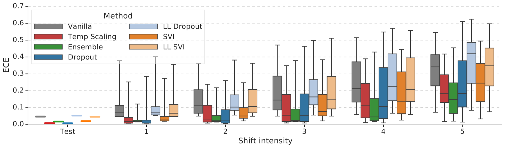
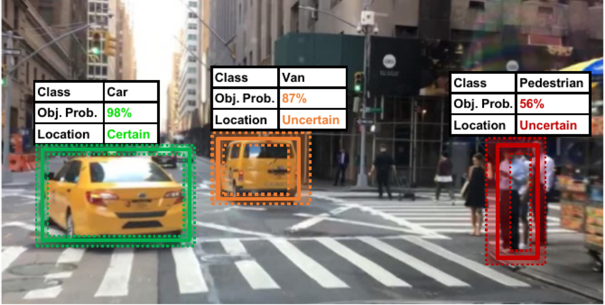

# Perception et Incertitude

**INF8422 : Perception Robotique et Intelligence Spatiale**

Prof. Pierre-Yves Lajoie


<div class="cover-footer-bar mt-4">
  <span style="background:#CF1C24" />
  <span style="background:#F15A22" />
  <span style="background:#25B34B" />
  <span style="background:#00BDF2" />
</div>

---
hideInToc: true
---

# Agenda

<Toc />

---
layout: section
---

# Motivation et Contexte

<SectionPipeline />

---
hideInToc: true
---

# L'Impact du Bruit

<div class="grid grid-cols-3 gap-6 mt-4">
<div class="text-center">

**Perception**

Capteurs, vision, LiDAR

*Comprendre le monde*

</div>
<div class="text-center">

**Planification**

Trajectoires, décisions

*Choisir les actions*

</div>
<div class="text-center">

**Contrôle**

Moteurs, actionneurs

*Exécuter les actions*

</div>
</div>

<AlertBlock title="Principe Fondamental" class="mt-4">

Tous les capteurs, sans exception, sont corrompus par du **bruit** (thermique, électrique, dérive mécanique, vibrations, etc.). Mal modélisée, cette incertitude se propage **en cascade** : données distordues $\to$ décisions sous-optimales $\to$ actions incorrectes.

</AlertBlock>

<!-- IMAGE: pipeline-robotique.png — Pipeline modulaire Perception → Planification → Contrôle avec flèches montrant la propagation de l'incertitude -->

---
hideInToc: true
disabled: true
---

# Pourquoi l'Incertitude ?

Un robot efficace doit *apprendre efficacement* et *agir robustement* dans un monde incertain.

<InfoBlock title="Deux Paradigmes de l'Incertitude">

- **Paradigme Frequentist** : Le modèle estime des *probabilités* associées à différentes hypothèses. Ex : « La probabilité que cet objet soit un piéton est 0.85 ».
- **Paradigme Bayesian** : Le robot génère des *scénarios hypothétiques* pour planifier. Ex : Simuler plusieurs trajectoires possibles d'un piéton.

</InfoBlock>

Raisonner sur **des scénarios divers** plutôt qu'un seul scénario déterministe améliore :

- la **robustesse** face aux conditions inattendues,
- l'**efficacité d'apprentissage** (savoir ce qu'on ne sait pas),
- la **sécurité** (décisions prudentes sous ambiguïté).

<!-- <InfoBlock title="Structure en spirale" class="mt-3">

Cette introduction donne un aperçu de quatre usages: **fusion, décision, apprentissage actif, propagation**.

</InfoBlock> -->

---
hideInToc: true
---

# Objectif du Cours

1. **Identifier les sources** d'incertitude dans un système robotique (matériel, modèle, environnement).

2. **Classifier** les types d'incertitude : aléatorique (données) vs épistémique (modèle).

3. **Mesurer** l'incertitude avec des métriques appropriées : variance, entropie, NLL, ECE.

4. **Quantifier** l'incertitude avec des méthodes d'apprentissage : ensembles, MC Dropout, prédiction conforme.

5. **Calibrer** un modèle pour que ses probabilités soient fiables.

6. **Agir** avec l'incertitude : comparer des décisions, planifier prudemment et explorer pour réduire ce que le robot ignore.

---
hideInToc: true
---

# Qu'est-ce que l'Incertitude ?

Avant de quantifier l'incertitude, il faut s'entendre sur ce qu'est une **probabilité**. Deux interprétations coexistent et les deux serviront dans ce cours.

<div class="grid grid-cols-2 gap-6 mt-4">
<div>

<InfoBlock title="École Fréquentiste">

La probabilité est une **fréquence limite** sur des expériences répétées :

$$P(A) = \lim_{n \to \infty} \frac{n_A}{n}$$

- Le paramètre $\theta$ est **fixe mais inconnu** ; ce sont les **données** qui sont aléatoires.

</InfoBlock>

</div>
<div>

<InfoBlock title="École Bayésienne">

La probabilité est un **degré de croyance** conditionné à l'information disponible :

$$p(\theta \mid \mathcal{D}) \propto p(\mathcal{D} \mid \theta)\, p(\theta)$$

- Le paramètre $\theta$ est une **variable aléatoire** ; on conditionne sur les données **observées** (fixes).

</InfoBlock>

</div>
</div>

<AlertBlock title="Pourquoi c'est important ici" class="mt-4">

« L'incertitude » d'une prédiction n'a pas le même sens dans les deux écoles : **variabilité sous répétition** (fréquentiste) vs **croyance sur ce qu'on ignore** (bayésien).

</AlertBlock>

---
hideInToc: true
---

# Fréquentiste vs. Bayésien — Visualisation Interactive

Le **même flux d'essais** Bernoulli (taux de succès réel $p^* = 0.7$, caché) lu par les deux écoles : à gauche $\hat{p} = k/n$ fluctue autour d'un $p^*$ fixe ; à droite la croyance sur $p$ se concentre.

<FreqVsBayesAnimation class="mt-2" />

---
hideInToc: true
disabled: true
---

# Deux Écoles : Ce Que Ça Change en Robotique

<InfoBlock title="Les cours précédents étaient bayésiens">

Le SLAM par MAP maximise $p(\mathcal{D}|\theta)\,p(\theta)$ : les facteurs odométriques sont la vraisemblance, l'ancrage est le prior. Toute l'estimation d'état classique vit dans l'école bayésienne.

</InfoBlock>

**Et le deep learning ?** Un réseau entraîné par MLE ne garde que le **point** $\theta^* = \arg\max p(\mathcal{D}|\theta)$ :

- Pas de distribution sur $\theta$ → aucune incertitude **épistémique** par construction.
- Et la panoplie fréquentiste (bootstrap, intervalles de confiance) exige de ré-entraîner sur des répétitions — impraticable à l'échelle d'un DNN.

**Les deux écoles structurent la suite du cours :**

<div class="grid grid-cols-2 gap-6 mt-2">
<div>

**Représenter la croyance** (bayésien)

BNN, MC Dropout, ensembles ≈ échantillonner un posterior $p(\theta|\mathcal{D})$.

</div>
<div>

**Valider par les fréquences** (fréquentiste)

Calibration = confiances vs fréquences observées ; prédiction conforme = **couverture garantie** sur répétitions.

</div>
</div>

---
hideInToc: true
---

# L'Incertitude dans la Fusion de Capteurs

<div></div>

Un robot dispose généralement de **plusieurs capteurs** (caméra, LiDAR, GPS, IMU…). Face à des mesures contradictoires, l'incertitude sert de **poids de confiance**.

<InfoBlock title="Fusion Bayésienne">

Étant donné deux capteurs indépendants fournissant des mesures $z_1$ et $z_2$ sur l'état $\mathbf{x}$ :

$$p(\mathbf{x} \mid z_1, z_2) \propto \underbrace{p(z_1 \mid \mathbf{x})}_{\text{modèle capteur 1}} \cdot \underbrace{p(z_2 \mid \mathbf{x})}_{\text{modèle capteur 2}} \cdot \underbrace{p(\mathbf{x})}_{\text{prior}}$$

Le capteur le **plus précis** (variance la plus faible) contribue davantage à l'estimation finale.

</InfoBlock>

**Intuition :** Si le GPS est incertain (faible visibilité des satellites) mais la vision est confiante (repères visuels clairs), la fusion pondère naturellement en faveur de la vision.


---
hideInToc: true
---

# Fusion de Capteurs — Visualisation Interactive

Le produit de deux gaussiennes est une gaussienne **plus étroite** : ajustez les précisions et observez qui domine la fusion.

<SensorFusionAnimation class="mt-2" />

---
hideInToc: true
---

# Décider et Prédire sous Incertitude

L'incertitude sur l'état du monde **grandit avec l'horizon temporel**.

<div class="grid grid-cols-2 gap-6 mt-4">
<div>

**Décider : rover sur Mars**

- Carte d'élévation **probabiliste** : une *distribution* de cartes, pas une seule.
- Permet d'arbitrer risque de chute vs. consommation d'énergie → décision **risk-aware**.
- Sans incertitude : une seule décision.

</div>
<div>

**Prédire : suivi d'un piéton**

- De $t_0$ à $t_1$, la « bulle » d'incertitude se **propage et s'agrandit**.
- Outils : échantillonnage de scénarios, POMDPs et planification sensible au risque.
- Actions réductrices : s'approcher, demander de l'aide, trajectoire prudente.

</div>
</div>

<!-- IMAGE: rover-mars.png — Rover Mars + carte d'élévation avec mean/variance -->

---
hideInToc: true
disabled: true
---

# L'Apprentissage Actif (*Active Learning*)

<InfoBlock title="Le Problème de l'Annotation">

Annoter des données pour entraîner des modèles de perception est **coûteux** (temps humain, expertise). On ne peut pas tout annoter.

</InfoBlock>

**Solution :** L'apprentissage actif utilise l'incertitude pour *choisir intelligemment* quelles données annoter.

1. Entraîner un modèle initial sur quelques données annotées.
2. **Estimer l'incertitude** sur les données non annotées.
3. Envoyer à l'annotateur humain uniquement les données **les plus incertaines**.
4. Répéter jusqu'à convergence.

**Bénéfice :** Atteindre la même performance avec **10 à 100× moins** de données annotées. Particulièrement précieux pour la perception robotique (images rares, conditions extrêmes).

---
hideInToc: true
---

# Le problème avec les *Point Estimates*


<AlertBlock title="Un problème des réseaux de neurones">

Ces réseaux sont entraînés pour produire une **sortie déterministe unique**: l'estimation ponctuelle $\theta^*$ du MLE, sans distribution sur $\theta$. Ils sont souvent **sur-confiants** (*overconfident*) : ils ne savent pas qu'ils ne savent pas.

</AlertBlock>

**Conséquences concrètes :**

- Véhicule autonome classant une remorque blanche comme « ciel » avec confiance $\to$ collision.
- Un réseau confiant à 99% sur une image *adversarielle* (bruit imperceptible à l'œil humain).
- Un détecteur de piétons ignorant qu'il voit un objet jamais vu à l'entraînement.
- Un SLAM neuronal qui perd sa localisation *silencieusement* sans alarme.

**Objectif :** Renouer avec le probabilisme et obliger les réseaux à quantifier leur ignorance.

---
layout: section
---

# Sources de l'Incertitude

<SectionPipeline current="comprendre" />

---
hideInToc: true
---

# D'où Vient l'Incertitude ?

<div></div>

L'incertitude en robotique provient de sources **internes** (liées au robot) et **externes** (liées à l'environnement).

<div class="flex justify-center mt-4">
<svg viewBox="0 0 558 190" style="height:230px">
  <!-- Racine -->
  <rect x="219" y="10" width="120" height="30" fill="#475569" rx="5"/>
  <text x="279" y="29" text-anchor="middle" style="font-size:10px;fill:white;font-weight:700;font-family:sans-serif">Incertitude</text>
  <!-- Branches niveau 1 -->
  <line x1="279" y1="40" x2="140" y2="70" stroke="#94a3b8" stroke-width="1.2"/>
  <line x1="279" y1="40" x2="424" y2="70" stroke="#94a3b8" stroke-width="1.2"/>
  <rect x="80" y="70" width="120" height="26" fill="#00BDF2" rx="5"/>
  <text x="140" y="87" text-anchor="middle" style="font-size:9px;fill:white;font-weight:700;font-family:sans-serif">Interne (robot)</text>
  <rect x="364" y="70" width="140" height="26" fill="#F15A22" rx="5"/>
  <text x="434" y="87" text-anchor="middle" style="font-size:9px;fill:white;font-weight:700;font-family:sans-serif">Externe (environnement)</text>
  <!-- Feuilles internes -->
  <line x1="140" y1="96" x2="55" y2="125" stroke="#94a3b8" stroke-width="1"/>
  <line x1="140" y1="96" x2="150" y2="125" stroke="#94a3b8" stroke-width="1"/>
  <line x1="140" y1="96" x2="245" y2="125" stroke="#94a3b8" stroke-width="1"/>
  <rect x="8" y="125" width="94" height="40" fill="#f0f9ff" rx="4" stroke="#7dd3fc"/>
  <text x="55" y="141" text-anchor="middle" style="font-size:8px;fill:#0369a1;font-weight:700;font-family:sans-serif">1. Matériel</text>
  <text x="55" y="154" text-anchor="middle" style="font-size:7px;fill:#075985;font-family:sans-serif">bruit, biais, pannes</text>
  <rect x="108" y="125" width="94" height="40" fill="#f0f9ff" rx="4" stroke="#7dd3fc"/>
  <text x="155" y="141" text-anchor="middle" style="font-size:8px;fill:#0369a1;font-weight:700;font-family:sans-serif">2. Modèle</text>
  <text x="155" y="154" text-anchor="middle" style="font-size:7px;fill:#075985;font-family:sans-serif">capacité, quantization</text>
  <rect x="208" y="125" width="94" height="40" fill="#f0f9ff" rx="4" stroke="#7dd3fc"/>
  <text x="255" y="141" text-anchor="middle" style="font-size:8px;fill:#0369a1;font-weight:700;font-family:sans-serif">3. Observabilité</text>
  <text x="255" y="154" text-anchor="middle" style="font-size:7px;fill:#075985;font-family:sans-serif">self-occlusions, FOV</text>
  <!-- Feuilles externes -->
  <line x1="434" y1="96" x2="380" y2="125" stroke="#94a3b8" stroke-width="1"/>
  <line x1="434" y1="96" x2="490" y2="125" stroke="#94a3b8" stroke-width="1"/>
  <rect x="326" y="125" width="106" height="40" fill="#fff7ed" rx="4" stroke="#fdba74"/>
  <text x="379" y="141" text-anchor="middle" style="font-size:8px;fill:#c2410c;font-weight:700;font-family:sans-serif">4. Dynamique</text>
  <text x="379" y="154" text-anchor="middle" style="font-size:7px;fill:#9a3412;font-family:sans-serif">agents, météo, temps</text>
  <rect x="438" y="125" width="112" height="40" fill="#fff7ed" rx="4" stroke="#fdba74"/>
  <text x="494" y="141" text-anchor="middle" style="font-size:8px;fill:#c2410c;font-weight:700;font-family:sans-serif">5. Décalage de domaine</text>
  <text x="494" y="154" text-anchor="middle" style="font-size:7px;fill:#9a3412;font-family:sans-serif">entraînement ≠ déploiement</text>
</svg>
</div>

---
hideInToc: true
---

# Source 1 : Limitations Matérielles

Tous les dispositifs physiques de mesure présentent des **erreurs inévitables**.

<InfoBlock title="Types d'Erreurs de Mesure">

- **Erreurs systématiques** : Biais constant (ex : décalage de calibration d'une caméra).
- **Erreurs aléatoires** : Bruit thermique, électronique (ex : bruit gaussien sur un capteur de profondeur).

</InfoBlock>

**Exemple composé :** Un véhicule autonome tente de localiser un piéton.

- Le **LiDAR** introduit une erreur de distance ($\pm 2$ cm).
- Le **GPS** est imprécis en milieu urbain (multi-path, $\pm 5$ m).
- Les deux incertitudes se **composent** : l'incertitude totale sur la position du piéton est bien plus grande que chaque erreur individuelle.

---
hideInToc: true
disabled: true
---

# Source 2 : Limitations du Modèle

Les modèles d'apprentissage machine déployés sur robot sont soumis à des **contraintes sévères**.

<div class="grid grid-cols-2 gap-6 mt-4">
<div>

**Contraintes embarquées**

- Mémoire limitée (quelques Go).
- Budget énergétique restreint.
- Latence maximale imposée (temps réel).

$\Rightarrow$ Nécessité de modèles **plus petits** ou **quantisés**.

</div>
<div>

**Conséquences**

- Réduction de la capacité représentationnelle.
- Quantization (INT8 au lieu de FP32) → erreurs d'arrondi.
- Élagage (*pruning*) → perte de poids importants.

$\Rightarrow$ Incertitude **accrue** sur les prédictions.

</div>
</div>

<AlertBlock title="Compromis Fondamental" class="mt-4">

Plus le modèle est petit et rapide, plus il est incertain. Concevoir pour le temps réel implique **nécessairement** d'accepter et de quantifier cette incertitude supplémentaire.

</AlertBlock>

---
hideInToc: true
---

# Source 2 : Observabilité Partielle

Un robot ne perçoit jamais le monde dans son **intégralité**.

- **Occlusions** : Un objet caché derrière un autre (piéton derrière une voiture).
- **Conditions visuelles** : Brouillard, obscurité, éblouissement solaire.
- **Encombrement** : Scènes denses avec de nombreux objets superposés.
- **Champ de vue limité** : Un capteur ne voit qu'une portion de l'espace.

<!-- <InfoBlock title="Formalisme : POMDP">

Les **Processus de Décision de Markov Partiellement Observables** (POMDPs) modélisent explicitement l'observabilité partielle. L'agent maintient une **distribution de croyance** $b(s)$ sur l'état caché $s$, plutôt qu'un état unique certain.

</InfoBlock> -->

**Mitigation :** Utiliser plusieurs capteurs (modalités complémentaires), planifier des déplacements pour réduire les occlusions, maintenir une mémoire temporelle.

---
hideInToc: true
---

# Source 3 : Dynamique de l'Environnement

Le monde dans lequel opère le robot **change dans le temps**.

<div class="grid grid-cols-2 gap-6 mt-4">
<div>

**Éléments dynamiques**

- **Agents mobiles** : Piétons, cyclistes, autres véhicules.
- **Objets déplacés** : Meubles dans une maison, objets sur une table.
- **Conditions météo** : Pluie, vent, changement d'illumination.

</div>
<div>

**Conséquences**

- La carte construite à $t_0$ est **périmée** à $t_1$.
- Les prédictions de trajectoire sont **incertaines**.
- Le contrôle (ex : drone) perturbé par le vent → commandes imprécises.

</div>
</div>

<AlertBlock title="Incertitude Croissante dans le Temps" class="mt-4">

Plus l'horizon de prédiction est lointain, plus l'incertitude sur l'état futur est grande. Un robot planifiant à 10 secondes est bien plus incertain qu'un robot planifiant à 1 seconde.

</AlertBlock>

---
hideInToc: true
---

# Source 4 : Décalage de Domaine (*Domain Shift*)

Un modèle entraîné sur un ensemble de données peut **échouer** face à des situations non représentées.

<InfoBlock title="Définition">

Le **décalage de domaine** survient quand la distribution des données de test $p_{test}(\mathbf{x})$ diffère de la distribution d'entraînement $p_{train}(\mathbf{x})$. Le modèle rencontre des inputs pour lesquels il n'a **aucune expérience**.

</InfoBlock>

**Exemples :**

- Système de conduite autonome entraîné en Arizona → déployé à Montréal en hiver.
- Modèle de segmentation urbaine → déployé dans une zone **rurale** inconnue.

<!-- IMAGE: domain-shift.png — Comparaison scène conditions normales vs extrêmes (neige, nuit) -->

---
hideInToc: true
---

# Exemples Concrets : Trois Domaines Robotiques

<div class="grid grid-cols-3 gap-4 mt-4">
<div>

**Navigation Domestique**

- Meubles semi-permanents.
- Personnes dynamiques.
- VLMs/LLMs pour comprendre les instructions humaines.

</div>
<div>

**Manipulation**

- Objets occultés ou transparents.
- Masse et friction inconnues.
- Déformabilité incertaine.
- Pose de préhension incertaine.

</div>
<div>

**Robots de Terrain**

- SLAM sans GPS (mines, sous-marin, espace).
- Turbulences (drones, AUVs).
- Environnements non structurés.
- Éléments dynamiques (personnes, animaux, autres robots).

</div>
</div>

---
hideInToc: true
---

# L'incertitude dans le SLAM

Aux cours précédents, le SLAM était formulé comme une **estimation probabiliste** : le MAP donne la trajectoire, et la matrice d'information $\Lambda = J^\top \Omega J$ encode en principe toute l'incertitude ($\Sigma = \Lambda^{-1}$).

<AlertBlock title="">

En pratique, la plupart des systèmes SLAM déployés n'exploitent que la **moyenne** (l'estimée MAP) et ignorent la covariance. Le robot navigue comme si sa pose et sa carte étaient parfaites.

</AlertBlock>

**Pourquoi ce piège existe :**

- Récupérer $\Sigma$ exige de **résoudre le système** : inverser (ou marginaliser) $\Lambda$ détruit la sparsité qui rend le SLAM temps réel, coûteux en calcul et en stockage sur des graphes de millions de variables.
- Les benchmarks standards (ATE, RPE) ne notent que la précision de la moyenne, pas la qualité de l'incertitude.

**Conséquence :** une localisation qui dérive *silencieusement*, sans alarme. Les méthodes de ce cours visent précisément à redonner cette **introspection** aux systèmes de perception, classiques comme neuronaux.

---
hideInToc: true
disabled: true
---

# L'Incertitude est Inévitable mais gérable

<AlertBlock title="Réalité Fondamentale">

On ne peut pas **éliminer** l'incertitude dans les systèmes robotiques réels. Tenter de modéliser toutes les sources de stochasticité est souvent **inutile et coûteux**.

</AlertBlock>

**La vraie question :** Comment *quantifier*, *propager* et *exploiter* l'incertitude pour des décisions robustes ?

<InfoBlock title="Approche Moderne">

1. **Identifier** les sources d'incertitude les plus critiques.
2. **Modéliser** ces sources avec des représentations probabilistes appropriées.
3. **Propager** l'incertitude à travers le pipeline perception → décision.
4. **Agir** de manière prudente quand l'incertitude est haute.
5. **Réduire** l'incertitude épistémique en collectant de meilleures données.

</InfoBlock>

---
layout: section
---

# Mesurer l'Incertitude

<SectionPipeline current="mesurer" />

---
hideInToc: true
---

# Métriques d'Incertitude

Quantifier l'incertitude est inutile si on ne peut pas l'évaluer et la comparer.

<InfoBlock title="Trois Questions Distinctes">

1. **Dispersion :** À quel point la prédiction est-elle étalée ? (Variance, covariance, entropie)
2. **Qualité prédictive :** La distribution prédictive est-elle correcte par rapport à la réalité ? (NLL, Brier)
3. **Distance entre distributions :** Deux distributions sont-elles similaires ? (KL, Hellinger, Wasserstein)

</InfoBlock>

**Usages pratiques en robotique :**

- Comparer deux méthodes de quantification d'incertitude (ex. Ensembles vs. MC Dropout).
- Évaluer si un modèle est bien calibré sur un jeu de validation.
- Détecter des données hors-distribution (OOD) par seuillage sur une métrique.
- Guider l'exploration active vers les zones d'incertitude maximale.

---
hideInToc: true
---

# Variance

<div></div>

La **variance** mesure la *dispersion d'une variable aléatoire* autour de sa moyenne.

Pour une variable $X$ discrète avec $N$ outcomes $\{x_1, \ldots, x_N\}$ et probabilités $\{p_1, \ldots, p_N\}$ :

1. Moyenne : $\mu = \mathbb{E}[X] = \displaystyle\sum_{n=1}^N p_n x_n$

2. Variance :
$$\sigma^2 = \mathbb{E}\!\left[(X - \mu)^2\right] = \sum_{n=1}^N p_n (x_n - \mu)^2$$

**Propriétés importantes :**

- $\sigma^2 \geq 0$ (toujours non-négative). $\sigma^2 = 0$ ssi $X$ est déterministe.
- L'**écart-type** $\sigma = \sqrt{\sigma^2}$ est dans les mêmes unités que $X$ (plus interprétable).
- Pour une distribution continue $p(x)$ : $\sigma^2 = \int (x-\mu)^2 p(x)\,\mathrm{d}x$.

**Limite :** Ne mesure la dispersion que d'une *seule* variable (→ **covariance**, diapo suivante). Ne capture pas la forme de la distribution (une bimodale peut avoir la même variance qu'une unimodale).

---
hideInToc: true
---

# Covariance

<div></div>

Deux variables d'un même état (ex. $x$ et $y$ d'une pose) ne varient pas indépendamment.

La **covariance** mesure leur *co-variation* :

<div class="grid grid-cols-2 gap-6 mt-2">
<div>

$$\text{Cov}(X, Y) = \mathbb{E}\!\left[(X - \mu_X)(Y - \mu_Y)\right]$$

- Signe = sens de la co-variation ; version normalisée : la **corrélation** $\rho = \frac{\text{Cov}(X,Y)}{\sigma_X \sigma_Y} \in [-1, 1]$.

**Matrice de covariance** pour $\mathbf{x} \in \mathbb{R}^d$ :

$$\Sigma = \mathbb{E}\!\left[(\mathbf{x} - \boldsymbol{\mu})(\mathbf{x} - \boldsymbol{\mu})^\top\right], \qquad \Sigma_{ii} = \sigma_i^2, \quad \Sigma_{ij} = \text{Cov}(x_i, x_j)$$

- Symétrique **semi-définie positive**.
- Géométrie : les vecteurs propres de $\Sigma$ donnent les axes de l'**ellipse d'incertitude**, les $\sqrt{\lambda_i}$ ses demi-axes.


**Pourquoi c'est central en robotique :** $\Sigma$ décrit non seulement l'amplitude de l'erreur, mais aussi ses directions privilégiées — par exemple dans une pose ou une carte SLAM.

</div>
<div>

<div class="flex justify-center">
<svg viewBox="0 0 260 160" style="height:160px">
  <line x1="14" y1="80" x2="246" y2="80" stroke="#e2e8f0" stroke-width="1"/>
  <line x1="110" y1="10" x2="110" y2="150" stroke="#e2e8f0" stroke-width="1"/>
  <!-- Nuage corrélé -->
  <g fill="#475569" style="opacity:0.65">
    <circle cx="83" cy="112" r="2"/><circle cx="83" cy="96" r="2"/><circle cx="99" cy="105" r="2"/>
    <circle cx="95" cy="91" r="2"/><circle cx="107" cy="91" r="2"/><circle cx="98" cy="75" r="2"/>
    <circle cx="112" cy="82" r="2"/><circle cx="110" cy="73" r="2"/><circle cx="124" cy="77" r="2"/>
    <circle cx="118" cy="63" r="2"/><circle cx="130" cy="65" r="2"/><circle cx="126" cy="51" r="2"/>
    <circle cx="142" cy="58" r="2"/><circle cx="140" cy="48" r="2"/><circle cx="95" cy="115" r="2"/>
    <circle cx="126" cy="84" r="2"/><circle cx="133" cy="74" r="2"/><circle cx="92" cy="79" r="2"/>
  </g>
  <!-- Ellipse 2σ vraie (inclinée) -->
  <ellipse cx="110" cy="80" rx="50" ry="25" transform="rotate(-45 110 80)"
    fill="none" stroke="#CF1C24" stroke-width="1.8"/>
  <!-- Diagonale seule (corrélations ignorées) -->
  <ellipse cx="110" cy="80" rx="40" ry="40" fill="none" stroke="#00BDF2"
    stroke-width="1.3" stroke-dasharray="5,3"/>
  <!-- Axes propres -->
  <line x1="110" y1="80" x2="145" y2="45" stroke="#CF1C24" stroke-width="1.4"/>
  <line x1="110" y1="80" x2="128" y2="98" stroke="#CF1C24" stroke-width="1.4"/>
  <text x="149" y="42" style="font-size:8px;fill:#CF1C24;font-family:sans-serif">v₁√λ₁</text>
  <text x="131" y="107" style="font-size:8px;fill:#CF1C24;font-family:sans-serif">v₂√λ₂</text>
  <text x="168" y="128" style="font-size:8px;fill:#CF1C24;font-family:sans-serif">Σ complète (2σ)</text>
  <text x="168" y="140" style="font-size:8px;fill:#0284c7;font-family:sans-serif">diagonale seule</text>
</svg>
</div>

<AlertBlock title="Si on ignore les corrélations">

Garder seulement la diagonale (pointillés bleus) **sous-estime** l'incertitude dans la direction oblique.

</AlertBlock>

</div>
</div>

---
hideInToc: true
---

# Entropie de Shannon

<div></div>

L'**entropie** mesure à quel point les outcomes possibles d'un système sont aléatoires. Contrairement à la variance, elle prend en compte la **forme** de la distribution, pas les valeurs numériques.

Pour une variable $X$ avec $N$ outcomes discrets et probabilités $\{p_1, \ldots, p_N\}$ :

$$H(X) = -\sum_{n=1}^N p_n \log p_n \qquad \text{(en bits si log base 2, en nats si log naturel)}$$

**Propriétés :**

- $H(X) \geq 0$. $H(X) = 0$ ssi une seule issue est certaine ($p_k = 1$).
- $H(X)$ maximale = $\log N$ quand toutes les issues sont équiprobables.
- Pour un classifieur binaire ($p$ = prob. de la classe positive) : $H = -(p\log p + (1-p)\log(1-p))$.

<div class="flex justify-center">
<svg viewBox="0 0 340 145" style="height:130px">
  <line x1="40" y1="120" x2="300" y2="120" stroke="#94a3b8" stroke-width="1"/>
  <line x1="40" y1="120" x2="40" y2="15" stroke="#94a3b8" stroke-width="1"/>
  <polyline points="40.0,120.0 45.2,105.9 50.4,95.8 55.6,87.3 60.8,79.8 66.0,73.1 71.2,67.1 76.4,61.6 81.6,56.6 86.8,52.0 92.0,47.8 97.2,44.0 102.4,40.5 107.6,37.3 112.8,34.5 118.0,31.9 123.2,29.6 128.4,27.5 133.6,25.7 138.8,24.2 144.0,22.9 149.2,21.9 154.4,21.0 159.6,20.5 164.8,20.1 170.0,20.0 175.2,20.1 180.4,20.5 185.6,21.0 190.8,21.9 196.0,22.9 201.2,24.2 206.4,25.7 211.6,27.5 216.8,29.6 222.0,31.9 227.2,34.5 232.4,37.3 237.6,40.5 242.8,44.0 248.0,47.8 253.2,52.0 258.4,56.6 263.6,61.6 268.8,67.1 274.0,73.1 279.2,79.8 284.4,87.3 289.6,95.8 294.8,105.9 300.0,120.0"
    fill="none" stroke="#00BDF2" stroke-width="2"/>
  <line x1="170" y1="120" x2="170" y2="20" stroke="#CF1C24" stroke-width="0.8" stroke-dasharray="3,2"/>
  <text x="170" y="132" text-anchor="middle" style="font-size:8px;fill:#64748b;font-family:sans-serif">p = 0.5</text>
  <text x="40" y="132" text-anchor="middle" style="font-size:8px;fill:#64748b;font-family:sans-serif">0</text>
  <text x="300" y="132" text-anchor="middle" style="font-size:8px;fill:#64748b;font-family:sans-serif">1</text>
  <text x="32" y="24" text-anchor="end" style="font-size:8px;fill:#64748b;font-family:sans-serif">1 bit</text>
  <text x="182" y="30" style="font-size:8px;fill:#CF1C24;font-family:sans-serif">max : équiprobable</text>
  <text x="310" y="105" style="font-size:8px;fill:#475569;font-family:sans-serif">H(p)</text>
</svg>
</div>

---
hideInToc: true
---

# Negative Log-Likelihood (NLL)

<div></div>

La **NLL** mesure la *qualité d'une distribution prédictive par rapport à la vérité terrain*. C'est la métrique de choix pour évaluer des modèles probabilistes.

**En classification :** Pour la classe vraie $y_t$ avec probabilité prédite $\hat{p}(y_t)$ :

$$\text{NLL}_{\text{class}} = -\log \hat{p}(y_t)$$

Si le modèle est confiant et correct ($\hat{p}(y_t) \approx 1$) : $\text{NLL} \approx 0$. Sinon NLL augmente.

**En régression gaussienne :** Pour une prédiction $\hat{\mu}$ avec variance $\hat{\sigma}^2$ et vérité $y_t$ :

$$\text{NLL}_{\text{reg}} = \frac{1}{2}\log(2\pi\hat{\sigma}^2) + \frac{(y_t - \hat{\mu})^2}{2\hat{\sigma}^2}$$

<InfoBlock title="">

Son espérance est minimisée **si et seulement si** la distribution prédictive $\hat{p}$ est exactement la vraie distribution $p$.

</InfoBlock>

---
hideInToc: true
disabled: true
---

# Score de Brier

Le **Score de Brier** est une alternative plus robuste à la NLL pour la classification.

Pour $N$ prédictions avec probabilité prédite $\hat{p}_i$ et label vrai $y_i \in \{0, 1\}$ :

$$\text{Brier} = \frac{1}{N}\sum_{i=1}^N (\hat{p}_i - y_i)^2$$

**Propriétés :**

- Brier $\in [0, 1]$. Brier $= 0$ : prédictions parfaites.
- Moins sensible aux probabilités extrêmes que la NLL ($-\log p$ diverge quand $p \to 0$).
- C'est également une **règle de score strictement propre**.

**Analogie avec la MSE :** Le score de Brier est équivalent à une erreur quadratique moyenne sur les probabilités. Facile à interpréter et numériquement stable.

**Extension multi-classes :**

$$\frac{1}{N}\sum_i \sum_k \left(\hat{p}_{i,k} - \mathbf{1}[y_i = k]\right)^2$$

---
hideInToc: true
---

# Distance de Mahalanobis

<div></div>

La **distance de Mahalanobis** mesure la *distance entre un point et une distribution multivariée*, en tenant compte des corrélations.

Pour un point $\mathbf{x} \in \mathbb{R}^d$ par rapport à une distribution $(\boldsymbol{\mu}, \Sigma)$ :

$$D_M(\mathbf{x}) = \sqrt{(\mathbf{x} - \boldsymbol{\mu})^\top \Sigma^{-1} (\mathbf{x} - \boldsymbol{\mu})}$$

**Cas particuliers :**

- $d = 1$ : $D_M = |x - \mu| / \sigma$ (distance en nombre d'écarts-types).
- $\Sigma = I$ (identité) : $D_M = \|\mathbf{x} - \boldsymbol{\mu}\|_2$ (distance euclidienne).

**Applications en robotique :**

- **Détection OOD :** Si $D_M(\mathbf{x}_{\text{test}})$ est grande dans l'espace des features, l'entrée est probablement hors-distribution.
- **Évaluation de régression :** Distance entre la prédiction gaussienne et la vérité terrain.
- **Fusion de capteurs :** Distance de Mahalanobis entre deux estimations pour l'association de données


---
hideInToc: true
---

# Comparer des Distributions

<div></div>

Troisième famille de métriques : mesurer l'**écart entre deux distributions** $p$ et $q$ (posterior vs. approximation, features train vs. test, désaccord entre modèles).

| **Mesure** | **Formule** | **Propriétés** | **Usage typique** |
|---|---|---|---|
| **Kullback-Leibler** | $\mathbb{KL}[p \,\Vert\, q] = \sum_n p_n \log\frac{p_n}{q_n}$ | $\geq 0$, nulle ssi $p = q$, **non symétrique** | Variational Inference |
| **Jensen-Shannon** | $\frac{1}{2}\mathbb{KL}[p \,\Vert\, m] + \frac{1}{2}\mathbb{KL}[q \,\Vert\, m]$, $m = \frac{p+q}{2}$ | KL symétrisée, bornée | désaccord entre membres d'un ensemble |
| **Wasserstein** *Earth Mover Distance* ($W_2$) | coût minimal de **transport optimal** de $p$ vers $q$ | sensible à la géométrie ; lent à calculer | distance entre histogrammes, entre formes dans des images |

---
layout: section
---

# Types et Représentation de l'Incertitude

<SectionPipeline current="mesurer" />

---
hideInToc: true
---

# Les Deux Grands Types d'Incertitude

L'incertitude prédictive se divise en deux catégories fondamentales aux propriétés très différentes.

<div class="grid grid-cols-2 gap-6 mt-4">
<div>

<InfoBlock title="Incertitude Aléatoire">

Inhérente aux bruits sur les données

Une partie ne cette incertitude est *irréductible*.

</InfoBlock>

</div>
<div>

<InfoBlock title="Incertitude Épistémique">

Inhérente au modèle

Manque de connaissance, manque de données

Représentation limitée ne pouvant pas encoder toute la complexité des données

*Réductible* en ajoutant des données, en élargissant le modèle, etc.

</InfoBlock>

</div>
</div>

---
hideInToc: true
---

# Types d'Incertitude — Visualisation Interactive

Régression par processus gaussien : cliquez pour ajouter des observations — la bande **épistémique** s'effondre localement, la bande **aléatoire** ne bouge pas.

<AleatoricEpistemicAnimation class="mt-2" />

---
hideInToc: true
---

# Incertitude Aléatoire

<InfoBlock title="Définition">

L'**incertitude aléatoire** (aussi appelée *incertitude statistique* ou *data uncertainty*) est due à la **stochasticité inhérente** du phénomène observé. Elle est **irréductible** : même avec une quantité infinie de données, elle ne disparaît pas.

</InfoBlock>

**Modèle de mesure :** Pour une sortie $y$ étant donné une entrée $\mathbf{x}$ et les vrais paramètres $\theta^*$ :

$$y = f_{\theta^*}(\mathbf{x}) + \varepsilon, \qquad \varepsilon \sim \mathcal{N}(0, \sigma^2_{\text{alea}})$$

où $\varepsilon$ est le bruit irréductible de la mesure, $\sigma^2_{\text{alea}}$ sa variance.

**Exemples en perception robotique :**

- Bruit thermique d'un capteur de profondeur (présent même s'il ne bouge pas).
- Ambiguïté d'étiquetage sémantique à la frontière entre deux objets.
- Flou de mouvement dans une image capturée pendant un déplacement rapide.

---
hideInToc: true
disabled: true
---

# L'Analogie des Jetons — Incertitude Aléatoire

Pour illustrer la différence entre les deux types, imaginons deux **boîtes opaques** contenant des jetons de jeu.

<InfoBlock title="Boîte A — Incertitude Aléatoire">

La boîte A contient **moitié de jetons à 10$** et **moitié de jetons à 0$**, mélangés aléatoirement. Même en examinant 100 jetons tirés, vous ne pouvez pas prédire avec certitude la valeur du prochain jeton.

*L'ambiguïté est dans la source elle-même : la nature du jeu est fondamentalement stochastique.*

</InfoBlock>

<InfoBlock title="Boîte B — Pas d'incertitude aléatoire">

La boîte B contient uniquement des jetons à **6$**. Après avoir vu un seul jeton, vous connaissez parfaitement le système. Il n'y a pas de stochasticité intrinsèque.

</InfoBlock>

$\Rightarrow$ **L'incertitude aléatoire représente la variabilité irréductible du monde physique.**

---
hideInToc: true
---

# Incertitude Épistémique

<InfoBlock title="Définition">

L'**incertitude épistémique** (aussi appelée *incertitude de modèle* ou *systematic uncertainty*) provient du **manque de connaissance** ou de données. Elle est **réductible** : en collectant plus de données pertinentes, elle diminue.

</InfoBlock>

**Modèle de mesure :** On cherche les paramètres $\theta$ du modèle. L'incertitude épistémique est représentée par la **distribution posterior** :

$$p(\theta \mid \mathcal{D}) \propto p(\mathcal{D} \mid \theta)\, p(\theta)$$

Une distribution $p(\theta|\mathcal{D})$ concentrée = faible incertitude épistémique (beaucoup de données).
Une distribution diffuse = haute incertitude épistémique (peu de données).

**Exemples en perception robotique :**

- Détecteur jamais entraîné sur des objets rares → incertitude haute.
- Carte SLAM d'une zone jamais visitée → incertitude géométrique élevée.
- Modèle de segmentation face à une condition météo inconnue.

---
hideInToc: true
disabled: true
---

# L'Analogie des Jetons — Incertitude Épistémique

Reprenons la même boîte opaque, mais avec une situation différente.

<InfoBlock title="Boîte A — Incertitude Épistémique">

La boîte A contient **soit uniquement des jetons à 10$**, soit **uniquement des jetons à 0$** — vous ne savez pas lequel. La composition de la boîte est fixe, mais vous l'ignorez.

*Un seul jeton tiré dissipe instantanément cette ignorance et révèle le modèle.* C'est l'essence de l'épistémique : l'ignorance du paramètre, pas la variabilité du phénomène.

</InfoBlock>

<div class="grid grid-cols-2 gap-6 mt-4">
<div>

**Incertitude Aléatoire**

Boîte A (mélangée)

Voir 1000 jetons n'aide pas

</div>
<div>

**Incertitude Épistémique**

Boîte A (uniforme inconnue)

Voir **1 jeton** suffit !

</div>
</div>

---
hideInToc: true
---

# Représentations de l'Incertitude

L'incertitude peut être **représentée** sous différentes formes selon le contexte.

<div class="grid grid-cols-2 gap-6 mt-4">
<div>

**Représentations continues**

- **Distributions paramétriques** : Gaussienne $\mathcal{N}(\mu, \sigma^2)$, Dirichlet, von Mises-Fisher.
- **Échantillons** (Monte Carlo) : Un ensemble de $K$ prédictions représente le posterior.
- **Fonctions de densité** (flux normalisants, GP).

</div>
<div>

**Représentations discrètes**

- **Intervalles / ensembles** : $[y_{low}, y_{high}]$ (prédiction conforme).
- **Ensembles de classes** : \{chat, tigre\} (classification conforme).
- **Polytopes** et **boîtes de probabilité** (p-box) pour l'ingénierie.

</div>
</div>

<InfoBlock title="Choix Pratique" class="mt-4">

Le choix de représentation dépend du compromis **expressivité / coût computationnel**. Les Gaussiennes sont simples et efficaces ; les distributions non-paramétriques (e.g, ensembles) sont plus expressives mais plus coûteuses.

</InfoBlock>

---
hideInToc: true
---

# Incertitude Homoscédastique vs. Hétéroscédastique

L'incertitude aléatoire elle-même peut être **constante** ou **variable selon l'entrée**.

<div class="grid grid-cols-2 gap-6 mt-4">
<div>

**Homoscédastique**

Variance **constante** : $\sigma^2_{\text{alea}} = \sigma^2$ (indépendant de $\mathbf{x}$).

- Bruit thermique d'un capteur.
- Erreur de quantization uniforme.

Simple à modéliser : un seul scalaire à apprendre.

</div>
<div>

**Hétéroscédastique**

Variance **dépendante de l'entrée** : $\sigma^2_{\text{alea}}(\mathbf{x})$.

- Erreur de profondeur stéréo : $\sigma_Z \propto Z^2$ (croît avec la profondeur $Z$).
- Segmentation : incertitude plus haute aux frontières d'objets.

Le réseau doit **prédire** la variance.

</div>
</div>

---
hideInToc: true
disabled: true
---

# Homo vs. Hétéroscédastique — Visualisation Interactive

L'erreur d'une caméra stéréo croît en $Z^2$ : déplacez l'objet et comparez avec un bruit constant.

<HomoHeteroVarianceAnimation class="mt-2" />

---
hideInToc: true
---

# Représenter l'Incertitude Aléatoire : Classification

<div></div>

En classification avec $K$ classes, le réseau produit naturellement une distribution de probabilité.

La couche **Softmax** transforme les logits $z_k$ en probabilités :

$$p(y = k \mid \mathbf{x}) = \frac{e^{z_k}}{\sum_{j=1}^{K} e^{z_j}}, \qquad \sum_{k=1}^{K} p(y=k|\mathbf{x}) = 1$$

**Mesure d'incertitude aléatoire :** L'entropie de la distribution softmax :

$$H = -\sum_{k=1}^{K} p_k \log p_k$$

- $H = 0$ : une seule classe à 100% de probabilité → très certain.
- $H = \log K$ : distribution uniforme → maximalement incertain.

<AlertBlock title="Attention">

Cette entropie est l'incertitude *vue par un seul modèle* $\theta^*$ : structurellement **aveugle à l'épistémique** (elle peut être $\approx 0$ en zone OOD).

</AlertBlock>

---
hideInToc: true
---

# Représenter l'Incertitude Aléatoire : Régression

<div></div>

En régression, une *uncertainty head* ne prédit pas une « confiance » abstraite : elle transforme le réseau en modèle d'une **distribution conditionnelle** $p(y\mid\mathbf{x})$.

<InfoBlock title="Architecture à Double Tête">

Un backbone partagé produit $\mathbf{h}=f_\phi(\mathbf{x})$, puis deux têtes prédisent :

$$\hat\mu(\mathbf{x})=g_\mu(\mathbf{h}),\qquad \hat\sigma^2(\mathbf{x})=g_\sigma(\mathbf{h})>0$$

- $\hat\mu$ : la valeur centrale attendue;
- $\hat\sigma^2$ : l'échelle des erreurs attendues pour **cette entrée**.

</InfoBlock>

La tête de variance apprend l'incertitude **aléatoire hétéroscédastique**. Elle ne détecte pas à elle seule une entrée hors distribution : il faudra lui ajouter une méthode épistémique.

**Sortie multivariée :** Pour $y\in\mathbb{R}^d$ (ex. une boîte 3D), prédire une covariance $\Sigma(\mathbf{x})$. Elle doit rester semi-définie positive.

**Astuce de Cholesky :** Prédire la matrice triangulaire inférieure $L$ telle que $\Sigma = LL^\top$ :

$$\hat\Sigma=\hat L\hat L^\top,\qquad \operatorname{diag}(\hat L)>0$$

Cela garantit une covariance valide tout en apprenant les corrélations entre sorties.

---
hideInToc: true
---

# Décomposition de la Variance Totale

La variance totale d'une prédiction se décompose en deux contributions indépendantes.

<InfoBlock title="Variance Totale">

Pour un modèle avec paramètres $\theta$ :

$$\underbrace{\text{Var}(y \mid \mathbf{x})}_{\text{variance totale}} = \underbrace{\mathbb{E}_\theta\!\left[\sigma^2_{\text{alea}}(\mathbf{x}, \theta)\right]}_{\text{variance aléatoire}} + \underbrace{\text{Var}_\theta\!\left[\mu_\theta(\mathbf{x})\right]}_{\text{variance épistémique}}$$

</InfoBlock>

**Interprétation pratique :**

- **Variance épistémique** = variance des moyennes prédites par différents modèles plausibles.
- **Variance aléatoire** = bruit moyen prédit par ces modèles.

Cette décomposition est exploitée par les **ensembles profonds** et **MC Dropout** pour séparer les deux types.

---
hideInToc: true
---

# Quand les Deux Types se Mélangent

En pratique, la séparation stricte aléatoire/épistémique peut être **floue**.

<AlertBlock title="Exemples Ambigus">

- **Occlusion :** Un objet est caché. Est-ce de l'aléatoire (physique : l'objet est là mais invisible) ou de l'épistémique (le modèle n'a jamais appris à inférer derrière les occlusions de ce type) ?
- **Frontière sémantique :** Un pixel entre « route » et « trottoir ». Aléatoire (ambiguïté inhérente) ou épistémique (le modèle n'a pas assez d'exemples de frontières) ?

</AlertBlock>

**Limites théoriques :**

- Les méthodes de type dropout capturent parfois de l'aléatoire au lieu de l'épistémique.
- Les réseaux dédiés à la variance ($\hat{\sigma}^2$) peuvent absorber de l'épistémique.
- La décomposition est imparfaite, mais c'est une abstraction utile.


---
hideInToc: true
---

# Résumé : Tableau Comparatif

| **Type** | **Cause** | **Réductible ?** | **Représentation utile** |
|----------|-----------|------------------|--------------------------|
| **Aléatoire** | Bruit capteur, stochasticité inhérente, ambiguïté des données | **Non** | Distribution $p(y\mid x)$, variance ou covariance |
| **Épistémique** | Manque de données, zones non vues, domain shift | **Oui** (plus de données) | Distribution sur les modèles, désaccord prédictif |

<InfoBlock title="Message Clé" class="mt-6">

Pour un système robotique **sûr** : il faut capturer les **deux** types. L'aléatoire pour modéliser fidèlement le bruit capteur, l'épistémique pour détecter les situations inconnues et potentiellement dangereuses.

</InfoBlock>

---
hideInToc: true
disabled: true
---

# ✋ Checkpoint — Aléatoire ou Épistémique ?

Pour chaque situation, **quel type d'incertitude domine** ?

<div class="grid grid-cols-2 gap-3 mt-3">
<div class="border rounded-lg p-2" style="border-color:#CF1C24">

**🌡️ Bruit thermique d'un capteur ToF, robot à l'arrêt**

<div v-click="1">

→ **Aléatoire** (homoscédastique) : présent quelle que soit la quantité de données. Seul remède : le modéliser ($\sigma$ constant) et fusionner.

</div>
</div>
<div class="border rounded-lg p-2" style="border-color:#F15A22">

**🦘 Détecteur entraîné en Europe face à un kangourou**

<div v-click="2">

→ **Épistémique** : jamais vu à l'entraînement. Réductible avec des données australiennes et détectable (variance d'ensemble, OOD).

</div>
</div>
<div class="border rounded-lg p-2" style="border-color:#25B34B">

**📏 Profondeur stéréo d'un objet à 40 m**

<div v-click="3">

→ **Aléatoire hétéroscédastique** : $\sigma \propto Z^2$, énorme au loin. Plus de données n'y changent rien — il faut prédire $\sigma(\mathbf{x})$.

</div>
</div>
<div class="border rounded-lg p-2" style="border-color:#00BDF2">

**🛣️ Pixel à la frontière route / trottoir**

<div v-click="4">

→ **Les deux** : ambiguïté d'étiquetage inhérente (aléatoire) *et* rareté des exemples de frontière (épistémique) — le cas flou vu plus tôt.

</div>
</div>
</div>

---
layout: section
---

# Quantifier l'Incertitude

<SectionPipeline current="quantifier" />

---
hideInToc: true
---

# Les Systèmes classiques quantifient déjà l'incertitude

Trois piliers de la métrologie en robotique :

<div class="grid grid-cols-3 gap-4 mt-3">
<div>

**📄 Fiche technique (*datasheet*)**

Le fabricant mesure le bruit **en usine** et le publie :

- LiDAR : ±3 cm ($1\sigma$) à 100 m.
- Caméra ToF : ~1 % de la portée.
- IMU : densité de bruit (°/s/√Hz), *bias instability*.

Toujours avec des **conditions de validité** : portée, température, réflectivité de la cible.

</div>
<div>

**🎯 Calibration**

Retirer le **biais systématique** et mesurer le bruit résiduel :

- Mire d'échiquier → RMS de reprojection → $\sigma_{\text{pixel}}$.
- Étalonnage (certificat, traçabilité).

</div>
<div>

**🧪 Caractérisation (tests)**

Mesures répétées en conditions contrôlées → **ajuster le modèle de bruit**

- Histogramme des erreurs → gaussienne ; $\sigma(Z) \propto Z^2$ en stéréo (déjà vu).


</div>
</div>

<InfoBlock title="Il existe même une norme pour ça" class="mt-3">

Le **GUM** (*Guide to the Expression of Uncertainty in Measurement*, ISO) codifie tout ce processus.
</InfoBlock>

---
hideInToc: true
---

# Pourquoi la Datasheet ne suffit pas

<div></div>

Ce pipeline métrologique repose sur une hypothèse : le bruit du capteur est **stationnaire** et sa physique **connue**.

Malheureusement on opère rarement dans de telles conditions parce que le comportement des capteurs dépend aussi de l'environnement.

| | **Capteur classique** | **Réseau de neurones** |
|---|---|---|
| **Source d'erreur** | physique connue (bruit thermique, quantification) | dépend de l'entrée **et** des données d'entraînement |
| **Stationnarité** | stable dans les conditions spécifiées | stable dans le domaine d'entraînement |
| **Caractérisation** | en labo / en usine | à refaire pour chaque distribution rencontrée |

<InfoBlock title="" class="mt-4">

Une performance moyenne sur un jeu de test est une première source d'estimation de la variance, mais elle ne dit rien sur *cette* image, *cette* scène.

*Nous ne nous attarderons pas sur l'estimation de l'incertitude nominale de capteurs (datasheet), voir un cours de métrologie pour plus de détails (e.g. MEC8552).*

Le focus sera sur l'incertitude produite par les systèmes de perception et d'intelligence artificielle, puis sur son utilisation pour décider et planifier.

</InfoBlock>

---
hideInToc: true
---

# Vue d'Ensemble : Taxonomie des Méthodes

Comment produire concrètement une distribution ou un ensemble prédictif ? Quatre familles **complémentaires** :

<div class="flex justify-center mt-2">
<svg viewBox="0 0 558 195" style="height:235px">
  <!-- Racine -->
  <rect x="199" y="8" width="160" height="28" fill="#475569" rx="5"/>
  <text x="279" y="26" text-anchor="middle" style="font-size:9.5px;fill:white;font-weight:700;font-family:sans-serif">Quantifier l'incertitude</text>
  <!-- Branches -->
  <line x1="279" y1="36" x2="75" y2="62" stroke="#94a3b8" stroke-width="1.2"/>
  <line x1="279" y1="36" x2="212" y2="62" stroke="#94a3b8" stroke-width="1.2"/>
  <line x1="279" y1="36" x2="348" y2="62" stroke="#94a3b8" stroke-width="1.2"/>
  <line x1="279" y1="36" x2="486" y2="62" stroke="#94a3b8" stroke-width="1.2"/>
  <!-- Famille 1 : distribution de sortie -->
  <rect x="14" y="62" width="122" height="26" fill="#00BDF2" rx="5"/>
  <text x="75" y="79" text-anchor="middle" style="font-size:8.1px;fill:white;font-weight:700;font-family:sans-serif">Distribution de sortie</text>
  <rect x="14" y="94" width="122" height="68" fill="#f0f9ff" rx="4" stroke="#7dd3fc"/>
  <text x="24" y="108" style="font-size:7.5px;fill:#075985;font-family:sans-serif">• Tête μ, σ²</text>
  <text x="24" y="122" style="font-size:7.5px;fill:#075985;font-family:sans-serif">• Laplace / quantiles</text>
  <text x="24" y="136" style="font-size:7.5px;fill:#075985;font-family:sans-serif">• Evidential / Dirichlet</text>
  <text x="24" y="154" style="font-size:7px;fill:#0369a1;font-style:italic;font-family:sans-serif">une passe, surtout aléatoire</text>
  <!-- Famille 2 : posterior approché -->
  <rect x="151" y="62" width="122" height="26" fill="#25B34B" rx="5"/>
  <text x="212" y="79" text-anchor="middle" style="font-size:8.2px;fill:white;font-weight:700;font-family:sans-serif">Posterior approché</text>
  <rect x="151" y="94" width="122" height="68" fill="#f0fdf4" rx="4" stroke="#86efac"/>
  <text x="161" y="108" style="font-size:7.5px;fill:#15803d;font-family:sans-serif">• BNN / VI (ELBO)</text>
  <text x="161" y="122" style="font-size:7.5px;fill:#15803d;font-family:sans-serif">• Laplace sur les poids</text>
  <text x="161" y="136" style="font-size:7.5px;fill:#15803d;font-family:sans-serif">• MC Dropout</text>
  <text x="161" y="154" style="font-size:7px;fill:#166534;font-style:italic;font-family:sans-serif">distribution sur θ</text>
  <!-- Famille 3 : ensembles -->
  <rect x="288" y="62" width="122" height="26" fill="#F15A22" rx="5"/>
  <text x="349" y="79" text-anchor="middle" style="font-size:8.5px;fill:white;font-weight:700;font-family:sans-serif">Ensembles</text>
  <rect x="288" y="94" width="122" height="68" fill="#fff7ed" rx="4" stroke="#fdba74"/>
  <text x="298" y="108" style="font-size:7.5px;fill:#9a3412;font-family:sans-serif">• Deep Ensembles</text>
  <text x="298" y="122" style="font-size:7.5px;fill:#9a3412;font-family:sans-serif">• Snapshot / Packed</text>
  <text x="298" y="136" style="font-size:7.5px;fill:#9a3412;font-family:sans-serif">• Bootstrap / diversité</text>
  <text x="298" y="154" style="font-size:7px;fill:#c2410c;font-style:italic;font-family:sans-serif">désaccord entre K modèles</text>
  <!-- Famille 4 : post-hoc -->
  <rect x="425" y="62" width="122" height="26" fill="#CF1C24" rx="5"/>
  <text x="486" y="79" text-anchor="middle" style="font-size:8.5px;fill:white;font-weight:700;font-family:sans-serif">Post-hoc</text>
  <rect x="425" y="94" width="122" height="68" fill="#fef2f2" rx="4" stroke="#fca5a5"/>
  <text x="435" y="108" style="font-size:7.5px;fill:#991b1b;font-family:sans-serif">• Prédiction conforme</text>
  <text x="435" y="122" style="font-size:7.5px;fill:#991b1b;font-family:sans-serif">• Temperature scaling</text>
  <text x="435" y="136" style="font-size:7.5px;fill:#991b1b;font-family:sans-serif">• Recalibration régression</text>
  <text x="435" y="154" style="font-size:7px;fill:#b91c1c;font-style:italic;font-family:sans-serif">sur un modèle entraîné</text>
  <text x="279" y="184" text-anchor="middle" style="font-size:7px;fill:#64748b;font-family:sans-serif">Combinables : une tête hétéroscédastique peut équiper chaque membre d'un ensemble.</text>
</svg>
</div>

---
hideInToc: true
---

# Apprendre l'Hétéroscédasticité : Loss NLL

On ne possède généralement pas de cible « vraie variance ». Les mêmes labels $y_i$ entraînent indirectement **les deux têtes** en maximisant leur vraisemblance.

<InfoBlock title="Negative Log-Likelihood Gaussienne">

En supposant $p(y_i | \mathbf{x}_i) = \mathcal{N}(\hat{\mu}_i, \hat{\sigma}^2_i)$, la loss NLL est :

$$\mathcal{L}_{\text{NLL}} = \frac{1}{N}\sum_{i=1}^N \underbrace{\frac{\|y_i - \hat{\mu}_i\|^2}{2\hat{\sigma}_i^2}}_{\text{terme de précision}} + \underbrace{\frac{1}{2}\log\hat{\sigma}_i^2}_{\text{régularisation}}$$

</InfoBlock>

**Équilibre de la loss :**

- Si $\hat\sigma_i^2$ est trop petite, une erreur de moyenne coûte très cher.
- Si $\hat\sigma_i^2$ est trop grande, le terme $\log\hat\sigma_i^2$ la pénalise.
- L'optimum associe donc une petite variance aux cas prévisibles et une grande variance aux cas intrinsèquement ambigus.

<AlertBlock title="Piège pratique">

La variance peut temporairement « expliquer » les mauvaises prédictions en gonflant. Une NLL qui baisse ne signifie donc pas nécessairement que la moyenne s'améliore : il faut surveiller les deux séparément.

</AlertBlock>

---
hideInToc: true
---

# Quelle sistribution prédire ?

Ajouter une tête revient d'abord à choisir une famille pour $p(y\mid\mathbf{x})$. Cette hypothèse détermine les sorties du réseau et la loss.

| **Tête probabiliste** | **Sorties** | **Loss** | **Quand l'utiliser** |
|---|---|---|---|
| **Gaussienne** | $\mu,\;\log\sigma^2$ | NLL gaussienne | Erreurs symétriques, peu de valeurs extrêmes |
| **Laplace** | médiane $m$, $\log b$ | $\lvert y-m\rvert/b+\log b$ | Erreurs à queues plus lourdes, cible robuste |
| **Quantiles** | $q_{\tau_1},\ldots,q_{\tau_K}$ | *Pinball loss* | Intervalles directs, sans forme paramétrique complète |
| **Gaussienne multivariée** | $\boldsymbol\mu,\;L$ | NLL multivariée | Sorties corrélées : pose, boîte 3D, flot optique |

<InfoBlock title="Principe de choix" class="mt-4">

La tête doit refléter la **forme des résidus** et la structure de la sortie. Une variance gaussienne est utile seulement si cette approximation est raisonnable; elle ne représente pas automatiquement toute l'incertitude.

</InfoBlock>

<div class="text-center mt-2" style="font-size:0.58rem;color:#94a3b8">Réf. : <a href="https://arxiv.org/abs/1703.04977">Kendall & Gal, 2017</a>.</div>

---
hideInToc: true
---

# Entraîner une tête hétéroscédastique

<div class="grid grid-cols-2 gap-7 mt-2">
<div>

**Pseudo-code d'un minibatch**

```text
h       ← backbone(x)
mu      ← mean_head(h)
s_raw   ← scale_head(h)
s       ← clip(s_raw, s_min, s_max)   # log variance

sq_err  ← (y - mu)²
loss    ← mean(0.5 · exp(-s) · sq_err + 0.5 · s)

zero_grad()
backward(loss)
optimizer.step()
```

</div>
<div>

**Ce qui est réellement appris**

- $s=\log\sigma^2$ garantit $\sigma^2=e^s>0$.
- $e^{-s}$ pondère chaque résidu par la précision prédite.
- Le gradient traverse les deux têtes **et** le backbone partagé.
- Aucun label de variance n'est requis : la NLL compare la distribution prédite au seul label $y$.

**Alternative stable :** prédire $r\in\mathbb{R}$, puis poser $\sigma^2=\operatorname{softplus}(r)+\varepsilon$.

À l'inférence : $\hat\sigma=e^{s/2}$ et, sous l'hypothèse gaussienne, un intervalle approximatif à 95 % est $\hat\mu\pm1.96\hat\sigma$.

</div>
</div>

---
hideInToc: true
---

# Stabiliser et vérifier l'entraînement

<div class="grid grid-cols-2 gap-7 mt-2">
<div>

**Recette d'entraînement**

1. Entraîner d'abord la moyenne avec MSE ou Huber, variance fixée.
2. Activer la tête d'échelle et optimiser conjointement la NLL.
3. Si la moyenne cesse de progresser, utiliser la $\beta$-NLL :

$$\mathcal L_{\beta}=\operatorname{stopgrad}\!\left[(\hat\sigma^2)^\beta\right]\mathcal L_{\text{NLL}},\qquad 0\leq\beta\leq1$$

La pondération détachée modifie l'importance des exemples sans offrir un nouveau raccourci à la tête de variance.

</div>
<div>

**Vérifier sur validation**

- **Valeur centrale :** MAE ou RMSE de $\hat\mu$.
- **Distribution complète :** NLL.
- **Intervalles :** couverture empirique **et** largeur moyenne.
- **Sous-groupes :** répéter selon distance, éclairage, météo et domaine.

<AlertBlock title="Limite à retenir">

Cette tête apprend surtout l'aléatoire **dans le domaine d'entraînement**. Pour signaler l'inconnu, la combiner avec un ensemble, MC Dropout ou une autre méthode épistémique, puis la calibrer sur des données séparées.

</AlertBlock>

</div>
</div>

<div class="text-center mt-1" style="font-size:0.58rem;color:#94a3b8">Réf. : <a href="https://arxiv.org/abs/2203.09168">Seitzer et al., 2022</a>.</div>

---
hideInToc: true
---

# Le Théorème de Bayes : Fondement

La plupart des méthodes de quantification d'incertitude sont ancrées dans le **théorème de Bayes**.

Pour les paramètres $\theta$ d'un modèle et un jeu de données $\mathcal{D} = \{(\mathbf{x}_i, y_i)\}_{i=1}^N$ (entrées $x$, sorties $y$) :

$$\underbrace{p(\theta \mid \mathcal{D})}_{\text{posterior}} = \frac{\underbrace{p(\mathcal{D} \mid \theta)}_{\text{vraisemblance}} \cdot \underbrace{p(\theta)}_{\text{prior}}}{\underbrace{p(\mathcal{D})}_{\text{evidence}}}$$

**Chaque terme :**

- $p(\theta)$ : croyance **a priori** sur les paramètres (avant de voir les données).
- $p(\mathcal{D}|\theta)$ : **vraisemblance** des données étant donné les paramètres.
- $p(\mathcal{D}) = \int p(\mathcal{D}|\theta)\,p(\theta)\,\mathrm{d}\theta$ : **evidence** (généralement **intractable**, utilisé pour la normalisation seulement).
- $p(\theta|\mathcal{D})$ : **posterior**, notre croyance mise à jour après avoir observé $\mathcal{D}$.

---
hideInToc: true
disabled: true
---

# Théorème de Bayes — Visualisation Interactive

Cliquez pour ajouter des observations : le posterior se **concentre** et se **déplace** vers les données, l'incertitude épistémique se réduit.

<BayesianPosteriorAnimation class="mt-2" />

---
hideInToc: true
---

# Distribution Prédictive Bayésienne

L'objectif final est de prédire pour une nouvelle entrée $\mathbf{x}^*$.

<InfoBlock title="Distribution Prédictive">

En marginalisant sur le posterior des paramètres :

$$p(y^* \mid \mathbf{x}^*, \mathcal{D}) = \int \underbrace{p(y^* \mid \mathbf{x}^*, \theta)}_{\text{vraisemblance prédictive}} \cdot \underbrace{p(\theta \mid \mathcal{D})}_{\text{posterior}} \, \mathrm{d}\theta$$

Cette intégrale capture à la fois l'aléatoire ($p(y^*|\mathbf{x}^*,\theta)$) et l'épistémique ($p(\theta|\mathcal{D})$).

</InfoBlock>

**Approximation par échantillonnage :** Si on dispose de $K$ échantillons $\{\theta_k\}_{k=1}^K \sim p(\theta|\mathcal{D})$ :

$$p(y^* \mid \mathbf{x}^*, \mathcal{D}) \approx \frac{1}{K} \sum_{k=1}^K p(y^* \mid \mathbf{x}^*, \theta_k)$$

Le problème est d'obtenir ces échantillons $\theta_k$ du posterior, c'est ce que font les différentes méthodes.

<!-- IMAGE: bnn-posterior.png — BNN avec incertitude sur les poids et multiple sorties possibles -->

---
hideInToc: true
---

# Réseaux de Neurones Bayésiens (BNN)

<InfoBlock title="Idée Fondamentale">

Au lieu d'un seul poids $w_{ij}$ par connexion, placer une **distribution de probabilité** $q(w_{ij})$ sur chaque poids. Le réseau représente ainsi une distribution de réseaux possibles.

</InfoBlock>

Pour un réseau avec poids $\mathbf{w}$, on apprend une distribution variationnelle $q(\mathbf{w}) = \prod_{ij} \mathcal{N}(\mu_{ij}, \sigma_{ij}^2)$.

**Conséquences architecturales :**

- Chaque poids $w_{ij}$ est remplacé par **deux paramètres** $(\mu_{ij}, \sigma_{ij}^2)$ → doublement de la mémoire.
- À l'inférence, on **échantillonne** $\mathbf{w} \sim q(\mathbf{w})$ et on effectue le forward pass classique.
- La distribution prédictive est obtenue en répétant ce processus $K$ fois.

**Avantage :** Cadre mathématiquement rigoureux pour l'incertitude épistémique.

**Inconvénients :** Mémoire $\times 2$, instabilité numérique, difficultés à l'entraînement.

---
hideInToc: true
---

# Variational Inference (VI) et ELBO

Comment entraîner un BNN si le posterior $p(\mathbf{w}|\mathcal{D})$ est intractable ? En utilisant la **Variational Inference**.

**Objectif :** Trouver $q(\mathbf{w})$ dans une famille paramétrique qui *approche* au mieux $p(\mathbf{w}|\mathcal{D})$, en minimisant $\mathbb{KL}[q(\mathbf{w}) \| p(\mathbf{w}|\mathcal{D})]$.

Comme on ne peut pas calculer cette KL directement, on maximise l'**Evidence Lower BOund** (ELBO) :

$$\text{ELBO} = \underbrace{\mathbb{E}_{q(\mathbf{w})}\!\left[\log p(\mathcal{D} \mid \mathbf{w})\right]}_{\text{vraisemblance attendue}} - \underbrace{\mathbb{KL}\!\left[q(\mathbf{w}) \| p(\mathbf{w})\right]}_{\text{régularisation par le prior}}$$

- **Premier terme :** Récompense si $q$ explique bien les données d'entraînement (*fit*).
- **Second terme :** Pénalise si $q$ s'éloigne trop du prior $p(\mathbf{w})$ (régularisation).

<!--**Mean-Field :** Factorisation $q(\mathbf{w}) = \prod_i q_i(w_i)$ → tractable mais ignore les corrélations entre poids.-->

<!--
**Mean-Field :** Factorisation $q(\mathbf{w}) = \prod_i q_i(w_i)$ → tractable mais ignore les corrélations entre poids.--

<!--
**Mean-Field :** Factorisation $q(\mathbf{w}) = \prod_i q_i(w_i)$ → tractable mais ignore les corrélations entre poids.-

<!--
**Mean-Field :** Factorisation $q(\mathbf{w}) = \prod_i q_i(w_i)$ → tractable mais ignore les corrélations entre poids.

---
hideInToc: true
---

# Approximation de Laplace

L'**approximation de Laplace** est la méthode la plus simple pour approximer le posterior bayésien, utilisable *a posteriori* sur un réseau déjà entraîné.

**Principe :** Approximer $p(\mathbf{w}|\mathcal{D})$ par une Gaussienne centrée sur l'estimateur MAP $\mathbf{w}^*$ :

$$p(\mathbf{w} \mid \mathcal{D}) \approx \mathcal{N}\!\left(\mathbf{w}^*, \left[-\nabla^2_\mathbf{w} \log p(\mathbf{w}^* \mid \mathcal{D})\right]^{-1}\right)$$

La matrice de covariance est l'**inverse de la hessienne** de la log-posterior évaluée en $\mathbf{w}^*$.

**Avantages :** Simple, post-hoc (pas de ré-entraînement), rapide.

**Inconvénients :** Unimodale (incorrecte pour les distributions multimodales), la hessienne est coûteuse à calculer pour de grands réseaux (approximations KFAC, diagonale).

<!-- IMAGE: approx-comparison.png — Comparaison 4 méthodes sur distribution bimodale: True, Laplace, VI, MCMC
-->

---
hideInToc: true
---

# Monte Carlo Dropout (MC Dropout)

<InfoBlock>

Le Dropout, habituellement utilisé seulement à l'entraînement pour la régularisation, peut être maintenu actif à l'**inférence** comme approximation bayésienne.

</InfoBlock>

**Algorithme :**

1. Maintenir le Dropout actif à l'inférence (désactiver des neurones aléatoirement à chaque forward pass).
2. Passer la même entrée $\mathbf{x}$ à travers le réseau $N$ fois.
3. Calculer la moyenne et la variance des $N$ prédictions :

$$\hat{\mu} \approx \frac{1}{N}\sum_{i=1}^N f^{\hat{\mathbf{W}}_i}(\mathbf{x}), \qquad \hat{\sigma}^2_{\text{epis}} \approx \frac{1}{N}\sum_{i=1}^N \left(f^{\hat{\mathbf{W}}_i}(\mathbf{x}) - \hat{\mu}\right)^2$$

**Avantages :** Zéro modification architecturale, facile à implémenter.

**Inconvénients :** Temps d'inférence $\mathcal{O}(N)$, approximation bayésienne faible.

---
hideInToc: true
---

# MC Dropout — Visualisation Interactive

Un vrai réseau $1 \to 8 \to 1$ : chaque passe tire un **masque** de dropout et exécute un vrai forward pass. La dispersion des sorties estime l'incertitude.

<MCDropoutAnimation class="mt-2" />

---
hideInToc: true
---

# Ensembles Profonds (*Deep Ensembles*)

<div></div>

**Principe :** Entraîner $K$ réseaux **indépendants** avec des initialisations de poids différentes.

$$\hat{\mu} = \frac{1}{K}\sum_{k=1}^K \mu_k(\mathbf{x})$$

$$\hat{\sigma}^2 = \underbrace{\frac{1}{K}\sum_{k=1}^K \left(\mu_k(\mathbf{x}) - \hat{\mu}\right)^2}_{\text{épistémique}}$$

**Avantages :** Généralement assez précis, parallélisable.

**Inconvénients :** Coût de mémoire, d'entraînement et d'inférence $K\times$.

---
hideInToc: true
---

# Ensembles Profonds — Visualisation Interactive

$K$ régresseurs entraînés différemment (features aléatoires + bootstrap différents) : ils s'accordent sur les données et divergent en zone OOD.

<DeepEnsembleAnimation class="mt-2" />

---
hideInToc: true
disabled: true
---

# Décomposition de la Variance d'un Ensemble

La formule de variance d'un ensemble réalise naturellement la **décomposition loi de la variance totale**.

<div class="grid grid-cols-2 gap-6 mt-3">
<div>

<InfoBlock title="Intuition Géométrique">

- **Aléatoire** = moyenne des variances : le bruit moyen prédit par l'ensemble.
- **Épistémique** = variance des moyennes : le **désaccord** entre les réseaux.

$K$ réseaux qui divergent (zone OOD) → épistémique élevée. $K$ réseaux d'accord mais chacun incertain → aléatoire élevée.

</InfoBlock>

**Retour sur l'animation précédente :** la barre de décomposition sous le graphe calculait exactement ces deux termes — au centre (données), l'orange domine ; en zone OOD, le bleu explose.

</div>
<div>

**Pourquoi ça marche :** le paysage de perte d'un DNN a de **nombreux bassins** quasi-optimaux ; des initialisations différentes font tomber SGD dans des bassins **différents** → des fonctions diverses, toutes performantes.

<svg viewBox="0 0 340 130" style="height:115px" class="mx-auto">
  <path d="M15,30 C35,95 55,102 70,100 C90,97 95,55 115,50 C135,45 140,90 160,97 C180,103 185,60 205,55 C225,50 235,85 255,94 C275,102 300,60 325,32"
    fill="none" stroke="#94a3b8" stroke-width="1.6"/>
  <circle cx="68" cy="97" r="4" fill="#00BDF2"/>
  <circle cx="158" cy="94" r="4" fill="#F15A22"/>
  <circle cx="256" cy="91" r="4" fill="#25B34B"/>
  <text x="68" y="115" text-anchor="middle" style="font-size:8px;fill:#0284c7;font-family:sans-serif">θ₁</text>
  <text x="158" y="112" text-anchor="middle" style="font-size:8px;fill:#c2410c;font-family:sans-serif">θ₂</text>
  <text x="256" y="109" text-anchor="middle" style="font-size:8px;fill:#15803d;font-family:sans-serif">θ₃</text>
  <text x="325" y="122" text-anchor="end" style="font-size:8px;fill:#64748b;font-family:sans-serif">espace des poids θ</text>
  <text x="14" y="20" style="font-size:8px;fill:#64748b;font-family:sans-serif">loss</text>
</svg>

<AlertBlock title="Condition sine qua non">

Des membres **décorrélés** : initialisations indépendantes, mini-batchs mélangés. $K$ copies du même minimum = zéro épistémique.

</AlertBlock>

</div>
</div>

---
hideInToc: true
disabled: true
---

# Le Pendant Classification : Décomposition Entropique

La loi de la variance totale (régression) a un analogue **exact** en classification, en termes d'entropie :

$$\underbrace{H\Big[\tfrac{1}{K}\textstyle\sum_k p_k(y \mid \mathbf{x})\Big]}_{\text{incertitude totale}} = \underbrace{\tfrac{1}{K}\textstyle\sum_k H\big[p_k(y \mid \mathbf{x})\big]}_{\text{aléatoire (entropie moyenne)}} + \underbrace{I(y\,;\theta \mid \mathbf{x})}_{\text{épistémique (information mutuelle)}}$$

**Exemple à $K{=}2$ modèles, 2 classes — même incertitude totale, diagnostics opposés :**

| | Modèle A | Modèle B | Moyenne | Totale | Aléatoire | MI (épist.) |
|---|---|---|---|---|---|---|
| **Désaccord confiant** | $(0.9, 0.1)$ | $(0.1, 0.9)$ | $(0.5, 0.5)$ | $1.00$ bit | $0.47$ bit | $\mathbf{0.53}$ **bit** |
| **Accord incertain** | $(0.5, 0.5)$ | $(0.5, 0.5)$ | $(0.5, 0.5)$ | $1.00$ bit | $1.00$ bit | $\mathbf{0}$ **bit** |

Le premier cas est **réductible** (zone OOD — plus de données aideraient) ; le second est une ambiguïté **irréductible**.

**Usages directs :** critère **BALD** en apprentissage actif — annoter les $\mathbf{x}$ qui maximisent la MI — et score OOD qui ne confond pas *frontière ambiguë* et *zone inconnue*.

---
hideInToc: true
---

# Variantes d'Ensembles Efficaces

Le coût $K\times$ des ensembles profonds a motivé plusieurs **variantes plus légères**.

<div class="grid grid-cols-2 gap-6 mt-4">
<div>

**Snapshot Ensembles**

- Un seul entraînement avec un learning rate **cyclique**.
- Sauvegarder le modèle à chaque minimum local (« snapshot »).
- $K$ snapshots = $K$ membres de l'ensemble.
- Coût d'entraînement: $1\times$ au lieu de $K\times$.

**Packed Ensembles**

- $K$ sous-réseaux dans une **même architecture**.
- Calcul parallèle sur GPU.
- Coût mémoire réduit.

</div>
<div>

**BatchEnsemble** (Wen et al., 2020)

- Poids partagés + facteurs **rang-1** par membre : $W_k = W \odot r_k s_k^\top$.
- Mémoire quasi $1\times$, membres calculés en un seul batch.

**Adversarial Training**

- Entraîner les membres avec des fonctions de perte qui maximisent leur diversité.


</div>
</div>

---
hideInToc: true
disabled: true
---

# MCMC : Fondements

La **Markov Chain Monte Carlo** (MCMC) vise à obtenir des échantillons *exacts* du posterior $p(\mathbf{w}|\mathcal{D})$, sans hypothèse paramétrique sur sa forme.

**Idée principale :** Construire une chaîne de Markov $\mathbf{w}_0 \to \mathbf{w}_1 \to \ldots \to \mathbf{w}_T$ dont la distribution stationnaire est exactement le posterior. Après une période de « burn-in », les échantillons représentent le posterior.

**Metropolis-Hastings :** À chaque étape, proposer $\mathbf{w}' \sim q(\mathbf{w}'|\mathbf{w}_t)$, puis accepter avec probabilité :

$$\alpha = \min\!\left(1,\; \frac{p(\mathbf{w}'|\mathcal{D}) \cdot q(\mathbf{w}_t|\mathbf{w}')}{p(\mathbf{w}_t|\mathcal{D}) \cdot q(\mathbf{w}'|\mathbf{w}_t)}\right)$$

**Propriété :** Si suffisamment d'échantillons sont collectés ($T \to \infty$), la chaîne converge vers l'exact posterior.

**Limite :** Très lent en haute dimension (milliards de paramètres d'un DNN).

---
hideInToc: true
disabled: true
---

# MCMC : Méthodes Avancées

<div class="grid grid-cols-2 gap-6 mt-4">
<div>

**Hamiltonian MC (HMC)**

- Utilise les **gradients** du posterior pour proposer des sauts larges et efficaces.
- Réduit drastiquement le taux de rejet.
- NUTS (*No U-Turn Sampler*) : ajuste automatiquement la longueur des trajectoires HMC.

**Gibbs Sampling**

- Échantillonne **une variable à la fois**.
- Efficace si les conditionnelles sont connues.

</div>
<div>

**SGLD** (*Stochastic Gradient Langevin Dynamics*)

- Met à jour les paramètres avec des **mini-batches** (comme SGD) + bruit gaussien.
- Scalable aux grands datasets.
- Bruit injecté $\propto \sqrt{\eta}$ (taux d'apprentissage).

**Implémentations :** Stan, Pyro, NumPyro (HMC/NUTS).

</div>
</div>

**MCMC vs. VI :** MCMC peut capturer des posteriors multimodaux complexes (meilleure qualité) mais est bien plus lent. VI est plus rapide mais restreint par la famille paramétrique choisie.

---
hideInToc: true
---

# Prédiction Conforme : Apprendre une marge d'erreur

Un modèle prédit $\hat{y}(\mathbf{x})$, mais cette valeur seule ne dit pas **jusqu'où son erreur peut aller**.

<InfoBlock title="Idée en une phrase">

On garde des données de **calibration** à part, on observe les erreurs du modèle sur ces données, puis on choisit une marge $\hat q$ assez prudente pour entourer les nouvelles prédictions.

</InfoBlock>

<div class="grid grid-cols-2 gap-6 mt-4">
<div>

**Régression**

$$\hat y(\mathbf{x}^*) \quad\longrightarrow\quad [\hat y(\mathbf{x}^*)-\hat q,\;\hat y(\mathbf{x}^*)+\hat q]$$

La sortie est une **bande de valeurs plausibles**.

</div>
<div>

**Classification**

$$\text{chat} \quad\longrightarrow\quad \{\text{chat},\;\text{tigre}\}$$

La sortie est un **ensemble de classes plausibles**.

</div>
</div>

La prédiction conforme ne réentraîne pas le modèle : elle **calibre la taille de l'ensemble retourné** à partir de ses erreurs passées.

---
hideInToc: true
---

# Split Conformal : Construire la Bande

<div class="grid grid-cols-2 gap-7 mt-2">
<div>

**1. Mesurer les erreurs**

Sur $n$ données de calibration, calculer :

$$s_i = |y_i-\hat y(\mathbf{x}_i)|$$

**2. Choisir une marge prudente**

Trier $s_{(1)}\leq\cdots\leq s_{(n)}$, puis :

$$k=\left\lceil(n+1)(1-\alpha)\right\rceil,\qquad \hat q=s_{(k)}$$

**3. Entourer la nouvelle prédiction**

$$\mathcal C(\mathbf{x}^*)=[\hat y(\mathbf{x}^*)-\hat q,\;\hat y(\mathbf{x}^*)+\hat q]$$

</div>
<div>

<InfoBlock title="Exemple : n = 20, objectif = 90 %">

$$k=\lceil21\times0.90\rceil=19$$

On prend la **19e plus petite erreur** de calibration. Si $s_{(19)}=0.44$, alors $\hat q=0.44$.

Pour une nouvelle prédiction $\hat y(\mathbf{x}^*)=0.60$ :

$$\mathcal C(\mathbf{x}^*)=[0.16,\;1.04]$$

**Interprétation**: La vraie valeur se trouve dans cet intervalle dans 90% des cas.

</InfoBlock>


</div>
</div>

---
hideInToc: true
---

# De la Prédiction à l'Intervalle Conforme

Cliquez sur les quatre étapes : les **erreurs de calibration** deviennent une marge d'incertitude, puis un intervalle pour une nouvelle prédiction.

<ConformalPredictionAnimation class="mt-1" />

---
hideInToc: true
disabled: true
---

# Ce que Garantit Réellement la Couverture

<InfoBlock title="Garantie marginale">

Avant d'observer le jeu de calibration et la prochaine donnée test, la probabilité que la vraie valeur soit dans l'ensemble prédit vérifie :

$$P\!\left(y^*\in\mathcal C(\mathbf{x}^*)\right)\geq1-\alpha$$

</InfoBlock>

<div class="grid grid-cols-2 gap-7 mt-3">
<div>

**Ce que cela veut dire**

- Répéter l'expérience complète : nouvelle calibration, puis nouvelle donnée test.
- À long terme, au moins $1-\alpha$ des vraies valeurs sont couvertes.
- Avec $n=20$ et un objectif de 90 %, le rang choisi donne $19/21\approx90.5\,\%$.

</div>
<div>

**Ce que cela ne veut pas dire**

- Chaque lot de 40 tests contient au moins 90 % de points verts.
- Chaque région particulière de $\mathbf{x}$ est couverte à 90 %.
- La garantie survit automatiquement à un changement de distribution.

</div>
</div>

<AlertBlock title="Hypothèse essentielle : échangeabilité" class="mt-3">

Calibration et test doivent être comparables. Des images successives corrélées ou un *domain shift* peuvent invalider la garantie — précisément le risque rencontré en robotique.

</AlertBlock>


---
hideInToc: true
disabled: true
---

# Evidential Deep Learning

Plutôt que de prédire directement des probabilités, le réseau accumule des **preuves** $e_k \geq 0$ en faveur de chaque classe (une seule passe avant, pas d'échantillonnage).

<InfoBlock title="Ancrage Axiomatique (Logique Subjective)">

Les masses de croyance $b_k$ et l'incertitude $u$ se partagent un **budget unitaire** :

$$u + \sum_{k=1}^K b_k = 1, \qquad b_k = \frac{e_k}{S}, \qquad u = \frac{K}{S}, \qquad S = \sum_{k=1}^K (e_k + 1)$$

</InfoBlock>

- **Beaucoup de preuves** ($S$ grand) → $u \to 0$ : le réseau s'engage sur une classe.
- **Aucune preuve** ($e_k = 0\ \forall k$) → $b_k = 0$ et $u = 1$ : « je ne sais pas » explicite.

**Lien avec Dirichlet :** poser $\alpha_k = e_k + 1$ définit exactement une distribution $\text{Dir}(\boldsymbol{\pi}; \boldsymbol{\alpha})$ sur le simplex, avec $\mathbb{E}[\pi_k] = \alpha_k / S$. C'est le fondement des **Prior Networks** de la slide suivante.

---
hideInToc: true
disabled: true
---

# Prior Networks et Posterior Networks

Une approche différente : un **seul réseau** qui prédit directement une *distribution sur des distributions*.

<InfoBlock title="Prior Networks (Malinin & Gales, 2018)">

Le réseau produit les paramètres $\boldsymbol{\alpha} = (\alpha_1, \ldots, \alpha_K)$ d'une distribution de **Dirichlet** sur le simplex de probabilités :

$$p(\boldsymbol{\pi} \mid \mathbf{x}) = \text{Dir}(\boldsymbol{\pi}; \boldsymbol{\alpha}(\mathbf{x})), \qquad \boldsymbol{\pi} \in \Delta^{K-1}$$

- **Concentration haute** ($\sum_k \alpha_k$ grand) = faible incertitude épistémique (près des données d'entraînement).
- **Concentration faible** = haute incertitude épistémique (zone OOD).

</InfoBlock>

**Posterior Networks** (Charpentier et al., 2020) : Utilise des flux normalisants pour estimer la densité en entrée, plus robustes que les Prior Networks sans OOD samples.

**Lien :** Ces méthodes sont inspirées de l'**Evidential Deep Learning** (Dempster-Shafer Theory).

---
hideInToc: true
disabled: true
---

# Dirichlet sur le Simplex — Visualisation Interactive

Chaque point du triangle est une **distribution de probabilité** $\boldsymbol{\pi}$ sur 3 classes ; la Dirichlet est une densité *sur ces distributions*. Explorez les trois régimes : **confiance** (pic sur un sommet), **conflit** (pic entre deux sommets = aléatoire), **ignorance** (densité étalée = épistémique).

<DirichletSimplexAnimation class="mt-2" />

---
hideInToc: true
disabled: true
---

# Epistemic Neural Networks (ENNs)

Les **ENNs** (Osband et al., 2024) fournissent un **cadre unifié** pour représenter et comparer les différentes méthodes d'incertitude épistémique.

<InfoBlock title="Définition">

Un ENN est un réseau $f(\mathbf{x}; \mathbf{w}, z)$ où :
- $\mathbf{x}$ est l'entrée classique.
- $\mathbf{w}$ sont les paramètres appris.
- $z \sim p(z)$ est un vecteur d'**index épistémique** (source d'aléatoire contrôlée).

L'incertitude épistémique est représentée par la distribution sur les sorties induite par $z$.

</InfoBlock>

**Cas particuliers :**

- **Ensembles :** $z \in \{1,\ldots,K\}$ sélectionne un membre de l'ensemble.
- **MC Dropout :** $z$ est le masque de dropout.
- **BNN :** $z$ paramétrise l'échantillon du posterior des poids.

**Epinet :** Un petit réseau auxiliaire ajouté à un réseau de base pour modéliser l'index épistémique — simple et efficace.

---
hideInToc: true
---

# Comparaison des Méthodes

| **Méthode** | **Épist.** | **Aléat.** | **Post-hoc** | **Coût train** | **Garanties** |
|-------------|-----------|-----------|-------------|---------------|--------------|
| Deep Ensembles | ✓ | ≈ | Non | $K\times$ | Non |
| MC Dropout | ≈ | ✓ | Oui | $1\times$ | Non |
| Laplace | ✓ | Non | Oui | $1\times$ | Non |
| VI (BNN) | ✓ | ✓ | Non | $2$–$5\times$ | Non |
| Conformal | ≈ | ≈ | Oui | $1\times$ | **Oui** |

<div class="mt-2" style="font-size:0.7rem;color:#64748b">

≈ : approximation partielle.

</div>

<!-- IMAGE: comparison-methods.png — Comparaison visuelle Laplace/VI/EP/MCMC sur distribution bimodale -->

---
hideInToc: true
disabled: true
---

# Choisir la Bonne Méthode

Le choix dépend des **contraintes applicatives**.

<div class="grid grid-cols-2 gap-6 mt-4">
<div>

**Temps réel strict** (drones, chirurgie, ADAS)
- $\Rightarrow$ Laplace post-hoc
- $\Rightarrow$ MC Dropout (faible $N$)
- $\Rightarrow$ Packed Ensembles ($K=4$)

**Haute fiabilité requise** (systèmes critiques)
- $\Rightarrow$ Deep Ensembles ($K=10$)
- $\Rightarrow$ + Prédiction conforme

</div>
<div>

**Garanties formelles** (certification, médical)
- $\Rightarrow$ Prédiction conforme
- $\Rightarrow$ Couvre *n'importe quel* modèle

**Research / exploration** (pas de temps réel)
<!-- - $\Rightarrow$ MCMC (gold standard) -->
- $\Rightarrow$ BNN complet avec VI

</div>
</div>

<AlertBlock title="Recommandation Pratique" class="mt-4">

Commencer par les **Deep Ensembles** ($K=5$) : simple, robuste, et difficile à battre en qualité d'incertitude. Ajouter la prédiction conforme pour les garanties formelles.

</AlertBlock>

---
hideInToc: true
disabled: true
---

# ✋ Checkpoint — Quelle Méthode pour Quelle Contrainte ?

Quatre cahiers des charges, quatre choix. **Quelle méthode** recommandez-vous ?

<div class="grid grid-cols-2 gap-3 mt-3">
<div class="border rounded-lg p-2" style="border-color:#CF1C24">

**🚗 ADAS temps réel strict, un GPU embarqué**

<div v-click="1">

→ **Packed Ensembles / MC Dropout ($N$ faible)** : un seul passage GPU (packed) ou quelques passes ; l'ensemble complet est trop lent.

</div>
</div>
<div class="border rounded-lg p-2" style="border-color:#F15A22">

**🏥 Dispositif médical : couverture 95 % à certifier**

<div v-click="2">

→ **Prédiction conforme** : la seule avec une **garantie formelle** finie, distribution-free, quel que soit le modèle en dessous.

</div>
</div>
<div class="border rounded-lg p-2" style="border-color:#25B34B">

**🎯 Meilleure qualité d'incertitude, budget d'entraînement disponible**

<div v-click="3">

→ **Deep Ensembles ($K{=}5{-}10$)** : l'état de l'art pratique, décomposition aléatoire/épistémique incluse, robuste au domain shift (Ovadia 2019).

</div>
</div>
<div class="border rounded-lg p-2" style="border-color:#00BDF2">

**🧊 Réseau déjà entraîné et figé, pas de réentraînement possible**

<div v-click="4">

→ **Laplace post-hoc** (ou MC Dropout si le réseau a déjà du dropout) + **temperature scaling** pour recalibrer les probabilités.

</div>
</div>
</div>

---
layout: section
---

# Calibration de l'Incertitude

<SectionPipeline current="calibrer" />

---
hideInToc: true
---

# Calibration vs. Netteté (*Sharpness*)

Deux propriétés distinctes et complémentaires caractérisent une bonne distribution prédictive.

<div class="grid grid-cols-2 gap-6 mt-4">
<div>

<InfoBlock title="Calibration">

**Cohérence statistique** entre les probabilités prédites et les fréquences observées.

*Exemple :* Si le modèle prédit « voiture » avec probabilité 0.7 sur 100 images, alors environ 70 (en moyenne) doivent être des voitures.

Modèle parfaitement calibré = confiance = précision réelle.

</InfoBlock>

</div>
<div>

<InfoBlock title="Netteté (Sharpness)">

**Concentration** de la distribution prédictive. Un pic étroit = distribution *informative*.

*Exemple :* Prédire avec 99% de confiance est plus « net » que 60%.

Une distribution nette **mais mal calibrée** = dangereuse !

</InfoBlock>

</div>
</div>

<AlertBlock title="L'Objectif" class="mt-4">

Maximiser la **netteté** tout en garantissant la **calibration**. Les deux ensemble définissent une bonne distribution prédictive pour la sécurité robotique.

</AlertBlock>

---
hideInToc: true
---

# Diagramme de Fiabilité (*Reliability Diagram*)

Le **diagramme de fiabilité** est l'outil de visualisation standard pour évaluer la calibration.

**Construction :**

1. Partitionner les prédictions en $M$ bins selon la **confiance prédite** $\hat{p}$.
2. Pour chaque bin $B_m$ : calculer la **précision réelle** $\text{acc}(B_m)$ (fraction de bonnes prédictions).
3. Tracer $\text{acc}(B_m)$ vs. $\text{conf}(B_m)$ (confiance moyenne du bin).

**Lecture du graphe :**

- Diagonale parfaite = calibration idéale.
- Au-dessus diagonale = **sous-confiant** (*underconfident*).
- En-dessous diagonale = **sur-confiant** (*overconfident*).


---
hideInToc: true
---

# Expected Calibration Error (ECE)

L'**ECE** est la métrique scalaire la plus populaire pour évaluer la calibration.

Partitionner les $N$ prédictions en $M$ bins $\{B_m\}_{m=1}^M$ selon la confiance prédite. L'ECE est :

$$\text{ECE} = \sum_{m=1}^M \frac{|B_m|}{N} \left| \underbrace{\frac{1}{|B_m|}\sum_{i \in B_m} \mathbf{1}[\hat{y}_i = y_i]}_{\text{acc}(B_m)} - \underbrace{\frac{1}{|B_m|}\sum_{i \in B_m} \hat{p}_i}_{\text{conf}(B_m)} \right|$$

- ECE $= 0$ : calibration parfaite.
- Pondéré par la taille des bins $|B_m|/N$ → les bins avec plus d'échantillons contribuent davantage.
- **ACE** (*Adaptive CE*) : variante avec des bins de taille égale (même nombre d'échantillon) plutôt que des intervalles uniformes → plus robuste aux distributions déséquilibrées.

---
hideInToc: true
---

# ECE — Visualisation Interactive

<div></div>

Le slider de biais décale les **confiances** sans changer les **succès réels** : les gaps colorés sont les contributions de chaque bin à l'Expected Calibration Error (ECE).

<ReliabilityDiagramAnimation class="mt-2" />

---
hideInToc: true
---

# Les réseaux modernes sont mal calibrés

<InfoBlock title="Observation Empirique (Guo et al., 2017)">

En comparant des réseaux plus profonds du temps (ResNet, Inception) aux réseaux des années 1990-2000 : la précision top-1 a **augmenté**, mais la calibration s'est **dégradée**. Les réseaux profonds sont **systématiquement sur-confiants**.

</InfoBlock>

**Causes probables :**

- **Sur-paramétrisation :** Un réseau avec des millions de paramètres peut parfaitement interpoler les données d'entraînement → confiance artificielle.
- **Entraînement prolongé :** Peut mener à du sur-apprentissage.


<div class="text-center" style="font-size:0.6rem;color:#94a3b8">ResNet-110 sur CIFAR-100 : barres sous la diagonale = sur-confiance. ECE 12.67 % non calibré → 0.96 % après temperature scaling — Guo et al., 2017.</div>

---
hideInToc: true
disabled: true
---

# Règles de Score Propres (*Proper Scoring Rules*)

Une **règle de score propre** est une métrique qui encourage le modèle à produire des *probabilités honnêtes*.

<InfoBlock title="Définition Formelle">

Une perte $S(Q, y)$ est **propre** par rapport à une classe de distributions $\mathcal{P}$ si, pour toute vraie distribution $P \in \mathcal{P}$ et toute distribution prédictive $Q$ :

$$\mathbb{E}_{y \sim P}\!\left[S(P, y)\right] \leq \mathbb{E}_{y \sim P}\!\left[S(Q, y)\right]$$

Prédire la vraie distribution est optimal en espérance. Elle est **strictement propre** si l'égalité n'a lieu que pour $Q = P$ : la vérité est alors l'*unique* optimum — le modèle n'a aucun intérêt à « tricher » sur sa confiance.

</InfoBlock>

**Exemples de règles strictement propres (orientées perte, à minimiser) :**

- **NLL** (*Negative Log-Likelihood*) : $S = -\log Q(y)$. La plus courante.
- **CRPS** (*Continuous Ranked Probability Score*) : Pour les distributions continues en régression.
- **Energy Score :** Généralisation multivariée du CRPS.

**Contre-exemple :** l'accuracy top-1 n'est *pas* strictement propre — elle ne récompense que l'argmax, jamais l'honnêteté des probabilités.

---
hideInToc: true
disabled: true
---

# Métriques de Calibration pour la Régression

Pour la régression avec distributions gaussiennes, des métriques spécifiques évaluent la qualité des intervalles de prédiction.

<div class="grid grid-cols-2 gap-6 mt-4">
<div>

**PICP** (*Prediction Interval Coverage Probability*)

$$\text{PICP} = \frac{1}{N}\sum_{i=1}^N \mathbf{1}\!\left[y_i \in [\hat{l}_i, \hat{u}_i]\right]$$

Fraction des vraies valeurs dans l'intervalle prédit. Cible : $\text{PICP} \approx 1-\alpha$.

</div>
<div>

**MPIW** (*Mean PI Width*)

$$\text{MPIW} = \frac{1}{N}\sum_{i=1}^N (\hat{u}_i - \hat{l}_i)$$

Largeur moyenne des intervalles. Un bon modèle minimise MPIW tout en maintenant le PICP cible.

</div>
</div>

**Compromis :** Un modèle peut atteindre PICP $= 1$ en prédisant des intervalles infiniment larges. La qualité réside dans des intervalles **étroits mais couvrants**.

**NLL Gaussienne** reste la règle de score propre de référence pour la régression : elle pénalise simultanément les intervalles trop larges et les erreurs de prédiction.

<InfoBlock title="Recalibrer une régression (Kuleshov et al., 2018)" class="mt-2">

L'analogue régression du temperature scaling : apprendre sur validation une fonction **monotone** qui corrige les quantiles prédits, pour que la couverture empirique corresponde à chaque niveau ($\text{PICP}(\alpha) \approx 1-\alpha$ pour tout $\alpha$). Essentiel en robotique, où la perception est surtout de la **régression** (profondeur, pose).

</InfoBlock>

---
hideInToc: true
---

# Temperature Scaling

Le **Temperature Scaling** est la méthode de calibration post-hoc la plus populaire par sa *simplicité* et son *efficacité*.

**Principe :** Diviser les logits $\mathbf{z}$ par un scalaire $T > 0$ avant le softmax :

$$\hat{q}_k = \frac{\exp(z_k / T)}{\sum_{j=1}^K \exp(z_j / T)}$$

- $T=1$ : identique au modèle original.
- $T>1$ : distribution plus douce (moins confiante).
- $T<1$ : distribution plus piquée (plus confiante).

**Optimisation :** $T$ est choisi sur un ensemble de **validation** pour minimiser la NLL ou l'ECE.
<!-- Problème d'optimisation scalaire en 1D → trivial à résoudre. -->

<div class="grid grid-cols-2 gap-6 mt-3">
<div>

**Avantages :** Un seul paramètre, ne modifie pas l'accuracy top-1, post-hoc.

</div>
<div>

**Limites :** Même $T$ pour toutes les classes. Échoue sous domain shift.

</div>
</div>

---
hideInToc: true
---

# Temperature Scaling — Visualisation Interactive

<!-- Ce modèle exagère ses logits d'un facteur 2.5
: la recherche 1D sur $T$ doit retrouver $T^* \approx 2.5$ et ramener la courbe sur la diagonale. -->

<TemperatureScalingAnimation class="mt-2" />

---
hideInToc: true
---

# Histogram Binning

L'**Histogram Binning** est une méthode de calibration **non-paramétrique** qui ajuste directement les probabilités bin par bin.

**Algorithme :**

1. Partitionner $[0, 1]$ en $M$ bins $\{B_m\}_{m=1}^M$ (intervalles de confiance).
2. Sur l'ensemble de calibration, calculer l'accuracy réelle dans chaque bin : $\theta_m = \text{acc}(B_m)$.
3. À l'inférence : si le modèle prédit une confiance $\hat{p}$ dans le bin $B_m$, retourner $\theta_m$ à la place.

**Avantages :** Non-paramétrique, flexible, peut corriger des erreurs de calibration complexes.

**Inconvénients :**

- Requiert un grand ensemble de calibration ($n \gg M$).
- Sensible au choix du nombre de bins $M$.
- Ne généralise pas bien hors des bins observés.

---
hideInToc: true
disabled: true
---

# Platt Scaling, Isotonic Regression et BBQ

<InfoBlock title="Platt Scaling">

Apprendre une **régression logistique** sur les logits : $p_{cal} = \sigma(a \cdot z + b)$, où $a, b$ sont optimisés sur la calibration. Plus flexible que le Temperature Scaling.

</InfoBlock>

<InfoBlock title="Isotonic Regression">

Ajustement **non-paramétrique monotone** : apprend une fonction monotone $f : [0,1] \to [0,1]$ qui mappe les probabilités prédites aux probabilités calibrées. Plus flexible mais peut surajuster.

</InfoBlock>

<InfoBlock title="BBQ (Bayesian Binning into Quantiles)">

Approche bayésienne de l'histogram binning : choisit le nombre optimal de bins et leur placement selon une vraisemblance bayésienne. Robuste au faible nombre de données de calibration.

</InfoBlock>

---
hideInToc: true
---

# Qualité de Calibration sous Domain Shift

Une question cruciale en robotique : les méthodes de calibration sont-elles **robustes** aux changements de conditions ?

<InfoBlock title="Résultats d'Ovadia et al. (2019)">

Étude comparative de plusieurs méthodes (Temperature Scaling, MC Dropout, Ensembles, VI) sous différentes forces de perturbation (corruption, domain shift) :

- La qualité d'incertitude se dégrade avec la force de perturbation pour **toutes** les méthodes.
- Les **Ensembles profonds** et la **VI stochastique** se dégradent le moins vite.
- Le Temperature Scaling seul est **insuffisant** face au domain shift.

</InfoBlock>



<div class="text-center" style="font-size:0.6rem;color:#94a3b8">ECE sur CIFAR-10 corrompu : l'ECE de toutes les méthodes croît avec l'intensité du shift, mais l'ensemble (vert) reste le plus bas — Ovadia et al., 2019.</div>

---
hideInToc: true
---

# Résumé : Quand et Comment Calibrer ?

<InfoBlock title="Protocole Recommandé">

1. **Évaluer** toujours la calibration sur un ensemble de validation séparé.
2. **Visualiser** le reliability diagram pour comprendre le sens du biais.
3. **Calculer** l'ECE et la NLL comme métriques.
4. Si ECE $> 5\%$ : appliquer une méthode post-hoc.

</InfoBlock>

<div class="grid grid-cols-2 gap-6 mt-4">
<div>

**Quand utiliser le Temperature Scaling :**

- Distribution de test similaire au train.
- Budget computationnel très limité.
- Première baseline rapide.

</div>
<div>

**Quand préférer d'autres approches :**

- Domain shift attendu → Ensembles.
- Garanties formelles → Conformal.

</div>
</div>

<AlertBlock title="Principe Fondamental" class="mt-4">

La calibration post-hoc (e.g. temperature scaling) ne remplace pas une **bonne quantification d'incertitude** à la source. Elle améliore un modèle déjà raisonnable ; elle ne peut pas corriger un modèle fondamentalement déficient.

</AlertBlock>

---
hideInToc: true
disabled: true
---

# ✋ Checkpoint — Quel Diagnostic, Quel Remède ?

Quatre situations de calibration. **Que faites-vous ?** Réfléchissez avant de cliquer.

<div class="grid grid-cols-2 gap-3 mt-3">
<div class="border rounded-lg p-2" style="border-color:#CF1C24">

**🖼️ Segmentation : ECE 12 % sur validation, conditions de test ≈ entraînement**

<div v-click="1">

→ **Temperature scaling** : un seul paramètre, accuracy top-1 préservée, distribution stable — le cas d'école (Guo 2017 : 12.67 % → 0.96 %).

</div>
</div>
<div class="border rounded-lg p-2" style="border-color:#F15A22">

**📏 Profondeur : les intervalles à 95 % ne couvrent que 78 % (PICP)**

<div v-click="2">

→ **Sur-confiance en régression** : recalibration des quantiles (Kuleshov 2018) ou prédiction conforme si une garantie est exigée.

</div>
</div>
<div class="border rounded-lg p-2" style="border-color:#25B34B">

**❄️ Calibré en été, déployé sous la neige**

<div v-click="3">

→ Le temperature scaling **ne survit pas au shift** (Ovadia 2019) : ensembles profonds, et ré-évaluer l'ECE *sous corruption*, pas seulement sur validation propre.

</div>
</div>
<div class="border rounded-lg p-2" style="border-color:#00BDF2">

**📊 100k échantillons de calibration, courbe de fiabilité en forme de S**

<div v-click="4">

→ Miscalibration **non linéaire** : isotonic regression (non-paramétrique, monotone) — les données abondent, le surajustement est maîtrisé.

</div>
</div>
</div>

---
layout: section
---

# Applications en Perception Robotique

<SectionPipeline current="agir" />

---
hideInToc: true
---

# Vue d'Ensemble : L'Incertitude dans le Pipeline Robotique

L'incertitude quantifiée intervient à chaque étape du pipeline robotique.

<div class="flex justify-center mt-2">
<svg viewBox="0 0 558 120" style="height:145px">
  <defs>
    <marker id="pipeArr" markerWidth="7" markerHeight="7" refX="6" refY="3.5" orient="auto">
      <path d="M0,0 L7,3.5 L0,7 Z" fill="#64748b"/>
    </marker>
  </defs>
  <!-- Boîtes du pipeline -->
  <rect x="10" y="28" width="92" height="34" fill="#475569" rx="5"/>
  <text x="56" y="49" text-anchor="middle" style="font-size:8.5px;fill:white;font-weight:700;font-family:sans-serif">Capteurs</text>
  <rect x="124" y="28" width="92" height="34" fill="#00BDF2" rx="5"/>
  <text x="170" y="49" text-anchor="middle" style="font-size:8.5px;fill:white;font-weight:700;font-family:sans-serif">Perception</text>
  <rect x="238" y="28" width="92" height="34" fill="#25B34B" rx="5"/>
  <text x="284" y="44" text-anchor="middle" style="font-size:8.5px;fill:white;font-weight:700;font-family:sans-serif">Représentation</text>
  <text x="284" y="56" text-anchor="middle" style="font-size:7px;fill:white;font-family:sans-serif">(carte, état)</text>
  <rect x="352" y="28" width="92" height="34" fill="#F15A22" rx="5"/>
  <text x="398" y="49" text-anchor="middle" style="font-size:8.5px;fill:white;font-weight:700;font-family:sans-serif">Décision</text>
  <rect x="466" y="28" width="82" height="34" fill="#CF1C24" rx="5"/>
  <text x="507" y="49" text-anchor="middle" style="font-size:8.5px;fill:white;font-weight:700;font-family:sans-serif">Contrôle</text>
  <!-- Flèches -->
  <line x1="102" y1="45" x2="120" y2="45" stroke="#64748b" stroke-width="1.5" marker-end="url(#pipeArr)"/>
  <line x1="216" y1="45" x2="234" y2="45" stroke="#64748b" stroke-width="1.5" marker-end="url(#pipeArr)"/>
  <line x1="330" y1="45" x2="348" y2="45" stroke="#64748b" stroke-width="1.5" marker-end="url(#pipeArr)"/>
  <line x1="444" y1="45" x2="462" y2="45" stroke="#64748b" stroke-width="1.5" marker-end="url(#pipeArr)"/>
  <!-- Ce qui se propage -->
  <g style="font-size:7px;fill:#64748b;font-family:monospace">
    <text x="56" y="76" text-anchor="middle">z ± σ_capteur</text>
    <text x="170" y="76" text-anchor="middle">p(objets|z)</text>
    <text x="284" y="76" text-anchor="middle">carte + variance</text>
    <text x="398" y="76" text-anchor="middle">plan risk-aware</text>
    <text x="507" y="76" text-anchor="middle">marges de sécurité</text>
  </g>
  <!-- Bandeau propagation -->
  <path d="M10,92 L548,92" stroke="#CF1C24" stroke-width="1" stroke-dasharray="4,3"/>
  <text x="279" y="108" text-anchor="middle" style="font-size:7.5px;fill:#CF1C24;font-weight:700;font-family:sans-serif">l'incertitude se propage — chaque étage doit la recevoir, la transformer et la transmettre</text>
</svg>
</div>

<div class="grid grid-cols-3 gap-4 mt-4">
<div>

**Perception**

- Détection d'objets
- Segmentation
- Estimation de pose

</div>
<div>

**Représentation**

- Cartographie
- Localisation
- Modèle du monde

</div>
<div>

**Décision**

- Planification
- Contrôle
- Exploration active

</div>
</div>

---
hideInToc: true
---

# Cartographie Probabiliste

La **carte** est la représentation fondamentale du monde pour un robot. Représenter son incertitude est critique.

<div class="grid grid-cols-2 gap-6 mt-4">
<div>

**Occupancy Grids Classiques**

- Grille de cellules : $p(\text{occupé} | z_{1:t})$.
- Filtre bayésien récursif par log-odds.

</div>
<div>

**Cartes Probabilistes Avancées**

- **GP maps :** Estiment aléatoire **et** épistémique ; continues et différentiables.
- **Bayesian Hilbert Mapping (BHM) :** VI pour scalabilité sur grandes surfaces.

</div>
</div>

**Utilité de l'incertitude de carte :** Identifier les zones non visitées (incertitude épistémique haute) pour guider l'exploration, ou les zones dynamiques pour la replanification.

---
hideInToc: true
---

# Détection d'Objets Probabiliste

<div></div>

**Scénario** : un détecteur en ensemble ($K{=}5$) perçoit un **piéton** en bord de route.

<div class="grid grid-cols-2 gap-6 mt-3">
<div>

**Sortie probabiliste du détecteur :**

- Classe : $p(\text{piéton}) = 0.85$ (softmax moyen des membres).
- Distance : $\hat{\mu}_z = 12.0$ m, $\hat{\sigma}_z = 0.8$ m.
- Boîte 3D $(x, y, z, w, h, l)$ : un couple $(\hat{\mu}, \hat{\sigma}^2)$ par paramètre.


</div>
<div>



<div class="text-center" style="font-size:0.6rem;color:#94a3b8">Détecteur probabiliste idéal : probabilité de classe et incertitude de localisation (boîtes pointillées) par objet — Feng et al., 2021.</div>

</div>
</div>

---
hideInToc: true
---

# Estimation de Pose 6DoF et Segmentation Sémantique

Mêmes principes, autres têtes de sortie.

<div class="grid grid-cols-2 gap-6 mt-4">
<div>

**Pose 6DoF** ($\text{SE}(3)$)

Estimer $(x,y,z)$ + (roll, pitch, yaw) = 6 degrés de liberté.

- **Translation :** Gaussienne multivariée $\mathcal{N}(\boldsymbol{\mu}_t, \Sigma_t)$.
- **Rotation :** Sur $SO(3)$, distributions spécialisées :
  - *von Mises-Fisher* : Distribution sur la sphère.
  - *Bingham* : Pour les quaternions (antipodal).
- **Ensembles** pour pose 6DoF (Wursthorn et al., 2024).

</div>
<div>

**Segmentation Sémantique**

Assigner une classe à chaque pixel. Deux types d'incertitude:

- **Incertitude de classe :** Pixel ambigu entre deux catégories (ex : route/trottoir).
- **Incertitude de frontière :** Pixels aux limites entre objets, critique pour la sécurité en conduite autonome.


</div>
</div>

---
hideInToc: true
---

# Détection Hors-Distribution (OOD)

Un système robotique sûr doit savoir **quand il est hors de son domaine de compétence**.

<InfoBlock title="Principe">

Si l'incertitude épistémique est élevée pour une entrée $\mathbf{x}^*$, c'est un signal que $\mathbf{x}^*$ est **hors-distribution** (OOD) : le modèle n'a pas appris à traiter des inputs similaires.

</InfoBlock>

**Méthodes de détection OOD :**

- **Distance de Mahalanobis** dans l'espace des features : si $D_M(\phi(\mathbf{x}^*))$ est grande, $\mathbf{x}^*$ est OOD.
- **Variance d'ensemble** élevée → signal OOD fort.
- **Entropie** de la distribution prédictive.

**Applications :**

- Conduite autonome : détection de kangourous (Nitsch et al., 2021).
- Manipulation : objet inconnu → demander de l'aide.
- Robots spatiaux : pose estimation face à un objet non catalogué.

Idéalement on souhaite que **« Le modèle sache ce qu'il ne sait pas. »**.

---
hideInToc: true
disabled: true
---

# Propagation de l'Incertitude vers la Décision

Comment utiliser une distribution de perception $p_{\text{perc}}(z)$ pour prendre une décision ?

Si le module de perception produit une distribution $p_{\text{perc}}(z)$ sur l'état $z$, et que le planificateur applique $f_{\text{deci}} : \mathcal{Z} \to \mathcal{Y}$, alors :

$$y = \int p_{\text{perc}}(z)\, f_{\text{deci}}(z)\, \mathrm{d}z \approx \frac{1}{N}\sum_{n=1}^N f_{\text{deci}}(z_n), \quad z_n \sim p_{\text{perc}}$$

**Résultat :** La sortie $y$ est elle-même une **distribution de décisions** — plusieurs décisions possibles avec leurs probabilités respectives.

**Retour au fil rouge :** le piéton détecté à $\hat{\mu}_z = 12.0$ m avec $\hat{\sigma}_z = 0.8$ m. On échantillonne $z_n \sim \mathcal{N}(12.0,\, 0.8^2)$, chaque tirage traverse le planificateur → une distribution de trajectoires. La marge de freinage se calcule sur le **quantile prudent** ($z = 12.0 - 2\sigma = 10.4$ m), pas sur la moyenne.

Si l'incertitude est représentée comme un intervalle (prédiction conforme), les deux extrémités peuvent être passées séparément au planificateur pour évaluer les cas limites.

---
hideInToc: true
disabled: true
---

# Propager à Travers une Non-Linéarité — Visualisation Interactive

La disparité $d \sim \mathcal{N}(\mu_d, \sigma_d^2)$ traverse $Z = fb/d$ : une approximation linéaire contre 2000 tirages Monte Carlo.

<UncertaintyPropagationAnimation class="mt-2" />

---
hideInToc: true
disabled: true
---

# Planifier et Explorer sous Incertitude

Deux usages complémentaires de l'incertitude en décision : la **subir** (planifier prudemment autour du doute) et la **réduire** (aller chercher l'information manquante).

Cadre formel : le **POMDP** — croyance $b(s)$ mise à jour à chaque observation ; optimal en théorie, intractable en grand espace.

<InfoBlock title="Principe d'Information Gain">

$$\mathbf{a}^* = \arg\max_{\mathbf{a}} \; \mathbb{E}\!\left[H(p(s)) - H(p(s \mid z_{\mathbf{a}}))\right]$$

Choisir l'action qui maximise la **réduction d'entropie espérée** sur l'état $s$ — c'est exactement l'**information mutuelle** $I(s; z_{\mathbf{a}})$ de la décomposition entropique : le critère BALD, appliqué au *déplacement* plutôt qu'à l'annotation.

</InfoBlock>

<div class="grid grid-cols-2 gap-6 mt-3">
<div>

**Méthodes d'exploration informée :**

- **Frontières probabilistes :** aller où l'incertitude (GP) de la carte est maximale.
- **Bayesian Optimization :** choisir les points de mesure les plus informatifs.
- **POMDP solvers :** séquences d'actions qui réduisent la croyance.

</div>
<div>

**Critère de qualité (RL épistémique, Charpentier et al., 2022) :** une bonne incertitude épistémique **décroît avec l'entraînement** et **croît avec le domain shift** — sinon elle n'aide pas l'exploration.

**Applications :** mines et milieux sous-marins, surveillance par drones, rovers planétaires.

</div>
</div>

---
hideInToc: true
---

# Planification sous Incertitude — Visualisation Interactive

La position la plus probable d'un obstacle n'est pas toute l'information. Comparez un trajet court fondé sur cette seule position à un trajet qui tient compte de **toutes les positions plausibles**, puis testez-les dans 30 mondes possibles.

<UncertainGridPlanningAnimation class="mt-1" />

---
hideInToc: true
disabled: true
---

# Décision Averse au Risque : Espérance, Quantile, CVaR

Le fil rouge freinait sur $z = \mu - 2\sigma$ « par prudence ». Ce choix a un nom : c'est une **mesure de risque**. L'incertitude de perception induit un **coût aléatoire** $C(\mathbf{a})$ pour chaque action — trois attitudes face à sa distribution :

<div class="grid grid-cols-3 gap-4 mt-3">
<div>

**Neutre au risque**

$$\min_{\mathbf{a}} \; \mathbb{E}[C(\mathbf{a})]$$

Optimal *en moyenne* — mais la moyenne accepte les catastrophes rares. Inacceptable pour la sécurité.

</div>
<div>

**Quantile (VaR$_\alpha$)**

$$\text{VaR}_\alpha = \inf\{c : P(C \leq c) \geq \alpha\}$$

« Le coût ne dépasse ce seuil qu'avec probabilité $1-\alpha$. » Le $\mu - 2\sigma$ du fil rouge ≈ un quantile gaussien à 97.7 %. **Aveugle à la forme de la queue.**

</div>
<div>

**CVaR$_\alpha$ (queue moyenne)**

$$\text{CVaR}_\alpha = \mathbb{E}\!\left[C \mid C \geq \text{VaR}_\alpha\right]$$

La moyenne des **pires cas** au-delà du quantile. Cohérente, convexe (optimisable), sensible aux catastrophes rares — le standard de la planification *risk-aware*.

</div>
</div>

<div class="flex justify-center mt-2">
<svg viewBox="0 0 380 140" style="height:125px">
  <line x1="30" y1="118" x2="350" y2="118" stroke="#94a3b8" stroke-width="1"/>
  <text x="190" y="132" text-anchor="middle" style="font-size:7.5px;fill:#64748b;font-family:sans-serif">coût C de l'action</text>
  <!-- queue CVaR ombrée -->
  <path d="M262,118 C 278,110 305,114 350,117 L350,118 Z" fill="#CF1C24" style="opacity:0.25"/>
  <!-- pdf asymétrique -->
  <path d="M30,118 C 55,116 68,38 98,36 C 128,38 160,86 205,102 C 235,110 300,115 350,117"
    fill="none" stroke="#475569" stroke-width="1.8"/>
  <line x1="120" y1="118" x2="120" y2="52" stroke="#25B34B" stroke-width="1.2" stroke-dasharray="4,2"/>
  <text x="120" y="46" text-anchor="middle" style="font-size:7.5px;fill:#15803d;font-family:sans-serif">E[C]</text>
  <line x1="262" y1="118" x2="262" y2="70" stroke="#F15A22" stroke-width="1.2" stroke-dasharray="4,2"/>
  <text x="262" y="64" text-anchor="middle" style="font-size:7.5px;fill:#c2410c;font-family:sans-serif">VaR₀.₉₅</text>
  <text x="300" y="98" text-anchor="middle" style="font-size:7.5px;fill:#CF1C24;font-weight:700;font-family:sans-serif">CVaR = moyenne</text>
  <text x="300" y="107" text-anchor="middle" style="font-size:7.5px;fill:#CF1C24;font-weight:700;font-family:sans-serif">de la queue</text>
</svg>
</div>

**En robotique :** planification de trajectoire CVaR (rover qui pèse le risque de chute), RL averse au risque, évitement sous incertitude de détection. Le pire cas absolu ($\alpha \to 1$) est *robuste mais paralysant* — CVaR gradue la prudence.

---
hideInToc: true
disabled: true
---

# Incertitude des LLMs et Modèles VLA : Entropie Sémantique

Les modèles Vision-Langage-Action entrent en robotique — mais comment quantifier l'incertitude d'un modèle qui *parle* ? *(Ouverture état de l'art.)*

<AlertBlock title="Le Problème de la Dispersion Linguistique">

« L'objet est sur la table », « Sur la table se trouve l'objet » : deux réponses **différentes en tokens** mais **identiques en sens**. L'entropie naïve sur les séquences confond reformulation et véritable incertitude.

</AlertBlock>

**Entropie sémantique** (Kuhn et al., 2023) :

1. **Échantillonner** $N$ réponses du modèle (température $> 0$).
2. **Regrouper** les réponses par équivalence sémantique (implication mutuelle testée par un modèle NLI) → clusters $c$.
3. **Calculer l'entropie sur les clusters** : $\text{SE} = -\sum_c p(c) \log p(c)$, où $p(c)$ agrège la probabilité des réponses du cluster.

**Application robotique :** un robot domestique piloté par VLA qui obtient une SE élevée sur « où dois-je poser la tasse ? » devrait **demander une clarification** plutôt qu'agir — la boucle *active learning* du début du cours, appliquée au langage.

---
hideInToc: true
---

# Défis Ouverts et Conclusion

Malgré les avancées considérables, plusieurs **défis ouverts** persistent.

<div class="grid grid-cols-2 gap-6 mt-4">
<div>

**Défis Scientifiques**

- **Séparation floue :** Aléatoire vs. épistémique n'est pas toujours clair, dépend du niveau de description.
- **Vérité terrain :** L'incertitude « réelle » d'une image est inconnue. Les simulateurs photo-réalistes aident mais sont imparfaits.
- **Calibration sous shift :** Aucune méthode ne reste parfaitement calibrée hors distribution.

</div>
<div>

**Défis Pratiques**

- **Scalabilité :** Les ensembles et BNNs sont trop lents, notamment pour les drones ou la chirurgie temps réel.
- **Grands modèles :** Comment quantifier l'incertitude dans les LLMs et VLMs ?
- **Standardisation :** Pas de protocole universel d'évaluation de l'incertitude.

</div>
</div>

<AlertBlock title="Message Final" class="mt-4">

La perception robotique robuste ne se mesure plus seulement en précision (mIoU, AP). La **capacité introspective**, *savoir ce que l'on ne sait pas*, définit la sécurité et la fiabilité d'un système autonome. Quantifier, calibrer, propager puis **agir avec l'incertitude** sont des compétences fondamentales de la perception robotique.

</AlertBlock>

---
hideInToc: true
disabled: true
---

# ✋ Checkpoint Final — Composez le Pipeline

**Drone d'inspection de ponts** : profondeur stéréo, structures parfois inédites, rapport certifié exigé, vol au plus près de la structure. Assemblez la pile d'incertitude — une brique par besoin.

<div class="mt-3">
<div class="border rounded-lg p-2 mb-2" style="border-color:#F15A22" v-click="1">

**1. Bruit capteur ($\sigma \propto Z^2$)** → tête hétéroscédastique $(\hat{\mu}, \hat{\sigma}^2)$ entraînée par **NLL gaussienne** — l'aléatoire est modélisé à la source.

</div>
<div class="border rounded-lg p-2 mb-2" style="border-color:#00BDF2" v-click="2">

**2. Structures jamais vues** → **ensemble $K{=}5$** : la variance des moyennes signale l'OOD ; au-delà d'un seuil, le drone recule et demande un opérateur.

</div>
<div class="border rounded-lg p-2 mb-2" style="border-color:#25B34B" v-click="3">

**3. Rapport certifié** → **prédiction conforme** sur l'erreur de profondeur : intervalles à couverture $\geq 95\%$ garantie, quel que soit le réseau. Calibration vérifiée (ECE) sur validation *et* sous météo dégradée.

</div>
<div class="border rounded-lg p-2" style="border-color:#CF1C24" v-click="4">

**4. Vol au plus près** → **planification sensible au risque** : échantillonner les profondeurs plausibles, évaluer le coût de chaque trajectoire et choisir un trajet dont le risque de collision reste acceptable, même s'il est un peu plus long.

</div>
</div>

---
hideInToc: true
disabled: true
---

# Prochain Cours : Représentations par Objets et Perception Dynamique

Jusqu'ici, la carte était une **géométrie figée**. Le prochain cours la découpe en **entités** (objets, agents) qu'on peut nommer, relier… et qui bougent.

<div class="grid grid-cols-2 gap-6 mt-4">
<div>

**Au programme**

- Former et **reconnaître** des entités : pose, classe, descripteur, association de données.
- Relations et **graphes de scène 3D**, requêtes en langage naturel.
- Le monde bouge : estimer le passé d'un objet, prédire son prochain pas, prédire le long terme (portes, pièces occupées).

</div>
<div>

**Ce cours-ci vous a préparés**

- Vous savez produire une distribution plutôt qu'une prédiction ponctuelle, puis vérifier qu'elle est calibrée.
- L'incertitude **croît avec l'horizon** de prédiction — une trajectoire future doit donc conserver plusieurs scénarios plausibles.
- Vous savez propager cette incertitude jusqu'au planificateur et comparer des actions selon leur risque, pas seulement leur coût moyen.

</div>
</div>

<InfoBlock title="Le fil conducteur" class="mt-4">

SLAM classique → cartes denses → apprentissage → photoréalisme → **incertitude** → **dynamique** → conduite autonome : chaque brique du cours porte l'incertitude un cran plus loin, jusqu'aux agents qui partagent la route.

</InfoBlock>

---
layout: section
hideInToc: true
---

# Annexe — Distances entre Distributions

---
hideInToc: true
---

# Annexe A1 : Divergence de Kullback-Leibler (KL)

La **divergence KL** mesure la *différence entre deux distributions de probabilité*. C'est un outil central de l'inférence bayésienne.

Pour deux distributions discrètes $p = \{p_n\}$ et $q = \{q_n\}$ :

$$\mathbb{KL}[p \| q] = \sum_{n=1}^N p_n \log\frac{p_n}{q_n}$$

**Propriétés fondamentales :**

- $\mathbb{KL}[p \| q] \geq 0$. Nulle si et seulement si $p = q$.
- **Non-symétrique** : $\mathbb{KL}[p \| q] \neq \mathbb{KL}[q \| p]$ en général.
- Rôle central dans la **Variational Inference** : minimiser $\mathbb{KL}[q(\theta) \| p(\theta|\mathcal{D})]$.

La divergence Jensen-Shannon (JSD) est une version symétrisée :

$$\text{JSD}(p,q) = \frac{1}{2}\mathbb{KL}[p\|m] + \frac{1}{2}\mathbb{KL}[q\|m], \quad m = \frac{p+q}{2}$$

---
hideInToc: true
disabled: true
---

# Annexe A2 : Distance de Hellinger et $f$-Divergences

La divergence KL est un cas particulier des **$f$-divergences**. D'autres mesures symétriques sont parfois préférables.

**Distance de Hellinger** pour distributions discrètes $p=\{p_n\}$ et $q=\{q_n\}$ :

$$H(p, q) = \frac{1}{\sqrt{2}} \sqrt{\sum_{n=1}^N \left(\sqrt{p_n} - \sqrt{q_n}\right)^2}$$

**Propriétés :** Symétrique, bornée dans $[0, 1]$, toujours définie (contrairement à KL).

**Distance de Bhattacharyya** (liée à Hellinger) : $B(p,q) = -\log\!\left(\sum_n \sqrt{p_n q_n}\right)$, souvent utilisée en fusion de données robotiques.

<InfoBlock title="$f$-Divergences">

Famille générale : $D_f(p\|q) = \sum_n q_n f\!\left(\frac{p_n}{q_n}\right)$ pour une fonction convexe $f$ avec $f(1)=0$.

KL: $f(t) = t\log t$. Hellinger$^2$: $f(t) = (\sqrt{t}-1)^2$. Total variation: $f(t) = |t-1|/2$.

</InfoBlock>

---
hideInToc: true
---

# Annexe A2 : Distance de Wasserstein

La **distance de Wasserstein** (ou distance de transport optimal) mesure la différence entre distributions en tenant compte de la **géométrie de l'espace**.

La **2-Wasserstein** ($W_2$) entre $p$ (portée par les points $\{x_i\}$) et $q$ (portée par $\{y_j\}$) :

$$W_2^2(p, q) = \min_{M \geq 0} \sum_{i,j} M_{i,j} \|x_i - y_j\|_2^2, \qquad W_2 = \sqrt{W_2^2}$$

sous les contraintes de marginales : $M \mathbf{1} = p$, $M^\top \mathbf{1} = q$ ($M_{ij}$ = masse transportée de $x_i$ vers $y_j$).

**Intuition :** $W_2$ est le coût minimal pour « déplacer » la distribution $p$ vers $q$ (*Earth Mover's Distance*).

**Avantages vs. KL :**

- Définie même quand les supports de $p$ et $q$ ne se chevauchent pas.
- Géométriquement sensible : deux Gaussiennes proches ont une petite distance Wasserstein.
- Utilisée pour évaluer les modèles génératifs (GANs) et en apprentissage de mesures d'incertitude.
