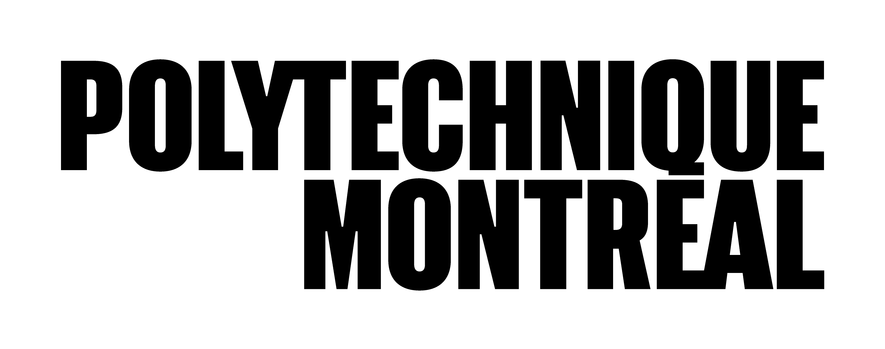
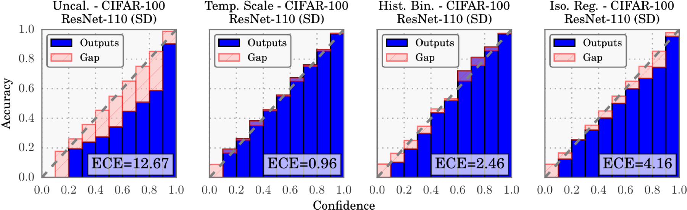

# Robotic Perception and Uncertainty

**INF8422: Robotic Perception and Spatial Intelligence**

Prof. Pierre-Yves Lajoie



<div class="cover-footer-bar mt-4">
  <span style="background:#CF1C24" />
  <span style="background:#F15A22" />
  <span style="background:#25B34B" />
  <span style="background:#00BDF2" />
</div>

---
hideInToc: true
---

# Agenda

<Toc />

---
layout: section
---

# Motivation and Context

<SectionPipeline />

---
hideInToc: true
---

# The Impact of Noise

<div class="grid grid-cols-3 gap-6 mt-4">
<div class="text-center">

**Perception**

Sensors, vision, LiDAR

*Understand the world*

</div>
<div class="text-center">

**Planning**

Trajectories, decisions

*Choose the actions*

</div>
<div class="text-center">

**Control**

Motors, actuators

*Execute the actions*

</div>
</div>

<AlertBlock title="Fundamental Principle" class="mt-4">

Every sensor, without exception, is corrupted by **noise** (thermal, electrical, mechanical drift, vibrations, etc.). If poorly modeled, this uncertainty propagates **in cascade**: distorted data $\to$ suboptimal decisions $\to$ incorrect actions.

</AlertBlock>

<!-- IMAGE: pipeline-robotique.png — Modular Perception → Planning → Control pipeline with arrows showing the propagation of uncertainty -->

---
hideInToc: true
disabled: true
---

# Why Uncertainty?

An efficient robot must *learn efficiently* and *act robustly* in an uncertain world.

<InfoBlock title="Two Paradigms of Uncertainty">

- **Frequentist Paradigm**: The model estimates *probabilities* associated with different hypotheses. Ex: "The probability that this object is a pedestrian is 0.85".
- **Bayesian Paradigm**: The robot generates *hypothetical scenarios* to plan. Ex: Simulating several possible trajectories of a pedestrian.

</InfoBlock>

Reasoning over **diverse scenarios** rather than a single deterministic scenario improves:

- **robustness** to unexpected conditions,
- **learning efficiency** (knowing what we don't know),
- **safety** (cautious decisions under ambiguity).

<!-- <InfoBlock title="Spiral Structure" class="mt-3">

This introduction gives an overview of four uses: **fusion, decision, active learning, propagation**.

</InfoBlock> -->

---
hideInToc: true
---

# Course Objective

1. **Identify the sources** of uncertainty in a robotic system (hardware, model, environment).

2. **Classify** the types of uncertainty: aleatoric (data) vs. epistemic (model).

3. **Measure** uncertainty with appropriate metrics: variance, entropy, NLL, ECE.

4. **Quantify** uncertainty with learning methods: ensembles, MC Dropout, conformal prediction.

5. **Calibrate** a model so that its probabilities are reliable.

6. **Act** with uncertainty: compare decisions, plan cautiously, and explore to reduce what the robot doesn't know.

---
hideInToc: true
---

# What Is Uncertainty?

Before quantifying uncertainty, we need to agree on what a **probability** is. Two interpretations coexist, and both will be used in this course.

<div class="grid grid-cols-2 gap-6 mt-4">
<div>

<InfoBlock title="Frequentist School">

Probability is a **limiting frequency** over repeated experiments:

$$P(A) = \lim_{n \to \infty} \frac{n_A}{n}$$

- The parameter $\theta$ is **fixed but unknown**; it is the **data** that is random.

</InfoBlock>

</div>
<div>

<InfoBlock title="Bayesian School">

Probability is a **degree of belief** conditioned on the available information:

$$p(\theta \mid \mathcal{D}) \propto p(\mathcal{D} \mid \theta)\, p(\theta)$$

- The parameter $\theta$ is a **random variable**; we condition on the **observed** (fixed) data.

</InfoBlock>

</div>
</div>

<AlertBlock title="Why It Matters Here" class="mt-4">

"The uncertainty" of a prediction does not mean the same thing in the two schools: **variability under repetition** (frequentist) vs. **belief about what we don't know** (Bayesian).

</AlertBlock>

---
hideInToc: true
---

# Frequentist vs. Bayesian — Interactive Visualization

The **same stream of Bernoulli trials** (true success rate $p^* = 0.7$, hidden) read by the two schools: on the left $\hat{p} = k/n$ fluctuates around a fixed $p^*$; on the right the belief about $p$ concentrates.

<FreqVsBayesAnimation class="mt-2" />

---
hideInToc: true
disabled: true
---

# Two Schools: What It Changes in Robotics

<InfoBlock title="Previous Courses Were Bayesian">

MAP-based SLAM maximizes $p(\mathcal{D}|\theta)\,p(\theta)$: the odometry factors are the likelihood, the anchoring is the prior. All of classical state estimation lives in the Bayesian school.

</InfoBlock>

**And deep learning?** A network trained by MLE keeps only the **point** $\theta^* = \arg\max p(\mathcal{D}|\theta)$:

- No distribution over $\theta$ → no **epistemic** uncertainty by construction.
- And the frequentist toolkit (bootstrap, confidence intervals) requires retraining on repetitions — impractical at the scale of a DNN.

**The two schools structure the rest of the course:**

<div class="grid grid-cols-2 gap-6 mt-2">
<div>

**Representing belief** (Bayesian)

BNN, MC Dropout, ensembles ≈ sampling a posterior $p(\theta|\mathcal{D})$.

</div>
<div>

**Validating with frequencies** (frequentist)

Calibration = confidences vs. observed frequencies; conformal prediction = **guaranteed coverage** under repetition.

</div>
</div>

---
hideInToc: true
---

# Uncertainty in Sensor Fusion

<div></div>

A robot generally has **several sensors** (camera, LiDAR, GPS, IMU…). Faced with conflicting measurements, uncertainty serves as a **confidence weight**.

<InfoBlock title="Bayesian Fusion">

Given two independent sensors providing measurements $z_1$ and $z_2$ about the state $\mathbf{x}$:

$$p(\mathbf{x} \mid z_1, z_2) \propto \underbrace{p(z_1 \mid \mathbf{x})}_{\text{sensor 1 model}} \cdot \underbrace{p(z_2 \mid \mathbf{x})}_{\text{sensor 2 model}} \cdot \underbrace{p(\mathbf{x})}_{\text{prior}}$$

The **more accurate** sensor (lower variance) contributes more to the final estimate.

</InfoBlock>

**Intuition:** If GPS is uncertain (poor satellite visibility) but vision is confident (clear visual landmarks), the fusion naturally weights in favor of vision.


---
hideInToc: true
---

# Sensor Fusion — Interactive Visualization

The product of two Gaussians is a **narrower** Gaussian: adjust the precisions and observe which one dominates the fusion.

<SensorFusionAnimation class="mt-2" />

---
hideInToc: true
---

# Deciding and Predicting Under Uncertainty

Uncertainty about the state of the world **grows with the time horizon**.

<div class="grid grid-cols-2 gap-6 mt-4">
<div>

**Deciding: Mars rover**

- **Probabilistic** elevation map: a *distribution* of maps, not a single one.
- Allows trading off risk of falling vs. energy consumption → **risk-aware** decision.
- Without uncertainty: a single decision.

</div>
<div>

**Predicting: pedestrian tracking**

- From $t_0$ to $t_1$, the uncertainty "bubble" **propagates and grows**.
- Tools: scenario sampling, POMDPs, and risk-sensitive planning.
- Mitigating actions: get closer, ask for help, cautious trajectory.

</div>
</div>

<!-- IMAGE: rover-mars.png — Mars rover + elevation map with mean/variance -->

---
hideInToc: true
disabled: true
---

# Active Learning

<InfoBlock title="The Annotation Problem">

Annotating data to train perception models is **costly** (human time, expertise). You cannot annotate everything.

</InfoBlock>

**Solution:** Active learning uses uncertainty to *intelligently choose* which data to annotate.

1. Train an initial model on a small amount of annotated data.
2. **Estimate the uncertainty** on unannotated data.
3. Send only the **most uncertain** data to the human annotator.
4. Repeat until convergence.

**Benefit:** Reach the same performance with **10 to 100× less** annotated data. Particularly valuable for robotic perception (rare images, extreme conditions).

---
hideInToc: true
---

# The Problem with *Point Estimates*

<AlertBlock title="A Problem with Neural Networks">

These networks are trained to produce a **single deterministic output**: the point estimate $\theta^*$ of the MLE, with no distribution over $\theta$. They are often **overconfident**: they don't know that they don't know.

</AlertBlock>

**Concrete consequences:**

- An autonomous vehicle classifying a white trailer as "sky" with confidence $\to$ collision.
- A network 99% confident on an *adversarial* image (noise imperceptible to the human eye).
- A pedestrian detector unaware it is looking at an object never seen during training.
- A neural SLAM system that *silently* loses its localization with no alarm.

**Goal:** Reconnect with probabilism and force networks to quantify their ignorance.

---
layout: section
---

# Sources of Uncertainty

<SectionPipeline current="comprendre" />

---
hideInToc: true
---

# Where Does Uncertainty Come From?

<div></div>

Uncertainty in robotics comes from **internal** sources (related to the robot) and **external** sources (related to the environment).

<div class="flex justify-center mt-4">
<svg viewBox="0 0 558 190" style="height:230px">
  <!-- Root -->
  <rect x="219" y="10" width="120" height="30" fill="#475569" rx="5"/>
  <text x="279" y="29" text-anchor="middle" style="font-size:10px;fill:white;font-weight:700;font-family:sans-serif">Uncertainty</text>
  <!-- Level 1 branches -->
  <line x1="279" y1="40" x2="140" y2="70" stroke="#94a3b8" stroke-width="1.2"/>
  <line x1="279" y1="40" x2="424" y2="70" stroke="#94a3b8" stroke-width="1.2"/>
  <rect x="80" y="70" width="120" height="26" fill="#00BDF2" rx="5"/>
  <text x="140" y="87" text-anchor="middle" style="font-size:9px;fill:white;font-weight:700;font-family:sans-serif">Internal (robot)</text>
  <rect x="364" y="70" width="140" height="26" fill="#F15A22" rx="5"/>
  <text x="434" y="87" text-anchor="middle" style="font-size:9px;fill:white;font-weight:700;font-family:sans-serif">External (environment)</text>
  <!-- Internal leaves -->
  <line x1="140" y1="96" x2="55" y2="125" stroke="#94a3b8" stroke-width="1"/>
  <line x1="140" y1="96" x2="150" y2="125" stroke="#94a3b8" stroke-width="1"/>
  <line x1="140" y1="96" x2="245" y2="125" stroke="#94a3b8" stroke-width="1"/>
  <rect x="8" y="125" width="94" height="40" fill="#f0f9ff" rx="4" stroke="#7dd3fc"/>
  <text x="55" y="141" text-anchor="middle" style="font-size:8px;fill:#0369a1;font-weight:700;font-family:sans-serif">1. Hardware</text>
  <text x="55" y="154" text-anchor="middle" style="font-size:7px;fill:#075985;font-family:sans-serif">noise, bias, failures</text>
  <rect x="108" y="125" width="94" height="40" fill="#f0f9ff" rx="4" stroke="#7dd3fc"/>
  <text x="155" y="141" text-anchor="middle" style="font-size:8px;fill:#0369a1;font-weight:700;font-family:sans-serif">2. Model</text>
  <text x="155" y="154" text-anchor="middle" style="font-size:7px;fill:#075985;font-family:sans-serif">capacity, quantization</text>
  <rect x="208" y="125" width="94" height="40" fill="#f0f9ff" rx="4" stroke="#7dd3fc"/>
  <text x="255" y="141" text-anchor="middle" style="font-size:8px;fill:#0369a1;font-weight:700;font-family:sans-serif">3. Observability</text>
  <text x="255" y="154" text-anchor="middle" style="font-size:7px;fill:#075985;font-family:sans-serif">self-occlusions, FOV</text>
  <!-- External leaves -->
  <line x1="434" y1="96" x2="380" y2="125" stroke="#94a3b8" stroke-width="1"/>
  <line x1="434" y1="96" x2="490" y2="125" stroke="#94a3b8" stroke-width="1"/>
  <rect x="326" y="125" width="106" height="40" fill="#fff7ed" rx="4" stroke="#fdba74"/>
  <text x="379" y="141" text-anchor="middle" style="font-size:8px;fill:#c2410c;font-weight:700;font-family:sans-serif">4. Dynamics</text>
  <text x="379" y="154" text-anchor="middle" style="font-size:7px;fill:#9a3412;font-family:sans-serif">agents, weather, time</text>
  <rect x="438" y="125" width="112" height="40" fill="#fff7ed" rx="4" stroke="#fdba74"/>
  <text x="494" y="141" text-anchor="middle" style="font-size:8px;fill:#c2410c;font-weight:700;font-family:sans-serif">5. Domain Shift</text>
  <text x="494" y="154" text-anchor="middle" style="font-size:7px;fill:#9a3412;font-family:sans-serif">training ≠ deployment</text>
</svg>
</div>

---
hideInToc: true
---

# Source 1: Hardware Limitations

All physical measurement devices exhibit **unavoidable errors**.

<InfoBlock title="Types of Measurement Errors">

- **Systematic errors**: Constant bias (e.g., calibration offset of a camera).
- **Random errors**: Thermal, electronic noise (e.g., Gaussian noise on a depth sensor).

</InfoBlock>

**Compound example:** An autonomous vehicle attempts to localize a pedestrian.

- The **LiDAR** introduces a distance error ($\pm 2$ cm).
- The **GPS** is imprecise in urban environments (multi-path, $\pm 5$ m).
- The two uncertainties **compound**: the total uncertainty on the pedestrian's position is much greater than each individual error.

---
hideInToc: true
disabled: true
---

# Source 2: Model Limitations

Machine learning models deployed on robots are subject to **severe constraints**.

<div class="grid grid-cols-2 gap-6 mt-4">
<div>

**Embedded Constraints**

- Limited memory (a few GB).
- Restricted energy budget.
- Maximum latency imposed (real time).

$\Rightarrow$ Need for **smaller** or **quantized** models.

</div>
<div>

**Consequences**

- Reduced representational capacity.
- Quantization (INT8 instead of FP32) → rounding errors.
- Pruning → loss of important weights.

$\Rightarrow$ **Increased** uncertainty on predictions.

</div>
</div>

<AlertBlock title="Fundamental Trade-off" class="mt-4">

The smaller and faster the model, the more uncertain it is. Designing for real time **necessarily** implies accepting and quantifying this additional uncertainty.

</AlertBlock>

---
hideInToc: true
---

# Source 2: Partial Observability

A robot never perceives the world in its **entirety**.

- **Occlusions**: An object hidden behind another (pedestrian behind a car).
- **Visual conditions**: Fog, darkness, sun glare.
- **Clutter**: Dense scenes with many overlapping objects.
- **Limited field of view**: A sensor sees only a portion of the space.

<!-- <InfoBlock title="Formalism: POMDP">

**Partially Observable Markov Decision Processes** (POMDPs) explicitly model partial observability. The agent maintains a **belief distribution** $b(s)$ over the hidden state $s$, rather than a single certain state.

</InfoBlock> -->

**Mitigation:** Use multiple sensors (complementary modalities), plan movements to reduce occlusions, maintain a temporal memory.

---
hideInToc: true
---

# Source 3: Environment Dynamics

The world in which the robot operates **changes over time**.

<div class="grid grid-cols-2 gap-6 mt-4">
<div>

**Dynamic Elements**

- **Mobile agents**: Pedestrians, cyclists, other vehicles.
- **Displaced objects**: Furniture in a house, objects on a table.
- **Weather conditions**: Rain, wind, changing lighting.

</div>
<div>

**Consequences**

- The map built at $t_0$ is **stale** at $t_1$.
- Trajectory predictions are **uncertain**.
- Control (e.g., a drone) disturbed by wind → imprecise commands.

</div>
</div>

<AlertBlock title="Growing Uncertainty Over Time" class="mt-4">

The further the prediction horizon, the greater the uncertainty about the future state. A robot planning 10 seconds ahead is far more uncertain than one planning 1 second ahead.

</AlertBlock>

---
hideInToc: true
---

# Source 4: Domain Shift

A model trained on one dataset can **fail** when facing situations it was never exposed to.

<InfoBlock title="Definition">

**Domain shift** occurs when the distribution of the test data $p_{test}(\mathbf{x})$ differs from the training distribution $p_{train}(\mathbf{x})$. The model encounters inputs for which it has **no experience**.

</InfoBlock>

**Examples:**

- Autonomous driving system trained in Arizona → deployed in Montreal in winter.
- Urban segmentation model → deployed in an unfamiliar **rural** area.

<!-- IMAGE: domain-shift.png — Comparison of normal vs. extreme conditions (snow, night) -->

---
hideInToc: true
---

# Concrete Examples: Three Robotic Domains

<div class="grid grid-cols-3 gap-4 mt-4">
<div>

**Domestic Navigation**

- Semi-permanent furniture.
- Dynamic people.
- VLMs/LLMs to understand human instructions.

</div>
<div>

**Manipulation**

- Occluded or transparent objects.
- Unknown mass and friction.
- Uncertain deformability.
- Uncertain grasp pose.

</div>
<div>

**Field Robots**

- SLAM without GPS (mines, underwater, space).
- Turbulence (drones, AUVs).
- Unstructured environments.
- Dynamic elements (people, animals, other robots).

</div>
</div>

---
hideInToc: true
---

# Uncertainty in SLAM

In previous courses, SLAM was formulated as **probabilistic estimation**: MAP gives the trajectory, and the information matrix $\Lambda = J^\top \Omega J$ in principle encodes all the uncertainty ($\Sigma = \Lambda^{-1}$).

<AlertBlock title="">

In practice, most deployed SLAM systems only exploit the **mean** (the MAP estimate) and ignore the covariance. The robot navigates as if its pose and map were perfect.

</AlertBlock>

**Why this pitfall exists:**

- Recovering $\Sigma$ requires **solving the system**: inverting (or marginalizing) $\Lambda$ destroys the sparsity that makes SLAM real-time — expensive in both computation and storage on graphs with millions of variables.
- Standard benchmarks (ATE, RPE) only score the accuracy of the mean, not the quality of the uncertainty.

**Consequence:** localization that drifts *silently*, with no alarm. The methods in this course aim precisely to give this **introspection** back to perception systems, classical as well as neural.

---
hideInToc: true
disabled: true
---

# Uncertainty Is Inevitable but Manageable

<AlertBlock title="Fundamental Reality">

We cannot **eliminate** uncertainty in real robotic systems. Trying to model every source of stochasticity is often **useless and costly**.

</AlertBlock>

**The real question:** How do we *quantify*, *propagate*, and *exploit* uncertainty for robust decisions?

<InfoBlock title="Modern Approach">

1. **Identify** the most critical sources of uncertainty.
2. **Model** these sources with appropriate probabilistic representations.
3. **Propagate** uncertainty through the perception → decision pipeline.
4. **Act** cautiously when uncertainty is high.
5. **Reduce** epistemic uncertainty by collecting better data.

</InfoBlock>

---
layout: section
---

# Measuring Uncertainty

<SectionPipeline current="mesurer" />

---
hideInToc: true
---

# Uncertainty Metrics

Quantifying uncertainty is useless if we cannot evaluate and compare it.

<InfoBlock title="Three Distinct Questions">

1. **Dispersion:** How spread out is the prediction? (Variance, covariance, entropy)
2. **Predictive quality:** Is the predictive distribution correct relative to reality? (NLL, Brier)
3. **Distance between distributions:** Are two distributions similar? (KL, Hellinger, Wasserstein)

</InfoBlock>

**Practical uses in robotics:**

- Comparing two uncertainty quantification methods (e.g., Ensembles vs. MC Dropout).
- Evaluating whether a model is well calibrated on a validation set.
- Detecting out-of-distribution (OOD) data by thresholding a metric.
- Guiding active exploration toward zones of maximum uncertainty.

---
hideInToc: true
---

# Variance

<div></div>

**Variance** measures the *dispersion of a random variable* around its mean.

For a discrete variable $X$ with $N$ outcomes $\{x_1, \ldots, x_N\}$ and probabilities $\{p_1, \ldots, p_N\}$:

1. Mean: $\mu = \mathbb{E}[X] = \displaystyle\sum_{n=1}^N p_n x_n$

2. Variance:
$$\sigma^2 = \mathbb{E}\!\left[(X - \mu)^2\right] = \sum_{n=1}^N p_n (x_n - \mu)^2$$

**Important properties:**

- $\sigma^2 \geq 0$ (always non-negative). $\sigma^2 = 0$ iff $X$ is deterministic.
- The **standard deviation** $\sigma = \sqrt{\sigma^2}$ is in the same units as $X$ (more interpretable).
- For a continuous distribution $p(x)$: $\sigma^2 = \int (x-\mu)^2 p(x)\,\mathrm{d}x$.

**Limitation:** Only measures the dispersion of a *single* variable (→ **covariance**, next slide). Does not capture the shape of the distribution (a bimodal distribution can have the same variance as a unimodal one).

---
hideInToc: true
---

# Covariance

<div></div>

Two variables of the same state (e.g., $x$ and $y$ of a pose) do not vary independently.

**Covariance** measures their *co-variation*:

<div class="grid grid-cols-2 gap-6 mt-2">
<div>

$$\text{Cov}(X, Y) = \mathbb{E}\!\left[(X - \mu_X)(Y - \mu_Y)\right]$$

- Sign = direction of co-variation; normalized version: **correlation** $\rho = \frac{\text{Cov}(X,Y)}{\sigma_X \sigma_Y} \in [-1, 1]$.

**Covariance matrix** for $\mathbf{x} \in \mathbb{R}^d$:

$$\Sigma = \mathbb{E}\!\left[(\mathbf{x} - \boldsymbol{\mu})(\mathbf{x} - \boldsymbol{\mu})^\top\right], \qquad \Sigma_{ii} = \sigma_i^2, \quad \Sigma_{ij} = \text{Cov}(x_i, x_j)$$

- Symmetric **positive semi-definite**.
- Geometry: the eigenvectors of $\Sigma$ give the axes of the **uncertainty ellipse**, the $\sqrt{\lambda_i}$ its half-axes.


**Why it is central in robotics:** $\Sigma$ describes not only the magnitude of the error but also its preferred directions — for example in a pose or a SLAM map.

</div>
<div>

<div class="flex justify-center">
<svg viewBox="0 0 260 160" style="height:160px">
  <line x1="14" y1="80" x2="246" y2="80" stroke="#e2e8f0" stroke-width="1"/>
  <line x1="110" y1="10" x2="110" y2="150" stroke="#e2e8f0" stroke-width="1"/>
  <!-- Correlated cloud -->
  <g fill="#475569" style="opacity:0.65">
    <circle cx="83" cy="112" r="2"/><circle cx="83" cy="96" r="2"/><circle cx="99" cy="105" r="2"/>
    <circle cx="95" cy="91" r="2"/><circle cx="107" cy="91" r="2"/><circle cx="98" cy="75" r="2"/>
    <circle cx="112" cy="82" r="2"/><circle cx="110" cy="73" r="2"/><circle cx="124" cy="77" r="2"/>
    <circle cx="118" cy="63" r="2"/><circle cx="130" cy="65" r="2"/><circle cx="126" cy="51" r="2"/>
    <circle cx="142" cy="58" r="2"/><circle cx="140" cy="48" r="2"/><circle cx="95" cy="115" r="2"/>
    <circle cx="126" cy="84" r="2"/><circle cx="133" cy="74" r="2"/><circle cx="92" cy="79" r="2"/>
  </g>
  <!-- True 2σ ellipse (tilted) -->
  <ellipse cx="110" cy="80" rx="50" ry="25" transform="rotate(-45 110 80)"
    fill="none" stroke="#CF1C24" stroke-width="1.8"/>
  <!-- Diagonal only (correlations ignored) -->
  <ellipse cx="110" cy="80" rx="40" ry="40" fill="none" stroke="#00BDF2"
    stroke-width="1.3" stroke-dasharray="5,3"/>
  <!-- Eigen axes -->
  <line x1="110" y1="80" x2="145" y2="45" stroke="#CF1C24" stroke-width="1.4"/>
  <line x1="110" y1="80" x2="128" y2="98" stroke="#CF1C24" stroke-width="1.4"/>
  <text x="149" y="42" style="font-size:8px;fill:#CF1C24;font-family:sans-serif">v₁√λ₁</text>
  <text x="131" y="107" style="font-size:8px;fill:#CF1C24;font-family:sans-serif">v₂√λ₂</text>
  <text x="168" y="128" style="font-size:8px;fill:#CF1C24;font-family:sans-serif">full Σ (2σ)</text>
  <text x="168" y="140" style="font-size:8px;fill:#0284c7;font-family:sans-serif">diagonal only</text>
</svg>
</div>

<AlertBlock title="If Correlations Are Ignored">

Keeping only the diagonal (blue dashed line) **underestimates** the uncertainty in the oblique direction.

</AlertBlock>

</div>
</div>

---
hideInToc: true
---

# Shannon Entropy

<div></div>

**Entropy** measures how random the possible outcomes of a system are. Unlike variance, it accounts for the **shape** of the distribution, not the numerical values.

For a variable $X$ with $N$ discrete outcomes and probabilities $\{p_1, \ldots, p_N\}$:

$$H(X) = -\sum_{n=1}^N p_n \log p_n \qquad \text{(in bits if log base 2, in nats if natural log)}$$

**Properties:**

- $H(X) \geq 0$. $H(X) = 0$ iff a single outcome is certain ($p_k = 1$).
- $H(X)$ is maximal, $= \log N$, when all outcomes are equiprobable.
- For a binary classifier ($p$ = probability of the positive class): $H = -(p\log p + (1-p)\log(1-p))$.

<div class="flex justify-center">
<svg viewBox="0 0 340 145" style="height:130px">
  <line x1="40" y1="120" x2="300" y2="120" stroke="#94a3b8" stroke-width="1"/>
  <line x1="40" y1="120" x2="40" y2="15" stroke="#94a3b8" stroke-width="1"/>
  <polyline points="40.0,120.0 45.2,105.9 50.4,95.8 55.6,87.3 60.8,79.8 66.0,73.1 71.2,67.1 76.4,61.6 81.6,56.6 86.8,52.0 92.0,47.8 97.2,44.0 102.4,40.5 107.6,37.3 112.8,34.5 118.0,31.9 123.2,29.6 128.4,27.5 133.6,25.7 138.8,24.2 144.0,22.9 149.2,21.9 154.4,21.0 159.6,20.5 164.8,20.1 170.0,20.0 175.2,20.1 180.4,20.5 185.6,21.0 190.8,21.9 196.0,22.9 201.2,24.2 206.4,25.7 211.6,27.5 216.8,29.6 222.0,31.9 227.2,34.5 232.4,37.3 237.6,40.5 242.8,44.0 248.0,47.8 253.2,52.0 258.4,56.6 263.6,61.6 268.8,67.1 274.0,73.1 279.2,79.8 284.4,87.3 289.6,95.8 294.8,105.9 300.0,120.0"
    fill="none" stroke="#00BDF2" stroke-width="2"/>
  <line x1="170" y1="120" x2="170" y2="20" stroke="#CF1C24" stroke-width="0.8" stroke-dasharray="3,2"/>
  <text x="170" y="132" text-anchor="middle" style="font-size:8px;fill:#64748b;font-family:sans-serif">p = 0.5</text>
  <text x="40" y="132" text-anchor="middle" style="font-size:8px;fill:#64748b;font-family:sans-serif">0</text>
  <text x="300" y="132" text-anchor="middle" style="font-size:8px;fill:#64748b;font-family:sans-serif">1</text>
  <text x="32" y="24" text-anchor="end" style="font-size:8px;fill:#64748b;font-family:sans-serif">1 bit</text>
  <text x="182" y="30" style="font-size:8px;fill:#CF1C24;font-family:sans-serif">max: equiprobable</text>
  <text x="310" y="105" style="font-size:8px;fill:#475569;font-family:sans-serif">H(p)</text>
</svg>
</div>

---
hideInToc: true
---

# Negative Log-Likelihood (NLL)

<div></div>

The **NLL** measures the *quality of a predictive distribution relative to ground truth*. It is the metric of choice for evaluating probabilistic models.

**In classification:** For the true class $y_t$ with predicted probability $\hat{p}(y_t)$:

$$\text{NLL}_{\text{class}} = -\log \hat{p}(y_t)$$

If the model is confident and correct ($\hat{p}(y_t) \approx 1$): $\text{NLL} \approx 0$. Otherwise NLL increases.

**In Gaussian regression:** For a prediction $\hat{\mu}$ with variance $\hat{\sigma}^2$ and ground truth $y_t$:

$$\text{NLL}_{\text{reg}} = \frac{1}{2}\log(2\pi\hat{\sigma}^2) + \frac{(y_t - \hat{\mu})^2}{2\hat{\sigma}^2}$$

<InfoBlock title="">

Its expectation is minimized **if and only if** the predictive distribution $\hat{p}$ is exactly the true distribution $p$.

</InfoBlock>

---
hideInToc: true
disabled: true
---

# Brier Score

The **Brier Score** is a more robust alternative to NLL for classification.

For $N$ predictions with predicted probability $\hat{p}_i$ and true label $y_i \in \{0, 1\}$:

$$\text{Brier} = \frac{1}{N}\sum_{i=1}^N (\hat{p}_i - y_i)^2$$

**Properties:**

- Brier $\in [0, 1]$. Brier $= 0$: perfect predictions.
- Less sensitive to extreme probabilities than NLL ($-\log p$ diverges as $p \to 0$).
- It is also a **strictly proper scoring rule**.

**Analogy with MSE:** The Brier score is equivalent to a mean squared error on probabilities. Easy to interpret and numerically stable.

**Multi-class extension:**

$$\frac{1}{N}\sum_i \sum_k \left(\hat{p}_{i,k} - \mathbf{1}[y_i = k]\right)^2$$

---
hideInToc: true
---

# Mahalanobis Distance

<div></div>

The **Mahalanobis distance** measures the *distance between a point and a multivariate distribution*, taking correlations into account.

For a point $\mathbf{x} \in \mathbb{R}^d$ relative to a distribution $(\boldsymbol{\mu}, \Sigma)$:

$$D_M(\mathbf{x}) = \sqrt{(\mathbf{x} - \boldsymbol{\mu})^\top \Sigma^{-1} (\mathbf{x} - \boldsymbol{\mu})}$$

**Special cases:**

- $d = 1$: $D_M = |x - \mu| / \sigma$ (distance in number of standard deviations).
- $\Sigma = I$ (identity): $D_M = \|\mathbf{x} - \boldsymbol{\mu}\|_2$ (Euclidean distance).

**Applications in robotics:**

- **OOD detection:** If $D_M(\mathbf{x}_{\text{test}})$ is large in feature space, the input is probably out-of-distribution.
- **Regression evaluation:** Distance between the Gaussian prediction and ground truth.
- **Sensor fusion:** Mahalanobis distance between two estimates for data association

---
hideInToc: true
---

# Comparing Distributions

<div></div>

Third family of metrics: measuring the **gap between two distributions** $p$ and $q$ (posterior vs. approximation, train vs. test features, disagreement between models).

| **Measure** | **Formula** | **Properties** | **Typical use** |
|---|---|---|---|
| **Kullback-Leibler** | $\mathbb{KL}[p \,\Vert\, q] = \sum_n p_n \log\frac{p_n}{q_n}$ | $\geq 0$, zero iff $p = q$, **not symmetric** | Variational Inference |
| **Jensen-Shannon** | $\frac{1}{2}\mathbb{KL}[p \,\Vert\, m] + \frac{1}{2}\mathbb{KL}[q \,\Vert\, m]$, $m = \frac{p+q}{2}$ | symmetrized KL, bounded | disagreement between ensemble members |
| **Wasserstein** *Earth Mover Distance* ($W_2$) | minimal cost of **optimal transport** from $p$ to $q$ | sensitive to geometry; slow to compute | distance between histograms, between shapes in images |


---
layout: section
---

# Types and Representation of Uncertainty

<SectionPipeline current="mesurer" />

---
hideInToc: true
---

# The Two Major Types of Uncertainty

Predictive uncertainty divides into two fundamental categories with very different properties.

<div class="grid grid-cols-2 gap-6 mt-4">
<div>

<InfoBlock title="Aleatoric Uncertainty">

Inherent to noise in the data

Part of this uncertainty is *irreducible*.

</InfoBlock>

</div>
<div>

<InfoBlock title="Epistemic Uncertainty">

Inherent to the model

Lack of knowledge, lack of data

Limited representation unable to encode the full complexity of the data

*Reducible* by adding data, expanding the model, etc.

</InfoBlock>

</div>
</div>

---
hideInToc: true
---

# Types of Uncertainty — Interactive Visualization

Gaussian process regression: click to add observations — the **epistemic** band collapses locally, the **aleatoric** band does not move.

<AleatoricEpistemicAnimation class="mt-2" />

---
hideInToc: true
---

# Aleatoric Uncertainty

<InfoBlock title="Definition">

**Aleatoric uncertainty** (also called *statistical uncertainty* or *data uncertainty*) is due to the **inherent stochasticity** of the observed phenomenon. It is **irreducible**: even with an infinite amount of data, it does not disappear.

</InfoBlock>

**Measurement model:** For an output $y$ given an input $\mathbf{x}$ and the true parameters $\theta^*$:

$$y = f_{\theta^*}(\mathbf{x}) + \varepsilon, \qquad \varepsilon \sim \mathcal{N}(0, \sigma^2_{\text{alea}})$$

where $\varepsilon$ is the irreducible measurement noise, $\sigma^2_{\text{alea}}$ its variance.

**Examples in robotic perception:**

- Thermal noise of a depth sensor (present even if it isn't moving).
- Semantic labeling ambiguity at the boundary between two objects.
- Motion blur in an image captured during fast movement.

---
hideInToc: true
disabled: true
---

# The Token Analogy — Aleatoric Uncertainty

To illustrate the difference between the two types, imagine two **opaque boxes** containing game tokens.

<InfoBlock title="Box A — Aleatoric Uncertainty">

Box A contains **half tokens worth $10** and **half tokens worth $0**, randomly mixed. Even after examining 100 drawn tokens, you cannot predict with certainty the value of the next token.

*The ambiguity is in the source itself: the nature of the game is fundamentally stochastic.*

</InfoBlock>

<InfoBlock title="Box B — No Aleatoric Uncertainty">

Box B contains only tokens worth **$6**. After seeing a single token, you know the system perfectly. There is no intrinsic stochasticity.

</InfoBlock>

$\Rightarrow$ **Aleatoric uncertainty represents the irreducible variability of the physical world.**

---
hideInToc: true
---

# Epistemic Uncertainty

<InfoBlock title="Definition">

**Epistemic uncertainty** (also called *model uncertainty* or *systematic uncertainty*) comes from a **lack of knowledge** or data. It is **reducible**: by collecting more relevant data, it decreases.

</InfoBlock>

**Measurement model:** We seek the parameters $\theta$ of the model. Epistemic uncertainty is represented by the **posterior distribution**:

$$p(\theta \mid \mathcal{D}) \propto p(\mathcal{D} \mid \theta)\, p(\theta)$$

A concentrated distribution $p(\theta|\mathcal{D})$ = low epistemic uncertainty (lots of data).
A diffuse distribution = high epistemic uncertainty (little data).

**Examples in robotic perception:**

- Detector never trained on rare objects → high uncertainty.
- SLAM map of a never-visited area → high geometric uncertainty.
- Segmentation model facing an unknown weather condition.

---
hideInToc: true
disabled: true
---

# The Token Analogy — Epistemic Uncertainty

Let's revisit the same opaque box, but with a different situation.

<InfoBlock title="Box A — Epistemic Uncertainty">

Box A contains **either only $10 tokens**, or **only $0 tokens** — you don't know which. The composition of the box is fixed, but you are ignorant of it.

*A single drawn token instantly dispels this ignorance and reveals the model.* This is the essence of the epistemic: ignorance of the parameter, not variability of the phenomenon.

</InfoBlock>

<div class="grid grid-cols-2 gap-6 mt-4">
<div>

**Aleatoric Uncertainty**

Box A (mixed)

Seeing 1000 tokens doesn't help

</div>
<div>

**Epistemic Uncertainty**

Box A (unknown uniform)

Seeing **1 token** is enough!

</div>
</div>

---
hideInToc: true
---

# Representations of Uncertainty

Uncertainty can be **represented** in different forms depending on the context.

<div class="grid grid-cols-2 gap-6 mt-4">
<div>

**Continuous Representations**

- **Parametric distributions**: Gaussian $\mathcal{N}(\mu, \sigma^2)$, Dirichlet, von Mises-Fisher.
- **Samples** (Monte Carlo): A set of $K$ predictions represents the posterior.
- **Density functions** (normalizing flows, GP).

</div>
<div>

**Discrete Representations**

- **Intervals / sets**: $[y_{low}, y_{high}]$ (conformal prediction).
- **Class sets**: \{cat, tiger\} (conformal classification).
- **Polytopes** and **probability boxes** (p-box) for engineering.

</div>
</div>

<InfoBlock title="Practical Choice" class="mt-4">

The choice of representation depends on the **expressiveness / computational cost** trade-off. Gaussians are simple and efficient; non-parametric distributions (e.g., ensembles) are more expressive but more costly.

</InfoBlock>

---
hideInToc: true
---

# Homoscedastic vs. Heteroscedastic Uncertainty

Aleatoric uncertainty itself can be **constant** or **input-dependent**.

<div class="grid grid-cols-2 gap-6 mt-4">
<div>

**Homoscedastic**

**Constant** variance: $\sigma^2_{\text{alea}} = \sigma^2$ (independent of $\mathbf{x}$).

- Thermal noise of a sensor.
- Uniform quantization error.

Simple to model: a single scalar to learn.

</div>
<div>

**Heteroscedastic**

**Input-dependent** variance: $\sigma^2_{\text{alea}}(\mathbf{x})$.

- Stereo depth error: $\sigma_Z \propto Z^2$ (grows with depth $Z$).
- Segmentation: higher uncertainty at object boundaries.

The network must **predict** the variance.

</div>
</div>

---
hideInToc: true
disabled: true
---

# Homo vs. Heteroscedastic — Interactive Visualization

A stereo camera's error grows as $Z^2$: move the object and compare it with constant noise.

<HomoHeteroVarianceAnimation class="mt-2" />

---
hideInToc: true
---

# Representing Aleatoric Uncertainty: Classification

<div></div>

In classification with $K$ classes, the network naturally produces a probability distribution.

The **Softmax** layer transforms the logits $z_k$ into probabilities:

$$p(y = k \mid \mathbf{x}) = \frac{e^{z_k}}{\sum_{j=1}^{K} e^{z_j}}, \qquad \sum_{k=1}^{K} p(y=k|\mathbf{x}) = 1$$

**Aleatoric uncertainty measure:** The entropy of the softmax distribution:

$$H = -\sum_{k=1}^{K} p_k \log p_k$$

- $H = 0$: a single class at 100% probability → very certain.
- $H = \log K$: uniform distribution → maximally uncertain.

<AlertBlock title="Warning">

This entropy is the uncertainty *as seen by a single model* $\theta^*$: structurally **blind to the epistemic** (it can be $\approx 0$ in an OOD zone).

</AlertBlock>

---
hideInToc: true
---

# Representing Aleatoric Uncertainty: Regression

<div></div>

In regression, an *uncertainty head* does not predict an abstract "confidence": it turns the network into a model of a **conditional distribution** $p(y\mid\mathbf{x})$.

<InfoBlock title="Two-Head Architecture">

A shared backbone produces $\mathbf{h}=f_\phi(\mathbf{x})$, then two heads predict:

$$\hat\mu(\mathbf{x})=g_\mu(\mathbf{h}),\qquad \hat\sigma^2(\mathbf{x})=g_\sigma(\mathbf{h})>0$$

- $\hat\mu$: the expected central value;
- $\hat\sigma^2$: the expected error scale for **this input**.

</InfoBlock>

The variance head learns **heteroscedastic aleatoric** uncertainty. It does not by itself detect an out-of-distribution input: an epistemic method must be added to it.

**Multivariate output:** For $y\in\mathbb{R}^d$ (e.g., a 3D box), predict a covariance $\Sigma(\mathbf{x})$. It must remain positive semi-definite.

**Cholesky trick:** Predict the lower triangular matrix $L$ such that $\Sigma = LL^\top$:

$$\hat\Sigma=\hat L\hat L^\top,\qquad \operatorname{diag}(\hat L)>0$$

This guarantees a valid covariance while learning correlations between outputs.

---
hideInToc: true
---

# Decomposition of the Total Variance

The total variance of a prediction decomposes into two independent contributions.

<InfoBlock title="Total Variance">

For a model with parameters $\theta$:

$$\underbrace{\text{Var}(y \mid \mathbf{x})}_{\text{total variance}} = \underbrace{\mathbb{E}_\theta\!\left[\sigma^2_{\text{alea}}(\mathbf{x}, \theta)\right]}_{\text{aleatoric variance}} + \underbrace{\text{Var}_\theta\!\left[\mu_\theta(\mathbf{x})\right]}_{\text{epistemic variance}}$$

</InfoBlock>

**Practical interpretation:**

- **Epistemic variance** = variance of the means predicted by different plausible models.
- **Aleatoric variance** = average noise predicted by these models.

This decomposition is exploited by **deep ensembles** and **MC Dropout** to separate the two types.

---
hideInToc: true
---

# When the Two Types Mix

In practice, the strict aleatoric/epistemic separation can be **blurry**.

<AlertBlock title="Ambiguous Examples">

- **Occlusion:** An object is hidden. Is this aleatoric (physical: the object is there but invisible) or epistemic (the model never learned to infer behind occlusions of this type)?
- **Semantic boundary:** A pixel between "road" and "sidewalk". Aleatoric (inherent ambiguity) or epistemic (the model doesn't have enough boundary examples)?

</AlertBlock>

**Theoretical limitations:**

- Dropout-type methods sometimes capture aleatoric instead of epistemic uncertainty.
- Networks dedicated to variance ($\hat{\sigma}^2$) can absorb epistemic uncertainty.
- The decomposition is imperfect, but it is a useful abstraction.


---
hideInToc: true
---

# Summary: Comparison Table

| **Type** | **Cause** | **Reducible?** | **Useful representation** |
|----------|-----------|------------------|--------------------------|
| **Aleatoric** | Sensor noise, inherent stochasticity, data ambiguity | **No** | Distribution $p(y\mid x)$, variance or covariance |
| **Epistemic** | Lack of data, unseen zones, domain shift | **Yes** (more data) | Distribution over models, predictive disagreement |

<InfoBlock title="Key Message" class="mt-6">

For a **safe** robotic system: both types must be captured. Aleatoric to faithfully model sensor noise, epistemic to detect unknown and potentially dangerous situations.

</InfoBlock>

---
hideInToc: true
disabled: true
---

# ✋ Checkpoint — Aleatoric or Epistemic?

For each situation, **which type of uncertainty dominates**?

<div class="grid grid-cols-2 gap-3 mt-3">
<div class="border rounded-lg p-2" style="border-color:#CF1C24">

**🌡️ Thermal noise of a ToF sensor, robot at rest**

<div v-click="1">

→ **Aleatoric** (homoscedastic): present regardless of the amount of data. The only remedy: model it (constant $\sigma$) and fuse.

</div>
</div>
<div class="border rounded-lg p-2" style="border-color:#F15A22">

**🦘 Detector trained in Europe facing a kangaroo**

<div v-click="2">

→ **Epistemic**: never seen during training. Reducible with Australian data and detectable (ensemble variance, OOD).

</div>
</div>
<div class="border rounded-lg p-2" style="border-color:#25B34B">

**📏 Stereo depth of an object at 40 m**

<div v-click="3">

→ **Heteroscedastic aleatoric**: $\sigma \propto Z^2$, huge at long range. More data changes nothing — $\sigma(\mathbf{x})$ must be predicted.

</div>
</div>
<div class="border rounded-lg p-2" style="border-color:#00BDF2">

**🛣️ Pixel at the road / sidewalk boundary**

<div v-click="4">

→ **Both**: inherent labeling ambiguity (aleatoric) *and* scarcity of boundary examples (epistemic) — the blurry case seen earlier.

</div>
</div>
</div>

---
layout: section
---

# Quantifying Uncertainty

<SectionPipeline current="quantifier" />

---
hideInToc: true
---

# Classical Systems Already Quantify Uncertainty

Three pillars of metrology in robotics:

<div class="grid grid-cols-3 gap-4 mt-3">
<div>

**📄 Datasheet**

The manufacturer measures the noise **at the factory** and publishes it:

- LiDAR: ±3 cm ($1\sigma$) at 100 m.
- ToF camera: ~1% of range.
- IMU: noise density (°/s/√Hz), *bias instability*.

Always with **validity conditions**: range, temperature, target reflectivity.

</div>
<div>

**🎯 Calibration**

Remove the **systematic bias** and measure the residual noise:

- Checkerboard target → reprojection RMS → $\sigma_{\text{pixel}}$.
- Calibration (certificate, traceability).

</div>
<div>

**🧪 Characterization (testing)**

Repeated measurements under controlled conditions → **fit the noise model**

- Error histogram → Gaussian; $\sigma(Z) \propto Z^2$ in stereo (already seen).


</div>
</div>

<InfoBlock title="There's Even a Standard for This" class="mt-3">

The **GUM** (*Guide to the Expression of Uncertainty in Measurement*, ISO) codifies this whole process.
</InfoBlock>

---
hideInToc: true
---

# Why the Datasheet Is Not Enough

<div></div>

This metrology pipeline relies on one assumption: sensor noise is **stationary** and its physics is **known**.

Unfortunately, we rarely operate under such conditions because sensor behavior also depends on the environment.

| | **Classical sensor** | **Neural network** |
|---|---|---|
| **Error source** | known physics (thermal noise, quantization) | depends on the input **and** training data |
| **Stationarity** | stable within specified conditions | stable within the training domain |
| **Characterization** | in a lab / at the factory | must be redone for each distribution encountered |

<InfoBlock title="" class="mt-4">

Average performance on a test set is a first source of variance estimation, but it says nothing about *this* image, *this* scene.

*We will not dwell on estimating the nominal uncertainty of sensors (datasheets); see a metrology course for more details (e.g., MEC8552).*

The focus will be on the uncertainty produced by perception and AI systems, and then on using it to decide and plan.

</InfoBlock>

---
hideInToc: true
---

# Overview: Taxonomy of Methods

How do we concretely produce a predictive distribution or ensemble? Four **complementary** families:

<div class="flex justify-center mt-2">
<svg viewBox="0 0 558 195" style="height:235px">
  <!-- Root -->
  <rect x="199" y="8" width="160" height="28" fill="#475569" rx="5"/>
  <text x="279" y="26" text-anchor="middle" style="font-size:9.5px;fill:white;font-weight:700;font-family:sans-serif">Quantifying Uncertainty</text>
  <!-- Branches -->
  <line x1="279" y1="36" x2="75" y2="62" stroke="#94a3b8" stroke-width="1.2"/>
  <line x1="279" y1="36" x2="212" y2="62" stroke="#94a3b8" stroke-width="1.2"/>
  <line x1="279" y1="36" x2="348" y2="62" stroke="#94a3b8" stroke-width="1.2"/>
  <line x1="279" y1="36" x2="486" y2="62" stroke="#94a3b8" stroke-width="1.2"/>
  <!-- Family 1: output distribution -->
  <rect x="14" y="62" width="122" height="26" fill="#00BDF2" rx="5"/>
  <text x="75" y="79" text-anchor="middle" style="font-size:8.1px;fill:white;font-weight:700;font-family:sans-serif">Output distribution</text>
  <rect x="14" y="94" width="122" height="68" fill="#f0f9ff" rx="4" stroke="#7dd3fc"/>
  <text x="24" y="108" style="font-size:7.5px;fill:#075985;font-family:sans-serif">• μ, σ² head</text>
  <text x="24" y="122" style="font-size:7.5px;fill:#075985;font-family:sans-serif">• Laplace / quantiles</text>
  <text x="24" y="136" style="font-size:7.5px;fill:#075985;font-family:sans-serif">• Evidential / Dirichlet</text>
  <text x="24" y="154" style="font-size:7px;fill:#0369a1;font-style:italic;font-family:sans-serif">single pass, mostly aleatoric</text>
  <!-- Family 2: approximate posterior -->
  <rect x="151" y="62" width="122" height="26" fill="#25B34B" rx="5"/>
  <text x="212" y="79" text-anchor="middle" style="font-size:8.2px;fill:white;font-weight:700;font-family:sans-serif">Approximate posterior</text>
  <rect x="151" y="94" width="122" height="68" fill="#f0fdf4" rx="4" stroke="#86efac"/>
  <text x="161" y="108" style="font-size:7.5px;fill:#15803d;font-family:sans-serif">• BNN / VI (ELBO)</text>
  <text x="161" y="122" style="font-size:7.5px;fill:#15803d;font-family:sans-serif">• Laplace on the weights</text>
  <text x="161" y="136" style="font-size:7.5px;fill:#15803d;font-family:sans-serif">• MC Dropout</text>
  <text x="161" y="154" style="font-size:7px;fill:#166534;font-style:italic;font-family:sans-serif">distribution over θ</text>
  <!-- Family 3: ensembles -->
  <rect x="288" y="62" width="122" height="26" fill="#F15A22" rx="5"/>
  <text x="349" y="79" text-anchor="middle" style="font-size:8.5px;fill:white;font-weight:700;font-family:sans-serif">Ensembles</text>
  <rect x="288" y="94" width="122" height="68" fill="#fff7ed" rx="4" stroke="#fdba74"/>
  <text x="298" y="108" style="font-size:7.5px;fill:#9a3412;font-family:sans-serif">• Deep Ensembles</text>
  <text x="298" y="122" style="font-size:7.5px;fill:#9a3412;font-family:sans-serif">• Snapshot / Packed</text>
  <text x="298" y="136" style="font-size:7.5px;fill:#9a3412;font-family:sans-serif">• Bootstrap / diversity</text>
  <text x="298" y="154" style="font-size:7px;fill:#c2410c;font-style:italic;font-family:sans-serif">disagreement between K models</text>
  <!-- Family 4: post-hoc -->
  <rect x="425" y="62" width="122" height="26" fill="#CF1C24" rx="5"/>
  <text x="486" y="79" text-anchor="middle" style="font-size:8.5px;fill:white;font-weight:700;font-family:sans-serif">Post-hoc</text>
  <rect x="425" y="94" width="122" height="68" fill="#fef2f2" rx="4" stroke="#fca5a5"/>
  <text x="435" y="108" style="font-size:7.5px;fill:#991b1b;font-family:sans-serif">• Conformal prediction</text>
  <text x="435" y="122" style="font-size:7.5px;fill:#991b1b;font-family:sans-serif">• Temperature scaling</text>
  <text x="435" y="136" style="font-size:7.5px;fill:#991b1b;font-family:sans-serif">• Regression recalibration</text>
  <text x="435" y="154" style="font-size:7px;fill:#b91c1c;font-style:italic;font-family:sans-serif">on a trained model</text>
  <text x="279" y="184" text-anchor="middle" style="font-size:7px;fill:#64748b;font-family:sans-serif">Combinable: a heteroscedastic head can equip each member of an ensemble.</text>
</svg>
</div>

---
hideInToc: true
---

# Learning Heteroscedasticity: NLL Loss

We generally have no "true variance" target. The same labels $y_i$ indirectly train **both heads** by maximizing their likelihood.

<InfoBlock title="Gaussian Negative Log-Likelihood">

Assuming $p(y_i | \mathbf{x}_i) = \mathcal{N}(\hat{\mu}_i, \hat{\sigma}^2_i)$, the NLL loss is:

$$\mathcal{L}_{\text{NLL}} = \frac{1}{N}\sum_{i=1}^N \underbrace{\frac{\|y_i - \hat{\mu}_i\|^2}{2\hat{\sigma}_i^2}}_{\text{precision term}} + \underbrace{\frac{1}{2}\log\hat{\sigma}_i^2}_{\text{regularization}}$$

</InfoBlock>

**Loss balance:**

- If $\hat\sigma_i^2$ is too small, a mean error is very costly.
- If $\hat\sigma_i^2$ is too large, the term $\log\hat\sigma_i^2$ penalizes it.
- The optimum thus associates a small variance with predictable cases and a large variance with intrinsically ambiguous cases.

<AlertBlock title="Practical Pitfall">

The variance can temporarily "explain away" bad predictions by inflating. A decreasing NLL therefore doesn't necessarily mean the mean is improving: both must be monitored separately.

</AlertBlock>

---
hideInToc: true
---

# Which Distribution Should Be Predicted?

Adding a head first means choosing a family for $p(y\mid\mathbf{x})$. This assumption determines the network's outputs and the loss.

| **Probabilistic head** | **Outputs** | **Loss** | **When to use it** |
|---|---|---|---|
| **Gaussian** | $\mu,\;\log\sigma^2$ | Gaussian NLL | Symmetric errors, few extreme values |
| **Laplace** | median $m$, $\log b$ | $\lvert y-m\rvert/b+\log b$ | Heavier-tailed errors, robust target |
| **Quantiles** | $q_{\tau_1},\ldots,q_{\tau_K}$ | *Pinball loss* | Direct intervals, without a full parametric form |
| **Multivariate Gaussian** | $\boldsymbol\mu,\;L$ | Multivariate NLL | Correlated outputs: pose, 3D box, optical flow |

<InfoBlock title="Choice Principle" class="mt-4">

The head should reflect the **shape of the residuals** and the structure of the output. A Gaussian variance is useful only if this approximation is reasonable; it does not automatically represent all the uncertainty.

</InfoBlock>

<div class="text-center mt-2" style="font-size:0.58rem;color:#94a3b8">Ref.: <a href="https://arxiv.org/abs/1703.04977">Kendall & Gal, 2017</a>.</div>

---
hideInToc: true
---

# Training a Heteroscedastic Head

<div class="grid grid-cols-2 gap-7 mt-2">
<div>

**Minibatch pseudo-code**

```text
h       ← backbone(x)
mu      ← mean_head(h)
s_raw   ← scale_head(h)
s       ← clip(s_raw, s_min, s_max)   # log variance

sq_err  ← (y - mu)²
loss    ← mean(0.5 · exp(-s) · sq_err + 0.5 · s)

zero_grad()
backward(loss)
optimizer.step()
```

</div>
<div>

**What is actually learned**

- $s=\log\sigma^2$ guarantees $\sigma^2=e^s>0$.
- $e^{-s}$ weights each residual by the predicted precision.
- The gradient flows through both heads **and** the shared backbone.
- No variance label is required: the NLL compares the predicted distribution to the single label $y$.

**Stable alternative:** predict $r\in\mathbb{R}$, then set $\sigma^2=\operatorname{softplus}(r)+\varepsilon$.

At inference: $\hat\sigma=e^{s/2}$ and, under the Gaussian assumption, an approximate 95% interval is $\hat\mu\pm1.96\hat\sigma$.

</div>
</div>

---
hideInToc: true
---

# Stabilizing and Verifying Training

<div class="grid grid-cols-2 gap-7 mt-2">
<div>

**Training Recipe**

1. First train the mean with MSE or Huber, with a fixed variance.
2. Activate the scale head and jointly optimize the NLL.
3. If the mean stops improving, use $\beta$-NLL:

$$\mathcal L_{\beta}=\operatorname{stopgrad}\!\left[(\hat\sigma^2)^\beta\right]\mathcal L_{\text{NLL}},\qquad 0\leq\beta\leq1$$

The detached weighting changes the importance of examples without offering the variance head a new shortcut.

</div>
<div>

**Verify on Validation**

- **Central value:** MAE or RMSE of $\hat\mu$.
- **Full distribution:** NLL.
- **Intervals:** empirical coverage **and** average width.
- **Subgroups:** repeat by distance, lighting, weather, and domain.

<AlertBlock title="Limitation to Remember">

This head mostly learns the aleatoric uncertainty **within the training domain**. To flag the unknown, combine it with an ensemble, MC Dropout, or another epistemic method, then calibrate it on separate data.

</AlertBlock>

</div>
</div>

<div class="text-center mt-1" style="font-size:0.58rem;color:#94a3b8">Ref.: <a href="https://arxiv.org/abs/2203.09168">Seitzer et al., 2022</a>.</div>

---
hideInToc: true
---

# Bayes' Theorem: Foundation

Most uncertainty quantification methods are grounded in **Bayes' theorem**.

For the parameters $\theta$ of a model and a dataset $\mathcal{D} = \{(\mathbf{x}_i, y_i)\}_{i=1}^N$ (inputs $x$, outputs $y$):

$$\underbrace{p(\theta \mid \mathcal{D})}_{\text{posterior}} = \frac{\underbrace{p(\mathcal{D} \mid \theta)}_{\text{likelihood}} \cdot \underbrace{p(\theta)}_{\text{prior}}}{\underbrace{p(\mathcal{D})}_{\text{evidence}}}$$

**Each term:**

- $p(\theta)$: **prior** belief about the parameters (before seeing the data).
- $p(\mathcal{D}|\theta)$: **likelihood** of the data given the parameters.
- $p(\mathcal{D}) = \int p(\mathcal{D}|\theta)\,p(\theta)\,\mathrm{d}\theta$: **evidence** (generally **intractable**, used for normalization only).
- $p(\theta|\mathcal{D})$: **posterior**, our updated belief after observing $\mathcal{D}$.

---
hideInToc: true
disabled: true
---

# Bayes' Theorem — Interactive Visualization

Click to add observations: the posterior **concentrates** and **shifts** toward the data, epistemic uncertainty decreases.

<BayesianPosteriorAnimation class="mt-2" />

---
hideInToc: true
---

# Bayesian Predictive Distribution

The final goal is to predict for a new input $\mathbf{x}^*$.

<InfoBlock title="Predictive Distribution">

By marginalizing over the parameter posterior:

$$p(y^* \mid \mathbf{x}^*, \mathcal{D}) = \int \underbrace{p(y^* \mid \mathbf{x}^*, \theta)}_{\text{predictive likelihood}} \cdot \underbrace{p(\theta \mid \mathcal{D})}_{\text{posterior}} \, \mathrm{d}\theta$$

This integral captures both the aleatoric ($p(y^*|\mathbf{x}^*,\theta)$) and the epistemic ($p(\theta|\mathcal{D})$).

</InfoBlock>

**Sampling approximation:** If we have $K$ samples $\{\theta_k\}_{k=1}^K \sim p(\theta|\mathcal{D})$:

$$p(y^* \mid \mathbf{x}^*, \mathcal{D}) \approx \frac{1}{K} \sum_{k=1}^K p(y^* \mid \mathbf{x}^*, \theta_k)$$

The problem is obtaining these samples $\theta_k$ from the posterior, which is what the various methods do.

<!-- IMAGE: bnn-posterior.png — BNN with uncertainty on the weights and multiple possible outputs -->

---
hideInToc: true
---

# Bayesian Neural Networks (BNN)

<InfoBlock title="Core Idea">

Instead of a single weight $w_{ij}$ per connection, place a **probability distribution** $q(w_{ij})$ over each weight. The network thus represents a distribution over possible networks.

</InfoBlock>

For a network with weights $\mathbf{w}$, we learn a variational distribution $q(\mathbf{w}) = \prod_{ij} \mathcal{N}(\mu_{ij}, \sigma_{ij}^2)$.

**Architectural consequences:**

- Each weight $w_{ij}$ is replaced by **two parameters** $(\mu_{ij}, \sigma_{ij}^2)$ → doubling memory.
- At inference, we **sample** $\mathbf{w} \sim q(\mathbf{w})$ and perform a classical forward pass.
- The predictive distribution is obtained by repeating this process $K$ times.

**Advantage:** Mathematically rigorous framework for epistemic uncertainty.

**Disadvantages:** $\times 2$ memory, numerical instability, training difficulties.

---
hideInToc: true
---

# Variational Inference (VI) and ELBO

How do we train a BNN if the posterior $p(\mathbf{w}|\mathcal{D})$ is intractable? By using **Variational Inference**.

**Goal:** Find $q(\mathbf{w})$ within a parametric family that *best approximates* $p(\mathbf{w}|\mathcal{D})$, by minimizing $\mathbb{KL}[q(\mathbf{w}) \| p(\mathbf{w}|\mathcal{D})]$.

Since this KL cannot be computed directly, we maximize the **Evidence Lower BOund** (ELBO):

$$\text{ELBO} = \underbrace{\mathbb{E}_{q(\mathbf{w})}\!\left[\log p(\mathcal{D} \mid \mathbf{w})\right]}_{\text{expected likelihood}} - \underbrace{\mathbb{KL}\!\left[q(\mathbf{w}) \| p(\mathbf{w})\right]}_{\text{prior regularization}}$$

- **First term:** Rewards $q$ for explaining the training data well (*fit*).
- **Second term:** Penalizes $q$ for straying too far from the prior $p(\mathbf{w})$ (regularization).

<!--
**Mean-Field:** Factorization $q(\mathbf{w}) = \prod_i q_i(w_i)$ → tractable but ignores correlations between weights.

---
hideInToc: true
---

# Laplace Approximation

The **Laplace approximation** is the simplest method for approximating the Bayesian posterior, usable *after the fact* on an already-trained network.

**Principle:** Approximate $p(\mathbf{w}|\mathcal{D})$ with a Gaussian centered on the MAP estimator $\mathbf{w}^*$:

$$p(\mathbf{w} \mid \mathcal{D}) \approx \mathcal{N}\!\left(\mathbf{w}^*, \left[-\nabla^2_\mathbf{w} \log p(\mathbf{w}^* \mid \mathcal{D})\right]^{-1}\right)$$

The covariance matrix is the **inverse of the Hessian** of the log-posterior evaluated at $\mathbf{w}^*$.

**Advantages:** Simple, post-hoc (no retraining), fast.

**Disadvantages:** Unimodal (incorrect for multimodal distributions), the Hessian is expensive to compute for large networks (KFAC, diagonal approximations).

IMAGE: approx-comparison.png — Comparison of 4 methods on a bimodal distribution: True, Laplace, VI, MCMC
-->

---
hideInToc: true
---

# Monte Carlo Dropout (MC Dropout)

<InfoBlock>

Dropout, usually used only during training for regularization, can be kept active at **inference** as a Bayesian approximation.

</InfoBlock>

**Algorithm:**

1. Keep Dropout active at inference (randomly disable neurons on each forward pass).
2. Pass the same input $\mathbf{x}$ through the network $N$ times.
3. Compute the mean and variance of the $N$ predictions:

$$\hat{\mu} \approx \frac{1}{N}\sum_{i=1}^N f^{\hat{\mathbf{W}}_i}(\mathbf{x}), \qquad \hat{\sigma}^2_{\text{epis}} \approx \frac{1}{N}\sum_{i=1}^N \left(f^{\hat{\mathbf{W}}_i}(\mathbf{x}) - \hat{\mu}\right)^2$$

**Advantages:** Zero architectural modification, easy to implement.

**Disadvantages:** $\mathcal{O}(N)$ inference time, weak Bayesian approximation.

---
hideInToc: true
---

# MC Dropout — Interactive Visualization

A real $1 \to 8 \to 1$ network: each pass draws a dropout **mask** and executes a real forward pass. The spread of the outputs estimates the uncertainty.

<MCDropoutAnimation class="mt-2" />

---
hideInToc: true
---

# Deep Ensembles

<div></div>

**Principle:** Train $K$ **independent** networks with different weight initializations.

$$\hat{\mu} = \frac{1}{K}\sum_{k=1}^K \mu_k(\mathbf{x})$$

$$\hat{\sigma}^2 = \underbrace{\frac{1}{K}\sum_{k=1}^K \left(\mu_k(\mathbf{x}) - \hat{\mu}\right)^2}_{\text{epistemic}}$$

**Advantages:** Generally quite accurate, parallelizable.

**Disadvantages:** $K\times$ memory, training, and inference cost.

---
hideInToc: true
---

# Deep Ensembles — Interactive Visualization

$K$ differently trained regressors (random features + different bootstraps): they agree on the data and diverge in the OOD zone.

<DeepEnsembleAnimation class="mt-2" />

---
hideInToc: true
disabled: true
---

# Decomposing an Ensemble's Variance

The ensemble variance formula naturally realizes the **total variance decomposition**.

<div class="grid grid-cols-2 gap-6 mt-3">
<div>

<InfoBlock title="Geometric Intuition">

- **Aleatoric** = mean of the variances: the average noise predicted by the ensemble.
- **Epistemic** = variance of the means: the **disagreement** between the networks.

$K$ networks that diverge (OOD zone) → high epistemic. $K$ networks that agree but are each uncertain → high aleatoric.

</InfoBlock>

**Back to the earlier animation:** the decomposition bar under the graph was computing exactly these two terms — at the center (data), orange dominates; in the OOD zone, blue explodes.

</div>
<div>

**Why it works:** a DNN's loss landscape has **many basins** that are near-optimal; different initializations cause SGD to fall into **different** basins → diverse functions, all performant.

<svg viewBox="0 0 340 130" style="height:115px" class="mx-auto">
  <path d="M15,30 C35,95 55,102 70,100 C90,97 95,55 115,50 C135,45 140,90 160,97 C180,103 185,60 205,55 C225,50 235,85 255,94 C275,102 300,60 325,32"
    fill="none" stroke="#94a3b8" stroke-width="1.6"/>
  <circle cx="68" cy="97" r="4" fill="#00BDF2"/>
  <circle cx="158" cy="94" r="4" fill="#F15A22"/>
  <circle cx="256" cy="91" r="4" fill="#25B34B"/>
  <text x="68" y="115" text-anchor="middle" style="font-size:8px;fill:#0284c7;font-family:sans-serif">θ₁</text>
  <text x="158" y="112" text-anchor="middle" style="font-size:8px;fill:#c2410c;font-family:sans-serif">θ₂</text>
  <text x="256" y="109" text-anchor="middle" style="font-size:8px;fill:#15803d;font-family:sans-serif">θ₃</text>
  <text x="325" y="122" text-anchor="end" style="font-size:8px;fill:#64748b;font-family:sans-serif">weight space θ</text>
  <text x="14" y="20" style="font-size:8px;fill:#64748b;font-family:sans-serif">loss</text>
</svg>

<AlertBlock title="A Sine Qua Non Condition">

**Decorrelated** members: independent initializations, shuffled mini-batches. $K$ copies of the same minimum = zero epistemic.

</AlertBlock>

</div>
</div>

---
hideInToc: true
disabled: true
---

# The Classification Counterpart: Entropic Decomposition

The law of total variance (regression) has an **exact** analog in classification, in terms of entropy:

$$\underbrace{H\Big[\tfrac{1}{K}\textstyle\sum_k p_k(y \mid \mathbf{x})\Big]}_{\text{total uncertainty}} = \underbrace{\tfrac{1}{K}\textstyle\sum_k H\big[p_k(y \mid \mathbf{x})\big]}_{\text{aleatoric (mean entropy)}} + \underbrace{I(y\,;\theta \mid \mathbf{x})}_{\text{epistemic (mutual information)}}$$

**Example with $K{=}2$ models, 2 classes — same total uncertainty, opposite diagnostics:**

| | Model A | Model B | Average | Total | Aleatoric | MI (epist.) |
|---|---|---|---|---|---|---|
| **Confident disagreement** | $(0.9, 0.1)$ | $(0.1, 0.9)$ | $(0.5, 0.5)$ | $1.00$ bit | $0.47$ bit | $\mathbf{0.53}$ **bit** |
| **Uncertain agreement** | $(0.5, 0.5)$ | $(0.5, 0.5)$ | $(0.5, 0.5)$ | $1.00$ bit | $1.00$ bit | $\mathbf{0}$ **bit** |

The first case is **reducible** (OOD zone — more data would help); the second is an **irreducible** ambiguity.

**Direct uses:** the **BALD** criterion in active learning — annotate the $\mathbf{x}$ that maximize the MI — and an OOD score that doesn't confuse an *ambiguous boundary* with an *unknown zone*.

---
hideInToc: true
---

# Efficient Ensemble Variants

The $K\times$ cost of deep ensembles has motivated several **lighter variants**.

<div class="grid grid-cols-2 gap-6 mt-4">
<div>

**Snapshot Ensembles**

- A single training run with a **cyclic** learning rate.
- Save the model at each local minimum ("snapshot").
- $K$ snapshots = $K$ ensemble members.
- Training cost: $1\times$ instead of $K\times$.

**Packed Ensembles**

- $K$ sub-networks within a **single architecture**.
- Parallel computation on GPU.
- Reduced memory cost.

</div>
<div>

**BatchEnsemble** (Wen et al., 2020)

- Shared weights + **rank-1** factors per member: $W_k = W \odot r_k s_k^\top$.
- Near $1\times$ memory, members computed in a single batch.

**Adversarial Training**

- Train the members with loss functions that maximize their diversity.


</div>
</div>

---
hideInToc: true
disabled: true
---

# MCMC: Foundations

**Markov Chain Monte Carlo** (MCMC) aims to obtain *exact* samples from the posterior $p(\mathbf{w}|\mathcal{D})$, without a parametric assumption on its shape.

**Main idea:** Build a Markov chain $\mathbf{w}_0 \to \mathbf{w}_1 \to \ldots \to \mathbf{w}_T$ whose stationary distribution is exactly the posterior. After a "burn-in" period, the samples represent the posterior.

**Metropolis-Hastings:** At each step, propose $\mathbf{w}' \sim q(\mathbf{w}'|\mathbf{w}_t)$, then accept with probability:

$$\alpha = \min\!\left(1,\; \frac{p(\mathbf{w}'|\mathcal{D}) \cdot q(\mathbf{w}_t|\mathbf{w}')}{p(\mathbf{w}_t|\mathcal{D}) \cdot q(\mathbf{w}'|\mathbf{w}_t)}\right)$$

**Property:** If enough samples are collected ($T \to \infty$), the chain converges to the exact posterior.

**Limitation:** Very slow in high dimensions (billions of parameters in a DNN).

---
hideInToc: true
disabled: true
---

# MCMC: Advanced Methods

<div class="grid grid-cols-2 gap-6 mt-4">
<div>

**Hamiltonian MC (HMC)**

- Uses the **gradients** of the posterior to propose large, efficient jumps.
- Drastically reduces the rejection rate.
- NUTS (*No U-Turn Sampler*): automatically tunes the length of HMC trajectories.

**Gibbs Sampling**

- Samples **one variable at a time**.
- Efficient when the conditionals are known.

</div>
<div>

**SGLD** (*Stochastic Gradient Langevin Dynamics*)

- Updates parameters with **mini-batches** (like SGD) + Gaussian noise.
- Scalable to large datasets.
- Injected noise $\propto \sqrt{\eta}$ (learning rate).

**Implementations:** Stan, Pyro, NumPyro (HMC/NUTS).

</div>
</div>

**MCMC vs. VI:** MCMC can capture complex multimodal posteriors (better quality) but is much slower. VI is faster but constrained by the chosen parametric family.

---
hideInToc: true
---

# Conformal Prediction: Learning an Error Margin

A model predicts $\hat{y}(\mathbf{x})$, but this value alone doesn't say **how far its error can go**.

<InfoBlock title="The Idea in One Sentence">

We hold out a **calibration** set, observe the model's errors on this data, then choose a margin $\hat q$ cautious enough to enclose new predictions.

</InfoBlock>

<div class="grid grid-cols-2 gap-6 mt-4">
<div>

**Regression**

$$\hat y(\mathbf{x}^*) \quad\longrightarrow\quad [\hat y(\mathbf{x}^*)-\hat q,\;\hat y(\mathbf{x}^*)+\hat q]$$

The output is a **band of plausible values**.

</div>
<div>

**Classification**

$$\text{cat} \quad\longrightarrow\quad \{\text{cat},\;\text{tiger}\}$$

The output is a **set of plausible classes**.

</div>
</div>

Conformal prediction does not retrain the model: it **calibrates the size of the returned set** based on its past errors.

---
hideInToc: true
---

# Split Conformal: Building the Band

<div class="grid grid-cols-2 gap-7 mt-2">
<div>

**1. Measure the Errors**

On $n$ calibration data points, compute:

$$s_i = |y_i-\hat y(\mathbf{x}_i)|$$

**2. Choose a Cautious Margin**

Sort $s_{(1)}\leq\cdots\leq s_{(n)}$, then:

$$k=\left\lceil(n+1)(1-\alpha)\right\rceil,\qquad \hat q=s_{(k)}$$

**3. Enclose the New Prediction**

$$\mathcal C(\mathbf{x}^*)=[\hat y(\mathbf{x}^*)-\hat q,\;\hat y(\mathbf{x}^*)+\hat q]$$

</div>
<div>

<InfoBlock title="Example: n = 20, target = 90%">

$$k=\lceil21\times0.90\rceil=19$$

We take the **19th smallest** calibration error. If $s_{(19)}=0.44$, then $\hat q=0.44$.

For a new prediction $\hat y(\mathbf{x}^*)=0.60$:

$$\mathcal C(\mathbf{x}^*)=[0.16,\;1.04]$$

**Interpretation:** The true value lies within this interval in 90% of cases.

</InfoBlock>


</div>
</div>


---
hideInToc: true
---

# From Prediction to Conformal Interval

Click through the four steps: **calibration errors** become an uncertainty margin, then an interval for a new prediction.

<ConformalPredictionAnimation class="mt-1" />

---
hideInToc: true
disabled: true
---

# What Coverage Actually Guarantees

<InfoBlock title="Marginal Guarantee">

Before observing the calibration set and the next test point, the probability that the true value lies in the predicted set satisfies:

$$P\!\left(y^*\in\mathcal C(\mathbf{x}^*)\right)\geq1-\alpha$$

</InfoBlock>

<div class="grid grid-cols-2 gap-7 mt-3">
<div>

**What This Means**

- Repeat the whole experiment: new calibration, then new test point.
- In the long run, at least $1-\alpha$ of the true values are covered.
- With $n=20$ and a 90% target, the chosen rank gives $19/21\approx90.5\,\%$.

</div>
<div>

**What This Does Not Mean**

- Every batch of 40 tests contains at least 90% green points.
- Every particular region of $\mathbf{x}$ is covered at 90%.
- The guarantee automatically survives a distribution shift.

</div>
</div>

<AlertBlock title="Essential Assumption: Exchangeability" class="mt-3">

Calibration and test must be comparable. Correlated consecutive images or a *domain shift* can invalidate the guarantee — precisely the risk encountered in robotics.

</AlertBlock>


---
hideInToc: true
disabled: true
---

# Evidential Deep Learning

Rather than directly predicting probabilities, the network accumulates **evidence** $e_k \geq 0$ in favor of each class (a single forward pass, no sampling).

<InfoBlock title="Axiomatic Grounding (Subjective Logic)">

The belief masses $b_k$ and the uncertainty $u$ share a **unit budget**:

$$u + \sum_{k=1}^K b_k = 1, \qquad b_k = \frac{e_k}{S}, \qquad u = \frac{K}{S}, \qquad S = \sum_{k=1}^K (e_k + 1)$$

</InfoBlock>

- **Lots of evidence** ($S$ large) → $u \to 0$: the network commits to a class.
- **No evidence** ($e_k = 0\ \forall k$) → $b_k = 0$ and $u = 1$: an explicit "I don't know".

**Link with Dirichlet:** setting $\alpha_k = e_k + 1$ exactly defines a distribution $\text{Dir}(\boldsymbol{\pi}; \boldsymbol{\alpha})$ on the simplex, with $\mathbb{E}[\pi_k] = \alpha_k / S$. This is the foundation of the **Prior Networks** in the next slide.

---
hideInToc: true
disabled: true
---

# Prior Networks and Posterior Networks

A different approach: a **single network** that directly predicts a *distribution over distributions*.

<InfoBlock title="Prior Networks (Malinin & Gales, 2018)">

The network produces the parameters $\boldsymbol{\alpha} = (\alpha_1, \ldots, \alpha_K)$ of a **Dirichlet** distribution over the probability simplex:

$$p(\boldsymbol{\pi} \mid \mathbf{x}) = \text{Dir}(\boldsymbol{\pi}; \boldsymbol{\alpha}(\mathbf{x})), \qquad \boldsymbol{\pi} \in \Delta^{K-1}$$

- **High concentration** (large $\sum_k \alpha_k$) = low epistemic uncertainty (near the training data).
- **Low concentration** = high epistemic uncertainty (OOD zone).

</InfoBlock>

**Posterior Networks** (Charpentier et al., 2020): Use normalizing flows to estimate the input density, more robust than Prior Networks without OOD samples.

**Link:** These methods are inspired by **Evidential Deep Learning** (Dempster-Shafer Theory).

---
hideInToc: true
disabled: true
---

# Dirichlet on the Simplex — Interactive Visualization

Each point in the triangle is a **probability distribution** $\boldsymbol{\pi}$ over 3 classes; the Dirichlet is a density *over these distributions*. Explore the three regimes: **confidence** (peak on one vertex), **conflict** (peak between two vertices = aleatoric), **ignorance** (spread-out density = epistemic).

<DirichletSimplexAnimation class="mt-2" />

---
hideInToc: true
disabled: true
---

# Epistemic Neural Networks (ENNs)

**ENNs** (Osband et al., 2024) provide a **unified framework** for representing and comparing different epistemic uncertainty methods.

<InfoBlock title="Definition">

An ENN is a network $f(\mathbf{x}; \mathbf{w}, z)$ where:
- $\mathbf{x}$ is the classical input.
- $\mathbf{w}$ are the learned parameters.
- $z \sim p(z)$ is an **epistemic index** vector (a controlled source of randomness).

Epistemic uncertainty is represented by the distribution over outputs induced by $z$.

</InfoBlock>

**Special cases:**

- **Ensembles:** $z \in \{1,\ldots,K\}$ selects an ensemble member.
- **MC Dropout:** $z$ is the dropout mask.
- **BNN:** $z$ parametrizes the sample from the weight posterior.

**Epinet:** A small auxiliary network added to a base network to model the epistemic index — simple and efficient.

---
hideInToc: true
---

# Comparison of Methods

| **Method** | **Epist.** | **Aleat.** | **Post-hoc** | **Training cost** | **Guarantees** |
|-------------|-----------|-----------|-------------|---------------|--------------|
| Deep Ensembles | ✓ | ≈ | No | $K\times$ | No |
| MC Dropout | ≈ | ✓ | Yes | $1\times$ | No |
| Laplace | ✓ | No | Yes | $1\times$ | No |
| VI (BNN) | ✓ | ✓ | No | $2$–$5\times$ | No |
| Conformal | ≈ | ≈ | Yes | $1\times$ | **Yes** |

<div class="mt-2" style="font-size:0.7rem;color:#64748b">

≈: partial approximation.

</div>

<!-- IMAGE: comparison-methods.png — Visual comparison of Laplace/VI/EP/MCMC on a bimodal distribution -->

---
hideInToc: true
disabled: true
---

# Choosing the Right Method

The choice depends on the **application constraints**.

<div class="grid grid-cols-2 gap-6 mt-4">
<div>

**Strict real time** (drones, surgery, ADAS)
- $\Rightarrow$ Post-hoc Laplace
- $\Rightarrow$ MC Dropout (low $N$)
- $\Rightarrow$ Packed Ensembles ($K=4$)

**High reliability required** (critical systems)
- $\Rightarrow$ Deep Ensembles ($K=10$)
- $\Rightarrow$ + Conformal prediction

</div>
<div>

**Formal guarantees** (certification, medical)
- $\Rightarrow$ Conformal prediction
- $\Rightarrow$ Covers *any* model

**Research / exploration** (no real-time constraint)
<!-- - $\Rightarrow$ MCMC (gold standard) -->
- $\Rightarrow$ Full BNN with VI

</div>
</div>

<AlertBlock title="Practical Recommendation" class="mt-4">

Start with **Deep Ensembles** ($K=5$): simple, robust, and hard to beat in uncertainty quality. Add conformal prediction for formal guarantees.

</AlertBlock>

---
hideInToc: true
disabled: true
---

# ✋ Checkpoint — Which Method for Which Constraint?

Four sets of requirements, four choices. **Which method** do you recommend?

<div class="grid grid-cols-2 gap-3 mt-3">
<div class="border rounded-lg p-2" style="border-color:#CF1C24">

**🚗 Strict real-time ADAS, one embedded GPU**

<div v-click="1">

→ **Packed Ensembles / MC Dropout (low $N$)**: a single GPU pass (packed) or a few passes; a full ensemble is too slow.

</div>
</div>
<div class="border rounded-lg p-2" style="border-color:#F15A22">

**🏥 Medical device: 95% coverage to be certified**

<div v-click="2">

→ **Conformal prediction**: the only method with a finite, distribution-free **formal guarantee**, regardless of the underlying model.

</div>
</div>
<div class="border rounded-lg p-2" style="border-color:#25B34B">

**🎯 Best uncertainty quality, training budget available**

<div v-click="3">

→ **Deep Ensembles ($K{=}5{-}10$)**: the practical state of the art, aleatoric/epistemic decomposition included, robust to domain shift (Ovadia 2019).

</div>
</div>
<div class="border rounded-lg p-2" style="border-color:#00BDF2">

**🧊 Network already trained and frozen, no retraining possible**

<div v-click="4">

→ **Post-hoc Laplace** (or MC Dropout if the network already has dropout) + **temperature scaling** to recalibrate the probabilities.

</div>
</div>
</div>

---
layout: section
---

# Calibrating Uncertainty

<SectionPipeline current="calibrer" />

---
hideInToc: true
---

# Calibration vs. Sharpness

Two distinct, complementary properties characterize a good predictive distribution.

<div class="grid grid-cols-2 gap-6 mt-4">
<div>

<InfoBlock title="Calibration">

**Statistical consistency** between predicted probabilities and observed frequencies.

*Example:* If the model predicts "car" with probability 0.7 on 100 images, then about 70 (on average) should indeed be cars.

A perfectly calibrated model = confidence = actual accuracy.

</InfoBlock>

</div>
<div>

<InfoBlock title="Sharpness">

**Concentration** of the predictive distribution. A narrow peak = *informative* distribution.

*Example:* Predicting with 99% confidence is "sharper" than 60%.

A sharp **but poorly calibrated** distribution is dangerous!

</InfoBlock>

</div>
</div>

<AlertBlock title="The Goal" class="mt-4">

Maximize **sharpness** while guaranteeing **calibration**. Together, these two define a good predictive distribution for robotic safety.

</AlertBlock>

---
hideInToc: true
---

# Reliability Diagram

The **reliability diagram** is the standard visualization tool for assessing calibration.

**Construction:**

1. Partition the predictions into $M$ bins based on **predicted confidence** $\hat{p}$.
2. For each bin $B_m$: compute the **actual accuracy** $\text{acc}(B_m)$ (fraction of correct predictions).
3. Plot $\text{acc}(B_m)$ vs. $\text{conf}(B_m)$ (mean confidence of the bin).

**Reading the graph:**

- Perfect diagonal = ideal calibration.
- Above the diagonal = **underconfident**.
- Below the diagonal = **overconfident**.


---
hideInToc: true
---

# Expected Calibration Error (ECE)

**ECE** is the most popular scalar metric for evaluating calibration.

Partition the $N$ predictions into $M$ bins $\{B_m\}_{m=1}^M$ based on predicted confidence. The ECE is:

$$\text{ECE} = \sum_{m=1}^M \frac{|B_m|}{N} \left| \underbrace{\frac{1}{|B_m|}\sum_{i \in B_m} \mathbf{1}[\hat{y}_i = y_i]}_{\text{acc}(B_m)} - \underbrace{\frac{1}{|B_m|}\sum_{i \in B_m} \hat{p}_i}_{\text{conf}(B_m)} \right|$$

- ECE $= 0$: perfect calibration.
- Weighted by bin size $|B_m|/N$ → bins with more samples contribute more.
- **ACE** (*Adaptive CE*): variant with equal-sized bins (the same number of samples) rather than uniform intervals → more robust to imbalanced distributions.

---
hideInToc: true
---

# ECE — Interactive Visualization

<div></div>

The bias slider shifts the **confidences** without changing the **actual successes**: the colored gaps are each bin's contribution to the Expected Calibration Error (ECE).

<ReliabilityDiagramAnimation class="mt-2" />

---
hideInToc: true
---

# Modern Networks Are Poorly Calibrated

<InfoBlock title="Empirical Observation (Guo et al., 2017)">

Comparing deeper contemporary networks (ResNet, Inception) to networks from the 1990s-2000s: top-1 accuracy **increased**, but calibration **degraded**. Deep networks are **systematically overconfident**.

</InfoBlock>

**Likely causes:**

- **Over-parameterization:** A network with millions of parameters can perfectly interpolate the training data → artificial confidence.
- **Prolonged training:** Can lead to overfitting.



<div class="text-center" style="font-size:0.6rem;color:#94a3b8">ResNet-110 on CIFAR-100: bars below the diagonal = overconfidence. ECE 12.67% uncalibrated → 0.96% after temperature scaling — Guo et al., 2017.</div>

---
hideInToc: true
disabled: true
---

# Proper Scoring Rules

A **proper scoring rule** is a metric that encourages the model to produce *honest probabilities*.

<InfoBlock title="Formal Definition">

A loss $S(Q, y)$ is **proper** with respect to a class of distributions $\mathcal{P}$ if, for any true distribution $P \in \mathcal{P}$ and any predictive distribution $Q$:

$$\mathbb{E}_{y \sim P}\!\left[S(P, y)\right] \leq \mathbb{E}_{y \sim P}\!\left[S(Q, y)\right]$$

Predicting the true distribution is optimal in expectation. It is **strictly proper** if equality holds only for $Q = P$: the truth is then the *unique* optimum — the model has no incentive to "cheat" about its confidence.

</InfoBlock>

**Examples of strictly proper rules (loss-oriented, to minimize):**

- **NLL** (*Negative Log-Likelihood*): $S = -\log Q(y)$. The most common.
- **CRPS** (*Continuous Ranked Probability Score*): For continuous distributions in regression.
- **Energy Score:** Multivariate generalization of the CRPS.

**Counterexample:** top-1 accuracy is *not* strictly proper — it only rewards the argmax, never the honesty of the probabilities.

---
hideInToc: true
disabled: true
---

# Calibration Metrics for Regression

For regression with Gaussian distributions, specific metrics evaluate the quality of prediction intervals.

<div class="grid grid-cols-2 gap-6 mt-4">
<div>

**PICP** (*Prediction Interval Coverage Probability*)

$$\text{PICP} = \frac{1}{N}\sum_{i=1}^N \mathbf{1}\!\left[y_i \in [\hat{l}_i, \hat{u}_i]\right]$$

Fraction of true values within the predicted interval. Target: $\text{PICP} \approx 1-\alpha$.

</div>
<div>

**MPIW** (*Mean PI Width*)

$$\text{MPIW} = \frac{1}{N}\sum_{i=1}^N (\hat{u}_i - \hat{l}_i)$$

Average width of the intervals. A good model minimizes MPIW while maintaining the target PICP.

</div>
</div>

**Trade-off:** A model can reach PICP $= 1$ by predicting infinitely wide intervals. Quality lies in intervals that are **narrow yet covering**.

**Gaussian NLL** remains the reference proper scoring rule for regression: it simultaneously penalizes overly wide intervals and prediction errors.

<InfoBlock title="Recalibrating a Regression (Kuleshov et al., 2018)" class="mt-2">

The regression analog of temperature scaling: learn on validation data a **monotone** function that corrects predicted quantiles, so that empirical coverage matches each level ($\text{PICP}(\alpha) \approx 1-\alpha$ for all $\alpha$). Essential in robotics, where perception is mostly **regression** (depth, pose).

</InfoBlock>

---
hideInToc: true
---

# Temperature Scaling

**Temperature Scaling** is the most popular post-hoc calibration method thanks to its *simplicity* and *effectiveness*.

**Principle:** Divide the logits $\mathbf{z}$ by a scalar $T > 0$ before the softmax:

$$\hat{q}_k = \frac{\exp(z_k / T)}{\sum_{j=1}^K \exp(z_j / T)}$$

- $T=1$: identical to the original model.
- $T>1$: softer distribution (less confident).
- $T<1$: sharper distribution (more confident).

**Optimization:** $T$ is chosen on a **validation** set to minimize the NLL or ECE.
<!-- 1D scalar optimization problem → trivial to solve. -->

<div class="grid grid-cols-2 gap-6 mt-3">
<div>

**Advantages:** A single parameter, does not change top-1 accuracy, post-hoc.

</div>
<div>

**Limitations:** Same $T$ for all classes. Fails under domain shift.

</div>
</div>

---
hideInToc: true
---

# Temperature Scaling — Interactive Visualization

<!-- This model exaggerates its logits by a factor of 2.5
: the 1D search over $T$ must recover $T^* \approx 2.5$ and bring the curve back onto the diagonal. -->

<TemperatureScalingAnimation class="mt-2" />

---
hideInToc: true
---

# Histogram Binning

**Histogram Binning** is a **non-parametric** calibration method that directly adjusts probabilities bin by bin.

**Algorithm:**

1. Partition $[0, 1]$ into $M$ bins $\{B_m\}_{m=1}^M$ (confidence intervals).
2. On the calibration set, compute the actual accuracy in each bin: $\theta_m = \text{acc}(B_m)$.
3. At inference: if the model predicts a confidence $\hat{p}$ in bin $B_m$, return $\theta_m$ instead.

**Advantages:** Non-parametric, flexible, can correct complex calibration errors.

**Disadvantages:**

- Requires a large calibration set ($n \gg M$).
- Sensitive to the choice of number of bins $M$.
- Does not generalize well outside the observed bins.

---
hideInToc: true
disabled: true
---

# Platt Scaling, Isotonic Regression, and BBQ

<InfoBlock title="Platt Scaling">

Learn a **logistic regression** on the logits: $p_{cal} = \sigma(a \cdot z + b)$, where $a, b$ are optimized on the calibration set. More flexible than Temperature Scaling.

</InfoBlock>

<InfoBlock title="Isotonic Regression">

**Non-parametric monotone** fitting: learns a monotone function $f : [0,1] \to [0,1]$ that maps predicted probabilities to calibrated probabilities. More flexible but can overfit.

</InfoBlock>

<InfoBlock title="BBQ (Bayesian Binning into Quantiles)">

Bayesian approach to histogram binning: chooses the optimal number of bins and their placement according to a Bayesian likelihood. Robust to a small amount of calibration data.

</InfoBlock>

---
hideInToc: true
---

# Calibration Quality Under Domain Shift

A crucial question in robotics: are calibration methods **robust** to changing conditions?

<InfoBlock title="Results from Ovadia et al. (2019)">

Comparative study of several methods (Temperature Scaling, MC Dropout, Ensembles, VI) under varying perturbation strengths (corruption, domain shift):

- Uncertainty quality degrades with perturbation strength for **all** methods.
- **Deep Ensembles** and **stochastic VI** degrade the slowest.
- Temperature Scaling alone is **insufficient** against domain shift.

</InfoBlock>


<div class="text-center" style="font-size:0.6rem;color:#94a3b8">ECE on corrupted CIFAR-10: the ECE of all methods grows with shift intensity, but the ensemble (green) stays lowest — Ovadia et al., 2019.</div>

---
hideInToc: true
---

# Summary: When and How to Calibrate?

<InfoBlock title="Recommended Protocol">

1. **Always evaluate** calibration on a separate validation set.
2. **Visualize** the reliability diagram to understand the direction of the bias.
3. **Compute** the ECE and NLL as metrics.
4. If ECE $> 5\%$: apply a post-hoc method.

</InfoBlock>

<div class="grid grid-cols-2 gap-6 mt-4">
<div>

**When to Use Temperature Scaling:**

- Test distribution similar to training.
- Very limited computational budget.
- Quick first baseline.

</div>
<div>

**When to Prefer Other Approaches:**

- Expected domain shift → Ensembles.
- Formal guarantees → Conformal.

</div>
</div>

<AlertBlock title="Fundamental Principle" class="mt-4">

Post-hoc calibration (e.g., temperature scaling) does not replace **good uncertainty quantification** at the source. It improves an already reasonable model; it cannot fix a fundamentally deficient one.

</AlertBlock>

---
hideInToc: true
disabled: true
---

# ✋ Checkpoint — Which Diagnosis, Which Remedy?

Four calibration situations. **What do you do?** Think before clicking.

<div class="grid grid-cols-2 gap-3 mt-3">
<div class="border rounded-lg p-2" style="border-color:#CF1C24">

**🖼️ Segmentation: ECE 12% on validation, test conditions ≈ training**

<div v-click="1">

→ **Temperature scaling**: a single parameter, top-1 accuracy preserved, stable distribution — the textbook case (Guo 2017: 12.67% → 0.96%).

</div>
</div>
<div class="border rounded-lg p-2" style="border-color:#F15A22">

**📏 Depth: 95% intervals only cover 78% (PICP)**

<div v-click="2">

→ **Overconfidence in regression**: quantile recalibration (Kuleshov 2018) or conformal prediction if a guarantee is required.

</div>
</div>
<div class="border rounded-lg p-2" style="border-color:#25B34B">

**❄️ Calibrated in summer, deployed in the snow**

<div v-click="3">

→ Temperature scaling **does not survive the shift** (Ovadia 2019): deep ensembles, and re-evaluate the ECE *under corruption*, not just on clean validation.

</div>
</div>
<div class="border rounded-lg p-2" style="border-color:#00BDF2">

**📊 100k calibration samples, S-shaped reliability curve**

<div v-click="4">

→ **Non-linear** miscalibration: isotonic regression (non-parametric, monotone) — data is abundant, overfitting is under control.

</div>
</div>
</div>

---
layout: section
---

# Applications in Robotic Perception

<SectionPipeline current="agir" />

---
hideInToc: true
---

# Overview: Uncertainty in the Robotic Pipeline

Quantified uncertainty comes into play at every stage of the robotic pipeline.

<div class="flex justify-center mt-2">
<svg viewBox="0 0 558 120" style="height:145px">
  <defs>
    <marker id="pipeArr" markerWidth="7" markerHeight="7" refX="6" refY="3.5" orient="auto">
      <path d="M0,0 L7,3.5 L0,7 Z" fill="#64748b"/>
    </marker>
  </defs>
  <!-- Pipeline boxes -->
  <rect x="10" y="28" width="92" height="34" fill="#475569" rx="5"/>
  <text x="56" y="49" text-anchor="middle" style="font-size:8.5px;fill:white;font-weight:700;font-family:sans-serif">Sensors</text>
  <rect x="124" y="28" width="92" height="34" fill="#00BDF2" rx="5"/>
  <text x="170" y="49" text-anchor="middle" style="font-size:8.5px;fill:white;font-weight:700;font-family:sans-serif">Perception</text>
  <rect x="238" y="28" width="92" height="34" fill="#25B34B" rx="5"/>
  <text x="284" y="44" text-anchor="middle" style="font-size:8.5px;fill:white;font-weight:700;font-family:sans-serif">Representation</text>
  <text x="284" y="56" text-anchor="middle" style="font-size:7px;fill:white;font-family:sans-serif">(map, state)</text>
  <rect x="352" y="28" width="92" height="34" fill="#F15A22" rx="5"/>
  <text x="398" y="49" text-anchor="middle" style="font-size:8.5px;fill:white;font-weight:700;font-family:sans-serif">Decision</text>
  <rect x="466" y="28" width="82" height="34" fill="#CF1C24" rx="5"/>
  <text x="507" y="49" text-anchor="middle" style="font-size:8.5px;fill:white;font-weight:700;font-family:sans-serif">Control</text>
  <!-- Arrows -->
  <line x1="102" y1="45" x2="120" y2="45" stroke="#64748b" stroke-width="1.5" marker-end="url(#pipeArr)"/>
  <line x1="216" y1="45" x2="234" y2="45" stroke="#64748b" stroke-width="1.5" marker-end="url(#pipeArr)"/>
  <line x1="330" y1="45" x2="348" y2="45" stroke="#64748b" stroke-width="1.5" marker-end="url(#pipeArr)"/>
  <line x1="444" y1="45" x2="462" y2="45" stroke="#64748b" stroke-width="1.5" marker-end="url(#pipeArr)"/>
  <!-- What propagates -->
  <g style="font-size:7px;fill:#64748b;font-family:monospace">
    <text x="56" y="76" text-anchor="middle">z ± σ_sensor</text>
    <text x="170" y="76" text-anchor="middle">p(objects|z)</text>
    <text x="284" y="76" text-anchor="middle">map + variance</text>
    <text x="398" y="76" text-anchor="middle">risk-aware plan</text>
    <text x="507" y="76" text-anchor="middle">safety margins</text>
  </g>
  <!-- Propagation banner -->
  <path d="M10,92 L548,92" stroke="#CF1C24" stroke-width="1" stroke-dasharray="4,3"/>
  <text x="279" y="108" text-anchor="middle" style="font-size:7.5px;fill:#CF1C24;font-weight:700;font-family:sans-serif">uncertainty propagates — every stage must receive it, transform it, and pass it on</text>
</svg>
</div>

<div class="grid grid-cols-3 gap-4 mt-4">
<div>

**Perception**

- Object detection
- Segmentation
- Pose estimation

</div>
<div>

**Representation**

- Mapping
- Localization
- World model

</div>
<div>

**Decision**

- Planning
- Control
- Active exploration

</div>
</div>

---
hideInToc: true
---

# Probabilistic Mapping

The **map** is the fundamental representation of the world for a robot. Representing its uncertainty is critical.

<div class="grid grid-cols-2 gap-6 mt-4">
<div>

**Classical Occupancy Grids**

- Grid of cells: $p(\text{occupied} | z_{1:t})$.
- Recursive Bayesian filter via log-odds.

</div>
<div>

**Advanced Probabilistic Maps**

- **GP maps:** Estimate both aleatoric **and** epistemic uncertainty; continuous and differentiable.
- **Bayesian Hilbert Mapping (BHM):** VI for scalability over large areas.

</div>
</div>

**Usefulness of map uncertainty:** Identify unvisited areas (high epistemic uncertainty) to guide exploration, or dynamic areas for replanning.

---
hideInToc: true
---

# Probabilistic Object Detection

<div></div>

**Scenario**: an ensemble detector ($K{=}5$) perceives a **pedestrian** at the roadside.

<div class="grid grid-cols-2 gap-6 mt-3">
<div>

**Probabilistic output of the detector:**

- Class: $p(\text{pedestrian}) = 0.85$ (average softmax across members).
- Distance: $\hat{\mu}_z = 12.0$ m, $\hat{\sigma}_z = 0.8$ m.
- 3D box $(x, y, z, w, h, l)$: a $(\hat{\mu}, \hat{\sigma}^2)$ pair per parameter.


</div>
<div>


<div class="text-center" style="font-size:0.6rem;color:#94a3b8">Ideal probabilistic detector: class probability and localization uncertainty (dashed boxes) per object — Feng et al., 2021.</div>

</div>
</div>

---
hideInToc: true
---

# 6DoF Pose Estimation and Semantic Segmentation

Same principles, different output heads.

<div class="grid grid-cols-2 gap-6 mt-4">
<div>

**6DoF Pose** ($\text{SE}(3)$)

Estimate $(x,y,z)$ + (roll, pitch, yaw) = 6 degrees of freedom.

- **Translation:** Multivariate Gaussian $\mathcal{N}(\boldsymbol{\mu}_t, \Sigma_t)$.
- **Rotation:** On $SO(3)$, specialized distributions:
  - *von Mises-Fisher*: Distribution on the sphere.
  - *Bingham*: For quaternions (antipodal).
- **Ensembles** for 6DoF pose (Wursthorn et al., 2024).

</div>
<div>

**Semantic Segmentation**

Assign a class to each pixel. Two types of uncertainty:

- **Class uncertainty:** Pixel ambiguous between two categories (e.g., road/sidewalk).
- **Boundary uncertainty:** Pixels at object boundaries, critical for safety in autonomous driving.


</div>
</div>

---
hideInToc: true
---

# Out-of-Distribution (OOD) Detection

A safe robotic system must know **when it is outside its domain of competence**.

<InfoBlock title="Principle">

If the epistemic uncertainty is high for an input $\mathbf{x}^*$, this is a signal that $\mathbf{x}^*$ is **out-of-distribution** (OOD): the model has not learned to handle similar inputs.

</InfoBlock>

**OOD detection methods:**

- **Mahalanobis distance** in feature space: if $D_M(\phi(\mathbf{x}^*))$ is large, $\mathbf{x}^*$ is OOD.
- **High ensemble variance** → strong OOD signal.
- **Entropy** of the predictive distribution.

**Applications:**

- Autonomous driving: kangaroo detection (Nitsch et al., 2021).
- Manipulation: unknown object → ask for help.
- Space robots: pose estimation for an uncataloged object.

Ideally we want **"The model to know what it doesn't know."**

---
hideInToc: true
disabled: true
---

# Propagating Uncertainty to Decision-Making

How do we use a perception distribution $p_{\text{perc}}(z)$ to make a decision?

If the perception module produces a distribution $p_{\text{perc}}(z)$ over the state $z$, and the planner applies $f_{\text{deci}} : \mathcal{Z} \to \mathcal{Y}$, then:

$$y = \int p_{\text{perc}}(z)\, f_{\text{deci}}(z)\, \mathrm{d}z \approx \frac{1}{N}\sum_{n=1}^N f_{\text{deci}}(z_n), \quad z_n \sim p_{\text{perc}}$$

**Result:** The output $y$ is itself a **distribution over decisions** — several possible decisions with their respective probabilities.

**Back to our running example:** the pedestrian detected at $\hat{\mu}_z = 12.0$ m with $\hat{\sigma}_z = 0.8$ m. We sample $z_n \sim \mathcal{N}(12.0,\, 0.8^2)$, each draw goes through the planner → a distribution of trajectories. The braking margin is computed on the **cautious quantile** ($z = 12.0 - 2\sigma = 10.4$ m), not on the mean.

If the uncertainty is represented as an interval (conformal prediction), both endpoints can be passed separately to the planner to evaluate the edge cases.

---
hideInToc: true
disabled: true
---

# Propagating Through a Non-Linearity — Interactive Visualization

The disparity $d \sim \mathcal{N}(\mu_d, \sigma_d^2)$ passes through $Z = fb/d$: a linear approximation against 2000 Monte Carlo draws.

<UncertaintyPropagationAnimation class="mt-2" />

---
hideInToc: true
disabled: true
---

# Planning and Exploring Under Uncertainty

Two complementary uses of uncertainty in decision-making: **enduring** it (plan cautiously around doubt) and **reducing** it (go seek the missing information).

Formal framework: the **POMDP** — belief $b(s)$ updated at each observation; optimal in theory, intractable in large spaces.

<InfoBlock title="Information Gain Principle">

$$\mathbf{a}^* = \arg\max_{\mathbf{a}} \; \mathbb{E}\!\left[H(p(s)) - H(p(s \mid z_{\mathbf{a}}))\right]$$

Choose the action that maximizes the **expected entropy reduction** on the state $s$ — this is exactly the **mutual information** $I(s; z_{\mathbf{a}})$ from the entropic decomposition: the BALD criterion, applied to *movement* rather than annotation.

</InfoBlock>

<div class="grid grid-cols-2 gap-6 mt-3">
<div>

**Informed Exploration Methods:**

- **Probabilistic frontiers:** go where the map's (GP) uncertainty is greatest.
- **Bayesian Optimization:** choose the most informative measurement points.
- **POMDP solvers:** action sequences that reduce the belief.

</div>
<div>

**Quality criterion (epistemic RL, Charpentier et al., 2022):** good epistemic uncertainty **decreases with training** and **increases with domain shift** — otherwise it does not help exploration.

**Applications:** mines and underwater environments, drone surveillance, planetary rovers.

</div>
</div>

---
hideInToc: true
---

# Planning Under Uncertainty — Interactive Visualization

The most probable position of an obstacle is not the whole story. Compare a short route based on this single position with a route that accounts for **all plausible positions**, then test both in 30 possible worlds.

<UncertainGridPlanningAnimation class="mt-1" />

---
hideInToc: true
disabled: true
---

# Risk-Averse Decisions: Expectation, Quantile, CVaR

Our running example braked at $z = \mu - 2\sigma$ "out of caution." This choice has a name: it is a **risk measure**. Perception uncertainty induces a **random cost** $C(\mathbf{a})$ for each action — three attitudes toward its distribution:

<div class="grid grid-cols-3 gap-4 mt-3">
<div>

**Risk-Neutral**

$$\min_{\mathbf{a}} \; \mathbb{E}[C(\mathbf{a})]$$

Optimal *on average* — but the average accepts rare catastrophes. Unacceptable for safety.

</div>
<div>

**Quantile (VaR$_\alpha$)**

$$\text{VaR}_\alpha = \inf\{c : P(C \leq c) \geq \alpha\}$$

"The cost exceeds this threshold only with probability $1-\alpha$." The $\mu - 2\sigma$ of the running example ≈ a Gaussian quantile at 97.7%. **Blind to the shape of the tail.**

</div>
<div>

**CVaR$_\alpha$ (tail average)**

$$\text{CVaR}_\alpha = \mathbb{E}\!\left[C \mid C \geq \text{VaR}_\alpha\right]$$

The average of the **worst cases** beyond the quantile. Coherent, convex (optimizable), sensitive to rare catastrophes — the standard for *risk-aware* planning.

</div>
</div>

<div class="flex justify-center mt-2">
<svg viewBox="0 0 380 140" style="height:125px">
  <line x1="30" y1="118" x2="350" y2="118" stroke="#94a3b8" stroke-width="1"/>
  <text x="190" y="132" text-anchor="middle" style="font-size:7.5px;fill:#64748b;font-family:sans-serif">cost C of the action</text>
  <!-- shaded CVaR tail -->
  <path d="M262,118 C 278,110 305,114 350,117 L350,118 Z" fill="#CF1C24" style="opacity:0.25"/>
  <!-- asymmetric pdf -->
  <path d="M30,118 C 55,116 68,38 98,36 C 128,38 160,86 205,102 C 235,110 300,115 350,117"
    fill="none" stroke="#475569" stroke-width="1.8"/>
  <line x1="120" y1="118" x2="120" y2="52" stroke="#25B34B" stroke-width="1.2" stroke-dasharray="4,2"/>
  <text x="120" y="46" text-anchor="middle" style="font-size:7.5px;fill:#15803d;font-family:sans-serif">E[C]</text>
  <line x1="262" y1="118" x2="262" y2="70" stroke="#F15A22" stroke-width="1.2" stroke-dasharray="4,2"/>
  <text x="262" y="64" text-anchor="middle" style="font-size:7.5px;fill:#c2410c;font-family:sans-serif">VaR₀.₉₅</text>
  <text x="300" y="98" text-anchor="middle" style="font-size:7.5px;fill:#CF1C24;font-weight:700;font-family:sans-serif">CVaR = tail</text>
  <text x="300" y="107" text-anchor="middle" style="font-size:7.5px;fill:#CF1C24;font-weight:700;font-family:sans-serif">average</text>
</svg>
</div>

**In robotics:** CVaR trajectory planning (a rover weighing the risk of falling), risk-averse RL, avoidance under detection uncertainty. The absolute worst case ($\alpha \to 1$) is *robust but paralyzing* — CVaR grades the caution.

---
hideInToc: true
disabled: true
---

# LLM and VLA Model Uncertainty: Semantic Entropy

Vision-Language-Action models are entering robotics — but how do we quantify the uncertainty of a model that *talks*? *(State-of-the-art preview.)*

<AlertBlock title="The Linguistic Dispersion Problem">

"The object is on the table," "On the table is the object": two **token-wise different** answers but **identical in meaning**. Naive entropy over sequences confuses rephrasing with genuine uncertainty.

</AlertBlock>

**Semantic entropy** (Kuhn et al., 2023):

1. **Sample** $N$ responses from the model (temperature $> 0$).
2. **Group** the responses by semantic equivalence (mutual entailment tested by an NLI model) → clusters $c$.
3. **Compute the entropy over the clusters**: $\text{SE} = -\sum_c p(c) \log p(c)$, where $p(c)$ aggregates the probability of the responses in the cluster.

**Robotic application:** a home robot piloted by a VLA that gets a high SE on "where should I put the cup?" should **ask for clarification** rather than act — the *active learning* loop from the start of the course, applied to language.

---
hideInToc: true
---

# Open Challenges and Conclusion

Despite considerable progress, several **open challenges** remain.

<div class="grid grid-cols-2 gap-6 mt-4">
<div>

**Scientific Challenges**

- **Blurry separation:** Aleatoric vs. epistemic is not always clear, depends on the level of description.
- **Ground truth:** The "true" uncertainty of an image is unknown. Photorealistic simulators help but are imperfect.
- **Calibration under shift:** No method remains perfectly calibrated out-of-distribution.

</div>
<div>

**Practical Challenges**

- **Scalability:** Ensembles and BNNs are too slow, especially for drones or real-time surgery.
- **Large models:** How do we quantify uncertainty in LLMs and VLMs?
- **Standardization:** No universal protocol for evaluating uncertainty.

</div>
</div>

<AlertBlock title="Final Message" class="mt-4">

Robust robotic perception is no longer measured by accuracy alone (mIoU, AP). **Introspective capacity** — *knowing what you don't know* — defines the safety and reliability of an autonomous system. Quantifying, calibrating, propagating, and then **acting with uncertainty** are fundamental skills of robotic perception.

</AlertBlock>

---
hideInToc: true
disabled: true
---

# ✋ Final Checkpoint — Compose the Pipeline

**Bridge inspection drone**: stereo depth, sometimes unprecedented structures, certified report required, flight as close as possible to the structure. Assemble the uncertainty stack — one brick per need.

<div class="mt-3">
<div class="border rounded-lg p-2 mb-2" style="border-color:#F15A22" v-click="1">

**1. Sensor noise ($\sigma \propto Z^2$)** → heteroscedastic head $(\hat{\mu}, \hat{\sigma}^2)$ trained with **Gaussian NLL** — the aleatoric is modeled at the source.

</div>
<div class="border rounded-lg p-2 mb-2" style="border-color:#00BDF2" v-click="2">

**2. Never-seen structures** → **ensemble $K{=}5$**: the variance of the means signals OOD; beyond a threshold, the drone backs off and calls an operator.

</div>
<div class="border rounded-lg p-2 mb-2" style="border-color:#25B34B" v-click="3">

**3. Certified report** → **conformal prediction** on the depth error: intervals with guaranteed $\geq 95\%$ coverage, regardless of the network. Calibration verified (ECE) on validation *and* under degraded weather.

</div>
<div class="border rounded-lg p-2" style="border-color:#CF1C24" v-click="4">

**4. Flight close to the structure** → **risk-sensitive planning**: sample the plausible depths, evaluate the cost of each trajectory, and choose a path whose collision risk remains acceptable, even if slightly longer.

</div>
</div>

---
hideInToc: true
disabled: true
---

# Next Course: Dynamic Perception

So far, the world has been essentially **static**: frozen maps, motionless scenes. The next course lifts this assumption — and uncertainty becomes an object **in motion**.

<div class="grid grid-cols-2 gap-6 mt-4">
<div>

**On the Agenda**

- Detection and tracking of **dynamic** objects (pedestrians, vehicles).
- Trajectory prediction: inherently **multimodal** and uncertain.
- SLAM in dynamic environments: what to do with points that move?

</div>
<div>

**This Course Prepared You**

- You know how to produce a distribution rather than a point prediction, then verify that it is calibrated.
- Uncertainty **grows with the prediction horizon** — a future trajectory must therefore retain several plausible scenarios.
- You know how to propagate this uncertainty to the planner and compare actions by their risk, not just their average cost.

</div>
</div>

<InfoBlock title="The Throughline" class="mt-4">

Classical SLAM → dense maps → learning → photorealism → **uncertainty** → **dynamics** → autonomous driving: each building block of the course carries uncertainty one step further, all the way to the agents sharing the road.

</InfoBlock>

---
layout: section
hideInToc: true
---

# Appendix — Distances Between Distributions

---
hideInToc: true
---

# Appendix A1: Kullback-Leibler (KL) Divergence

The **KL divergence** measures the *difference between two probability distributions*. It is a central tool of Bayesian inference.

For two discrete distributions $p = \{p_n\}$ and $q = \{q_n\}$:

$$\mathbb{KL}[p \| q] = \sum_{n=1}^N p_n \log\frac{p_n}{q_n}$$

**Fundamental properties:**

- $\mathbb{KL}[p \| q] \geq 0$. Zero if and only if $p = q$.
- **Not symmetric**: $\mathbb{KL}[p \| q] \neq \mathbb{KL}[q \| p]$ in general.
- Central role in **Variational Inference**: minimizing $\mathbb{KL}[q(\theta) \| p(\theta|\mathcal{D})]$.

The Jensen-Shannon divergence (JSD) is a symmetrized version:

$$\text{JSD}(p,q) = \frac{1}{2}\mathbb{KL}[p\|m] + \frac{1}{2}\mathbb{KL}[q\|m], \quad m = \frac{p+q}{2}$$

---
hideInToc: true
disabled: true
---

# Appendix A2: Hellinger Distance and $f$-Divergences

The KL divergence is a special case of **$f$-divergences**. Other symmetric measures are sometimes preferable.

**Hellinger distance** for discrete distributions $p=\{p_n\}$ and $q=\{q_n\}$:

$$H(p, q) = \frac{1}{\sqrt{2}} \sqrt{\sum_{n=1}^N \left(\sqrt{p_n} - \sqrt{q_n}\right)^2}$$

**Properties:** Symmetric, bounded in $[0, 1]$, always defined (unlike KL).

**Bhattacharyya distance** (related to Hellinger): $B(p,q) = -\log\!\left(\sum_n \sqrt{p_n q_n}\right)$, often used in robotic data fusion.

<InfoBlock title="$f$-Divergences">

General family: $D_f(p\|q) = \sum_n q_n f\!\left(\frac{p_n}{q_n}\right)$ for a convex function $f$ with $f(1)=0$.

KL: $f(t) = t\log t$. Hellinger$^2$: $f(t) = (\sqrt{t}-1)^2$. Total variation: $f(t) = |t-1|/2$.

</InfoBlock>

---
hideInToc: true
---

# Appendix A2: Wasserstein Distance

The **Wasserstein distance** (or optimal transport distance) measures the difference between distributions while taking the **geometry of the space** into account.

The **2-Wasserstein** ($W_2$) between $p$ (carried by points $\{x_i\}$) and $q$ (carried by $\{y_j\}$):

$$W_2^2(p, q) = \min_{M \geq 0} \sum_{i,j} M_{i,j} \|x_i - y_j\|_2^2, \qquad W_2 = \sqrt{W_2^2}$$

subject to the marginal constraints: $M \mathbf{1} = p$, $M^\top \mathbf{1} = q$ ($M_{ij}$ = mass transported from $x_i$ to $y_j$).

**Intuition:** $W_2$ is the minimal cost to "move" distribution $p$ toward $q$ (*Earth Mover's Distance*).

**Advantages over KL:**

- Defined even when the supports of $p$ and $q$ do not overlap.
- Geometrically sensitive: two nearby Gaussians have a small Wasserstein distance.
- Used to evaluate generative models (GANs) and in learning uncertainty measures.
